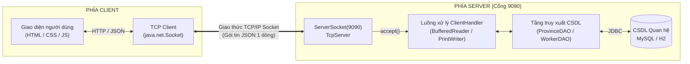
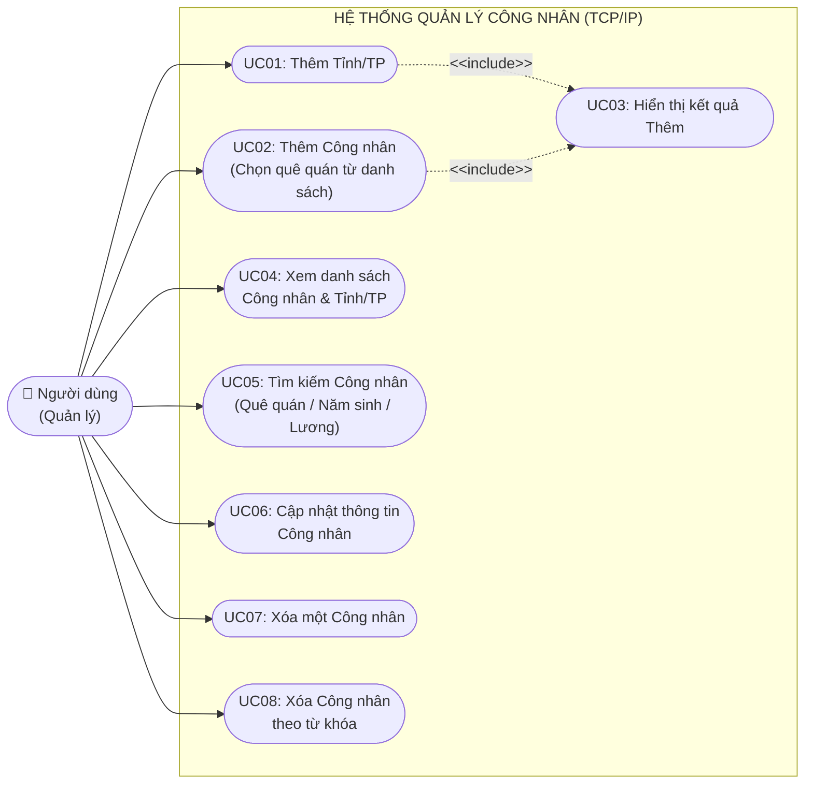
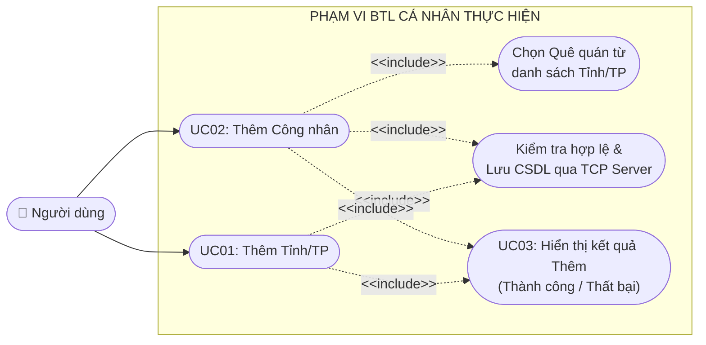
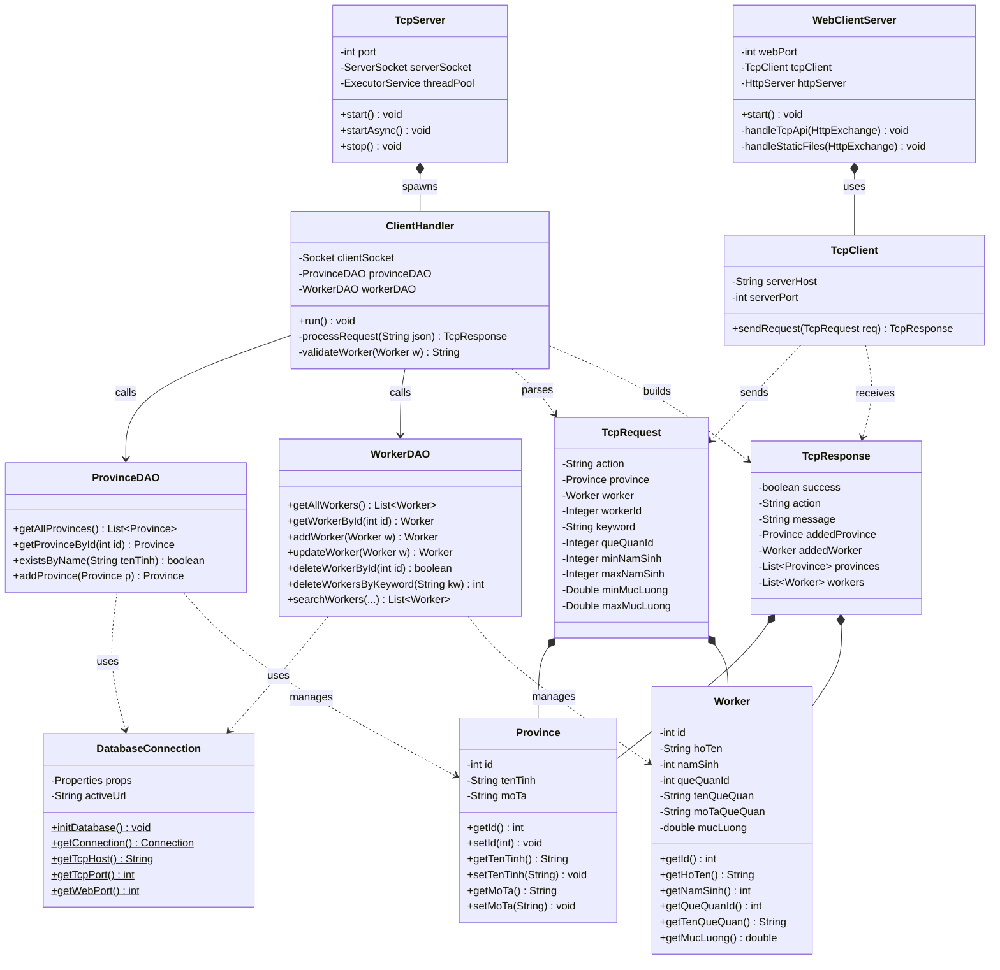
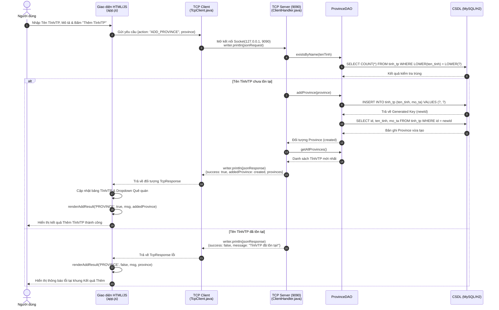
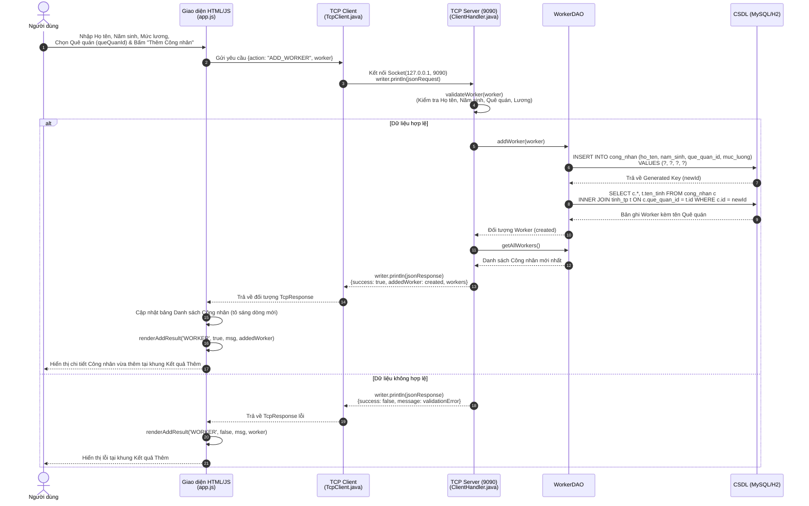
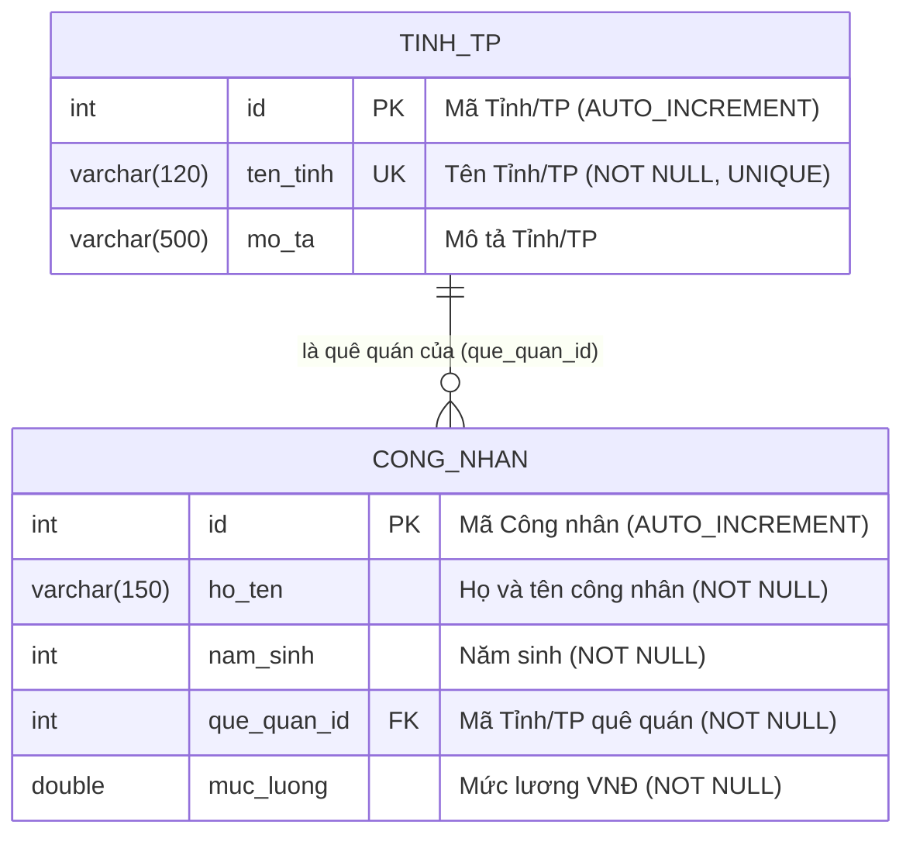
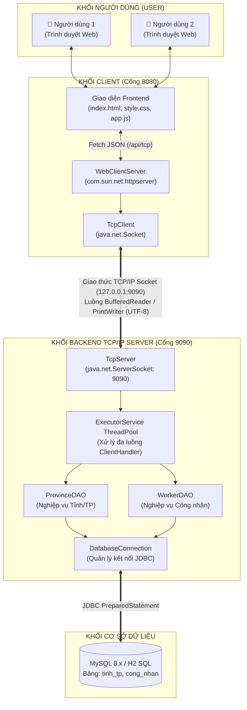

# TRANG BÌA

**BỘ GIÁO DỤC VÀ ĐÀO TẠO**  
**TRƯỜNG ĐẠI HỌC ..................................................**  
**KHOA CÔNG NGHỆ THÔNG TIN**  
**-----    -----**

<br>

## BÁO CÁO BÀI TẬP LỚN (CÁ NHÂN)
### HỌC PHẦN: LẬP TRÌNH MẠNG

<br>

### ĐỀ TÀI:
# XÂY DỰNG HỆ THỐNG QUẢN LÝ CÔNG NHÂN VÀ TỈNH/THÀNH PHỐ THEO MÔ HÌNH CLIENT – SERVER SỬ DỤNG GIAO THỨC TCP/IP

**Chức năng cá nhân thực hiện:**
1. **Thêm Tỉnh / Thành phố**
2. **Thêm Công nhân (chọn quê quán từ danh sách)**
3. **Hiển thị kết quả Thêm**

<br>

- **Giảng viên hướng dẫn:** Thầy Hoàng Anh
- **Họ và tên sinh viên:** ............................................................
- **Mã số sinh viên (MSSV):** ....................................................
- **Lớp:** ....................................................................................

<br>

**Hà Nội, Năm 2026**

---

# MỤC LỤC

- **DANH MỤC TỪ VIẾT TẮT**
- **DANH MỤC HÌNH VẼ**
- **DANH MỤC BẢNG BIỂU**
- **LỜI MỞ ĐẦU**
- **CHƯƠNG 1: GIỚI THIỆU ỨNG DỤNG VÀ PHÂN TÍCH YÊU CẦU CHỨC NĂNG**
  - 1.1. Giới thiệu tổng quan về đề tài
  - 1.2. Cơ sở lý thuyết về lập trình mạng với giao thức TCP/IP trong Java
  - 1.3. Phân tích yêu cầu chức năng tổng thể của hệ thống
  - 1.4. Phân tích chi tiết yêu cầu chức năng Cá nhân thực hiện
  - 1.5. Yêu cầu phi chức năng
- **CHƯƠNG 2: PHÂN TÍCH VÀ THIẾT KẾ HỆ THỐNG**
  - 2.1. Phân tích thiết kế tổng quan ứng dụng
  - 2.2. Thiết kế Use Case chi tiết phần Cá nhân đảm nhận
    - 2.2.1. Biểu đồ Use Case chi tiết cá nhân
    - 2.2.2. Đặc tả chi tiết Use Case Thêm Tỉnh/TP (UC01)
    - 2.2.3. Đặc tả chi tiết Use Case Thêm Công nhân (UC02)
    - 2.2.4. Đặc tả chi tiết Use Case Hiển thị kết quả Thêm (UC03)
  - 2.3. Thiết kế Biểu đồ lớp (Class Diagram)
    - 2.3.1. Sơ đồ lớp của hệ thống
    - 2.3.2. Mô tả chi tiết các lớp trong chương trình
  - 2.4. Thiết kế Biểu đồ tuần tự (Sequence Diagram)
    - 2.4.1. Biểu đồ tuần tự chức năng Thêm Tỉnh/TP và Hiển thị kết quả Thêm
    - 2.4.2. Biểu đồ tuần tự chức năng Thêm Công nhân và Hiển thị kết quả Thêm
  - 2.5. Thiết kế Cơ sở dữ liệu và Sơ đồ Thực thể Quan hệ (ERD)
    - 2.5.1. Sơ đồ thực thể quan hệ (ERD)
    - 2.5.2. Đặc tả chi tiết các bảng dữ liệu vật lý
- **CHƯƠNG 3: KIẾN TRÚC, CÀI ĐẶT, TRIỂN KHAI VÀ KẾT QUẢ THỰC HIỆN**
  - 3.1. Kiến trúc ứng dụng
  - 3.2. Thiết kế giao thức bản tin truyền thông trên nền TCP/IP
  - 3.3. Cài đặt và triển khai ứng dụng
    - 3.3.1. Công cụ và môi trường cài đặt
    - 3.3.2. Tổ chức cấu trúc dự án Gradle
    - 3.3.3. Cài đặt mã nguồn chi tiết chức năng cá nhân
    - 3.3.4. Hướng dẫn đóng gói và triển khai chạy ứng dụng
  - 3.4. Các kết quả thực hiện được và Kiểm thử thực nghiệm
    - 3.4.1. Mô tả kết quả giao diện và chức năng đạt được
    - 3.4.2. Kịch bản và kết quả kiểm thử (Test Cases)
- **KẾT LUẬN VÀ HƯỚNG PHÁT TRIỂN**
- **TÀI LIỆU THAM KHẢO**

---

# DANH MỤC TỪ VIẾT TẮT

| Từ viết tắt | Tiếng Anh | Giải nghĩa tiếng Việt |
| :--- | :--- | :--- |
| **BTL** | Major Assignment / Project | Bài tập lớn |
| **CN** | Worker | Công nhân |
| **CSDL** | Database (DB) | Cơ sở dữ liệu |
| **DAO** | Data Access Object | Đối tượng truy cập dữ liệu |
| **ERD** | Entity Relationship Diagram | Sơ đồ thực thể mối quan hệ |
| **HTML/CSS/JS** | HyperText Markup Language / Cascading Style Sheets / JavaScript | Bộ ngôn ngữ xây dựng giao diện người dùng phía Client |
| **HTTP** | HyperText Transfer Protocol | Giao thức truyền tải siêu văn bản |
| **IP** | Internet Protocol | Giao thức liên mạng |
| **JDBC** | Java Database Connectivity | Công nghệ kết nối cơ sở dữ liệu chuẩn của Java |
| **JDK** | Java Development Kit | Bộ công cụ phát triển phần mềm Java |
| **JSON** | JavaScript Object Notation | Định dạng trao đổi dữ liệu văn bản nhẹ |
| **SQL** | Structured Query Language | Ngôn ngữ truy vấn có cấu trúc |
| **TCP** | Transmission Control Protocol | Giao thức điều khiển truyền vận hướng kết nối |
| **TP** | City / Province | Thành phố / Tỉnh |
| **UI** | User Interface | Giao diện người dùng |
| **UML** | Unified Modeling Language | Ngôn ngữ mô hình hóa thống nhất |

---

# DANH MỤC HÌNH VẼ

- **Hình 1.1:** Mô hình giao tiếp Socket TCP/IP giữa Client và Server trong Java (`so_do/Hinh_1_1_Mo_Hinh_Giao_Tiep_TCP_IP.png`).
- **Hình 2.1:** Biểu đồ Use Case tổng quát của hệ thống Quản lý Công nhân (`so_do/Hinh_2_1_UseCase_Tong_Quat.png`).
- **Hình 2.2:** Biểu đồ Use Case chi tiết phần cá nhân thực hiện (`so_do/Hinh_2_2_UseCase_Chi_Tiet_Ca_Nhan.png`).
- **Hình 2.3:** Biểu đồ lớp (Class Diagram) của toàn bộ hệ thống (`so_do/Hinh_2_3_Bieu_Do_Lop_Class_Diagram.png`).
- **Hình 2.4:** Biểu đồ tuần tự (Sequence Diagram) chức năng Thêm Tỉnh/TP và Hiển thị kết quả Thêm (`so_do/Hinh_2_4_Sequence_Them_Tinh_TP.png`).
- **Hình 2.5:** Biểu đồ tuần tự (Sequence Diagram) chức năng Thêm Công nhân và Hiển thị kết quả Thêm (`so_do/Hinh_2_5_Sequence_Them_Cong_Nhan.png`).
- **Hình 2.6:** Sơ đồ thực thể quan hệ (ERD) của Cơ sở dữ liệu Quản lý Công nhân (`so_do/Hinh_2_6_So_Do_ERD_CSDL.png`).
- **Hình 3.1:** Sơ đồ kiến trúc tổng thể các khối (User – Client – TCP Server – Database) của ứng dụng (`so_do/Hinh_3_1_Kien_Truc_Ung_Dung.png`).

---

# DANH MỤC BẢNG BIỂU

- **Bảng 1.1:** Phân công nhiệm vụ và phạm vi nghiệp vụ của đề tài Quản lý Công nhân.
- **Bảng 2.1:** Đặc tả chi tiết Use Case UC01 – Thêm Tỉnh/Thành phố.
- **Bảng 2.2:** Đặc tả chi tiết Use Case UC02 – Thêm Công nhân (chọn quê quán từ danh sách).
- **Bảng 2.3:** Đặc tả chi tiết Use Case UC03 – Hiển thị kết quả Thêm.
- **Bảng 2.4:** Mô tả chức năng các lớp trong kiến trúc phần mềm.
- **Bảng 2.5:** Đặc tả cấu trúc bảng dữ liệu `tinh_tp` (Tỉnh/Thành phố).
- **Bảng 2.6:** Đặc tả cấu trúc bảng dữ liệu `cong_nhan` (Công nhân).
- **Bảng 3.1:** Quy ước các mã lệnh (`action`) trong giao thức truyền thông TCP/IP.
- **Bảng 3.2:** Bảng kết quả kiểm thử thực nghiệm (Test Cases) các chức năng của ứng dụng.

---

# LỜI MỞ ĐẦU

Trong bối cảnh chuyển đổi số và tự động hóa quản lý tại các doanh nghiệp, khu công nghiệp hiện nay, nhu cầu quản lý thông tin nhân sự — đặc biệt là đội ngũ công nhân sản xuất đến từ nhiều tỉnh, thành phố khác nhau — đòi hỏi hệ thống phần mềm phải có khả năng trao đổi dữ liệu tập trung, nhanh chóng, chính xác và đồng bộ theo thời gian thực giữa các máy trạm (Client) và máy chủ trung tâm (Server).

Học phần **Lập trình mạng** cung cấp nền tảng kiến thức cốt lõi về cách các tiến trình phần mềm giao tiếp với nhau qua môi trường mạng máy tính. Trong đó, giao thức **TCP/IP (Transmission Control Protocol / Internet Protocol)** đóng vai trò là giao thức tầng giao vận quan trọng bậc nhất nhờ đặc tính hướng kết nối (*connection-oriented*), đảm bảo độ tin cậy cao, kiểm soát luồng và bảo toàn thứ tự dữ liệu truyền tải.

Xuất phát từ yêu cầu thực tế của học phần, đề tài **"Xây dựng hệ thống Quản lý Công nhân và Tỉnh/Thành phố theo mô hình Client – Server sử dụng giao thức TCP/IP"** được thực hiện nhằm áp dụng trực tiếp kỹ thuật lập trình **Java Socket (`java.net.ServerSocket` và `java.net.Socket`)**, lập trình đa luồng (*Multi-threading*), kết nối cơ sở dữ liệu quan hệ qua **JDBC (MySQL / SQL Server / H2)** kết hợp công cụ quản lý dự án **Gradle** và giao diện **HTML/CSS/JavaScript** trực quan.

Trong khuôn khổ Bài tập lớn, bên cạnh việc nắm vững và xây dựng hoàn chỉnh các nghiệp vụ chung của toàn hệ thống (quản lý danh sách, tìm kiếm đa tiêu chí theo quê quán/khoảng năm sinh/khoảng lương, cập nhật, xóa theo từ khóa và xóa đơn lẻ), **phần nhiệm vụ cá nhân trọng tâm** được giao và trình bày sâu trong báo cáo này bao gồm 3 chức năng:
1. **Thêm Tỉnh / Thành phố mới** vào hệ thống qua kết nối TCP/IP.
2. **Thêm Công nhân mới** (với việc chọn quê quán từ danh sách Tỉnh/Thành phố lấy từ Server).
3. **Hiển thị kết quả Thêm** trực tiếp từ phản hồi của TCP Server lên giao diện người dùng.

Báo cáo được bố cục thành 3 chương chính:
- **Chương 1:** Giới thiệu ứng dụng và phân tích yêu cầu chức năng.
- **Chương 2:** Phân tích thiết kế tổng quan ứng dụng và thiết kế chi tiết chức năng cá nhân đảm nhận (Use Case, Class Diagram, Sequence Diagram, ERD).
- **Chương 3:** Kiến trúc ứng dụng, cài đặt, triển khai và kết quả thực nghiệm.

---

# CHƯƠNG 1: GIỚI THIỆU ỨNG DỤNG VÀ PHÂN TÍCH YÊU CẦU CHỨC NĂNG

## 1.1. Giới thiệu tổng quan về đề tài

Hệ thống **Quản lý Công nhân** là một ứng dụng mạng hoạt động theo mô hình **Client – Server** sử dụng giao thức **TCP/IP**. Hệ thống quản lý hai đối tượng thực thể chính có mối quan hệ chặt chẽ với nhau:
1. **Đối tượng Tỉnh / Thành phố (`Province` - bảng `tinh_tp`):** Lưu trữ danh mục các địa phương (quê quán của công nhân), bao gồm các thông tin: *Mã Tỉnh/TP (`id`), Tên Tỉnh/TP (`tenTinh`), Mô tả (`moTa`)*.
2. **Đối tượng Công nhân (`Worker` - bảng `cong_nhan`):** Lưu trữ hồ sơ của từng công nhân làm việc tại đơn vị, bao gồm các thông tin: *Mã công nhân (`id`), Họ và tên (`hoTen`), Năm sinh (`namSinh`), Quê quán (`queQuanId` tham chiếu tới Tỉnh/TP), và Mức lương (`mucLuong`)*.

**Bảng 1.1: Phân công nhiệm vụ và phạm vi nghiệp vụ của đề tài Quản lý Công nhân**

| Chủ đề quản lý | Giao thức | Đối tượng chính | Nghiệp vụ Server chính | Nghiệp vụ Client chính | BTL Cá nhân thực hiện |
| :--- | :---: | :--- | :--- | :--- | :--- |
| **Quản lý Công nhân** | **TCP/IP** | **Công nhân** (Họ tên, Năm sinh, Quê quán, Mức lương) + **Tỉnh/TP** (Tên, Mô tả) | - Thêm công nhân<br>- Trả về danh sách công nhân<br>- Cập nhật thông tin công nhân<br>- Xóa công nhân theo từ khóa<br>- Quản lý danh mục Tỉnh/TP | - Thêm công nhân (chọn quê quán từ danh sách)<br>- Tìm kiếm và hiển thị theo quê quán / khoảng năm sinh / khoảng lương<br>- Xóa một công nhân | 1. **Thêm Tỉnh/TP**<br>2. **Thêm Công nhân**<br>3. **Hiển thị kết quả Thêm** |

## 1.2. Cơ sở lý thuyết về lập trình mạng với giao thức TCP/IP trong Java

Giao thức **TCP (Transmission Control Protocol)** là giao thức tầng giao vận (Transport Layer) hoạt động trên nền tảng **IP (Internet Protocol)**. Đặc điểm cốt lõi của TCP/IP bao gồm:
- **Hướng kết nối (Connection-oriented):** Trước khi truyền dữ liệu, tiến trình Client và tiến trình Server phải thực hiện quá trình bắt tay ba bước (*Three-way handshake*: `SYN` -> `SYN-ACK` -> `ACK`) để thiết lập kênh truyền ảo tin cậy.
- **Truyền dữ liệu theo luồng byte tin cậy (Reliable Byte Stream):** Dữ liệu được truyền đi đúng thứ tự, có cơ chế xác nhận (`ACK`), truyền lại khi mất gói và kiểm soát tắc nghẽn.
- **Lập trình Socket TCP trong Java (`java.net`):**
  - Phía Server sử dụng lớp `java.net.ServerSocket` gắn với cổng `9090`, gọi phương thức `accept()` để lắng nghe yêu cầu kết nối từ Client.
  - Khi kết nối được thiết lập, mỗi phiên giao tiếp được quản lý bởi một đối tượng `java.net.Socket` trên một luồng thực thi độc lập (`ClientHandler implements Runnable`) được quản lý bởi `ExecutorService` (Thread Pool), giúp Server phục vụ đồng thời nhiều Client.
  - Phía Client sử dụng lớp `java.net.Socket` kết nối tới địa chỉ IP và cổng của Server (`127.0.0.1:9090`), sử dụng luồng xuất `PrintWriter` (bọc `OutputStreamWriter` chuẩn mã hóa `UTF-8`) để gửi bản tin yêu cầu và luồng nhập `BufferedReader` (bọc `InputStreamReader` chuẩn `UTF-8`) để nhận bản tin phản hồi.



*Hình 1.1: Mô hình giao tiếp Socket TCP/IP giữa Client và Server trong Java.*

## 1.3. Phân tích yêu cầu chức năng tổng thể của hệ thống

### a) Nghiệp vụ phía Server (`TcpServer` & `ClientHandler`):
1. **Tiếp nhận và quản lý kết nối TCP/IP:** Mở cổng `9090`, lắng nghe và khởi tạo luồng xử lý riêng cho từng Client kết nối tới.
2. **Xử lý nghiệp vụ Tỉnh/TP:**
   - Nhận yêu cầu thêm mới Tỉnh/TP (`ADD_PROVINCE`), kiểm tra tính hợp lệ (không rỗng, không trùng tên Tỉnh/TP đã có trong CSDL), thực hiện lưu vào bảng `tinh_tp` và trả về bản ghi vừa tạo.
   - Truy vấn và trả về danh sách toàn bộ Tỉnh/TP (`GET_PROVINCES`).
3. **Xử lý nghiệp vụ Công nhân:**
   - **Thêm công nhân (`ADD_WORKER`):** Kiểm tra hợp lệ dữ liệu (Họ tên, Năm sinh, Mã quê quán, Mức lương), lưu vào bảng `cong_nhan` và trả về đối tượng Công nhân vừa thêm kèm tên Tỉnh/TP quê quán.
   - **Trả về danh sách công nhân (`GET_WORKERS`, `GET_ALL_DATA`):** Truy vấn danh sách công nhân kết hợp (`INNER JOIN`) với bảng `tinh_tp` để trả về đầy đủ thông tin cho Client.
   - **Cập nhật thông tin công nhân (`UPDATE_WORKER`):** Cập nhật Họ tên, Năm sinh, Quê quán, Mức lương theo mã `id` của công nhân.
   - **Xóa công nhân theo từ khóa (`DELETE_WORKERS_BY_KEYWORD`):** Xóa tất cả các công nhân có Họ tên hoặc Tên quê quán chứa từ khóa do người dùng chỉ định và trả về số lượng bản ghi đã xóa.
   - **Xóa một công nhân theo mã (`DELETE_WORKER_BY_ID`)** và **Tìm kiếm đa tiêu chí (`SEARCH_WORKERS`)**.

### b) Nghiệp vụ phía Client (`TcpClient`, `WebClientServer` & Giao diện HTML):
1. **Thêm Tỉnh/TP và Thêm Công nhân (chọn quê quán từ danh sách):** Cung cấp biểu mẫu nhập liệu, trong đó trường *Quê quán* được nạp động dưới dạng danh sách thả xuống (`<select>`) từ dữ liệu Tỉnh/TP do TCP Server gửi về.
2. **Hiển thị kết quả Thêm:** Tiếp nhận gói tin `TcpResponse` từ Server sau mỗi thao tác thêm mới để hiển thị chi tiết trạng thái và thông tin đối tượng vừa được lưu thành công.
3. **Tìm kiếm và hiển thị công nhân:** Cho phép người dùng lọc danh sách công nhân theo 3 tiêu chí kết hợp: *Theo Quê quán*, *Khoảng năm sinh (Từ năm – Đến năm)*, và *Khoảng mức lương (Từ mức lương – Đến mức lương)*.
4. **Cập nhật và Xóa một công nhân:** Cho phép chọn một công nhân cụ thể trên bảng danh sách để chỉnh sửa thông tin hoặc xóa bản ghi đó qua giao thức TCP/IP.

## 1.4. Phân tích chi tiết yêu cầu chức năng Cá nhân thực hiện

### 1.4.1. Chức năng 1: Thêm Tỉnh / Thành phố (`ADD_PROVINCE`)
- **Mục đích:** Bổ sung một địa phương (Tỉnh hoặc Thành phố) mới vào danh mục quê quán trong cơ sở dữ liệu thông qua giao thức TCP/IP.
- **Dữ liệu đầu vào (Input):**
  - `Tên Tỉnh/TP` (`tenTinh` - chuỗi ký tự, bắt buộc nhập, không trùng lặp).
  - `Mô tả` (`moTa` - chuỗi ký tự mô tả đặc điểm của Tỉnh/TP, tùy chọn).
- **Quy trình xử lý:**
  - Client kiểm tra sơ bộ trường `Tên Tỉnh/TP` không được để trống, đóng gói vào đối tượng `TcpRequest` với mã lệnh `action = "ADD_PROVINCE"` và truyền qua Socket TCP tới Server.
  - Server kiểm tra trùng lặp tên Tỉnh/TP không phân biệt hoa thường (`LOWER(ten_tinh) = LOWER(?)`). Nếu đã tồn tại, Server trả về gói tin báo lỗi (`success = false`). Nếu hợp lệ, Server thực hiện câu lệnh `INSERT INTO tinh_tp`, lấy khóa chính `id` vừa tự động tăng và đóng gói đối tượng `Province` mới vào trường `addedProvince` của `TcpResponse`.
- **Dữ liệu đầu ra (Output):** Bản ghi Tỉnh/TP mới được lưu vào CSDL, danh sách Tỉnh/TP trên bảng và trong ô chọn `<select>` Quê quán của form Thêm Công nhân được cập nhật tức thì (tự động chọn sẵn Tỉnh/TP vừa thêm).

### 1.4.2. Chức năng 2: Thêm Công nhân – Chọn quê quán từ danh sách (`ADD_WORKER`)
- **Mục đích:** Thêm mới hồ sơ một công nhân vào hệ thống, đảm bảo tính toàn vẹn tham chiếu giữa Công nhân và Tỉnh/TP quê quán.
- **Dữ liệu đầu vào (Input):**
  - `Họ tên` (`hoTen` - chuỗi ký tự, bắt buộc).
  - `Năm sinh` (`namSinh` - số nguyên trong khoảng hợp lệ từ `1940` đến `2015`).
  - `Quê quán` (`queQuanId` - mã số nguyên của Tỉnh/TP được chọn từ danh sách thả xuống `<select>`).
  - `Mức lương` (`mucLuong` - số thực lớn hơn `0`).
- **Quy trình xử lý:**
  - Người dùng nhập thông tin và chọn một Tỉnh/TP từ danh sách. Client đóng gói đối tượng `Worker` vào `TcpRequest` với `action = "ADD_WORKER"` và gửi qua Socket TCP tới cổng `9090`.
  - Server thực hiện kiểm tra hợp lệ (`validateWorker`), gọi `WorkerDAO.addWorker()` để thực thi câu lệnh `INSERT INTO cong_nhan`. Sau khi chèn thành công, Server truy vấn lại bản ghi vừa tạo kèm phép nối `INNER JOIN tinh_tp` để lấy đầy đủ `tenQueQuan`, gắn vào trường `addedWorker` của `TcpResponse` và gửi trả về Client.
- **Dữ liệu đầu ra (Output):** Công nhân mới được lưu vào CSDL, hiển thị ngay ở đầu bảng Danh sách Công nhân và hiển thị chi tiết tại khu vực Kết quả Thêm.

### 1.4.3. Chức năng 3: Hiển thị kết quả Thêm (`renderAddResult`)
- **Mục đích:** Minh bạch hóa kết quả xử lý từ TCP Server, giúp người dùng biết chính xác yêu cầu Thêm Tỉnh/TP hoặc Thêm Công nhân vừa gửi qua mạng thành công hay thất bại, kèm theo thông tin bản ghi thực tế đã được ghi nhận tại Server.
- **Dữ liệu đầu vào (Input):** Đối tượng phản hồi `TcpResponse` nhận về từ `TcpClient` (gồm trạng thái `success`, thông báo `message`, đối tượng `addedProvince` hoặc `addedWorker`).
- **Quy trình xử lý & Đầu ra (Output):**
  - Nếu `success == true`: Khung **Hiển thị kết quả Thêm** chuyển sang trạng thái thành công (nền xanh lá), hiển thị nhãn *"Thêm Tỉnh/TP thành công"* hoặc *"Thêm Công nhân thành công"*, lời nhắn phản hồi từ Server và liệt kê chi tiết các trường dữ liệu vừa thêm. Đồng thời dòng dữ liệu vừa thêm trên bảng danh sách được tô sáng (`highlight-new`).
  - Nếu `success == false`: Khung **Hiển thị kết quả Thêm** chuyển sang trạng thái cảnh báo lỗi (nền đỏ), hiển thị nguyên nhân lỗi do TCP Server trả về.

## 1.5. Yêu cầu phi chức năng
- **Độ tin cậy truyền thông:** Sử dụng chuẩn giao thức TCP/IP đảm bảo không mất mát gói tin; mã hóa luồng truyền `UTF-8` giúp hiển thị tiếng Việt có dấu chính xác 100%.
- **Xử lý đồng thời (Concurrency):** TCP Server sử dụng `ExecutorService` (`CachedThreadPool`) cho phép nhiều Client kết nối và gửi yêu cầu cùng lúc.
- **Tính sẵn sàng của CSDL:** Hỗ trợ kết nối trực tiếp MySQL / SQL Server qua JDBC và tự động khởi tạo bảng (`CREATE TABLE IF NOT EXISTS`) cũng như cơ chế dự phòng CSDL nhúng H2.

---

# CHƯƠNG 2: PHÂN TÍCH VÀ THIẾT KẾ HỆ THỐNG

## 2.1. Phân tích thiết kế tổng quan ứng dụng



*Hình 2.1: Biểu đồ Use Case tổng quát của hệ thống Quản lý Công nhân.*

---

## 2.2. Thiết kế Use Case chi tiết phần Cá nhân đảm nhận

### 2.2.1. Biểu đồ Use Case chi tiết cá nhân



*Hình 2.2: Biểu đồ Use Case chi tiết phần cá nhân thực hiện.*

### 2.2.2. Đặc tả chi tiết Use Case Thêm Tỉnh/TP (UC01)

**Bảng 2.1: Đặc tả chi tiết Use Case UC01 – Thêm Tỉnh/Thành phố**

| Mục | Nội dung mô tả |
| :--- | :--- |
| **Mã và Tên Use Case** | **UC01 – Thêm Tỉnh / Thành phố** |
| **Tác nhân (Actor)** | Người dùng (Cán bộ quản lý) |
| **Mô tả tóm tắt** | Cho phép người dùng thêm một Tỉnh/TP mới (gồm Tên Tỉnh/TP và Mô tả) vào hệ thống thông qua giao thức TCP/IP. |
| **Điều kiện tiên quyết (Pre-conditions)** | - `TcpServer` đang hoạt động và lắng nghe tại cổng `9090`.<br>- Kết nối JDBC tới CSDL đã sẵn sàng.<br>- Giao diện Client đã được mở trên trình duyệt (`http://localhost:8080`). |
| **Điều kiện sau (Post-conditions)** | - Bản ghi Tỉnh/TP mới được lưu vào bảng `tinh_tp` trong CSDL.<br>- Danh sách Tỉnh/TP và ô chọn Quê quán được cập nhật.<br>- Khung *Hiển thị kết quả Thêm* hiển thị thông tin Tỉnh/TP vừa thêm. |
| **Luồng sự kiện chính (Basic Flow)** | 1. Người dùng nhập *Tên Tỉnh/TP* và *Mô tả* vào biểu mẫu "Thêm Tỉnh/TP".<br>2. Người dùng nhấn nút **"Thêm Tỉnh/TP"**.<br>3. Giao diện gọi hàm `handleAddProvince()`, đóng gói bản tin `{action: "ADD_PROVINCE", province: {tenTinh, moTa}}` gửi xuống `TcpClient`.<br>4. `TcpClient` mở kết nối `Socket` tới `TcpServer (9090)` và truyền chuỗi JSON.<br>5. `ClientHandler` tại Server nhận gói tin, kiểm tra `tenTinh` hợp lệ và chưa tồn tại trong CSDL.<br>6. `ProvinceDAO.addProvince()` thực thi lệnh `INSERT INTO tinh_tp (ten_tinh, mo_ta) VALUES (?, ?)` và lấy lại bản ghi vừa tạo.<br>7. Server đóng gói `TcpResponse` (`success = true`, `addedProvince`, danh sách `provinces` mới) gửi trả lại Client qua Socket.<br>8. Client cập nhật bảng Tỉnh/TP, cập nhật `<select>` Quê quán và kích hoạt **UC03** để hiển thị kết quả thêm thành công. |
| **Luồng ngoại lệ (Exception Flow)** | - **5a. Tên Tỉnh/TP để trống:** Server trả về `success = false`, `message = "Tên Tỉnh/TP không được để trống!"`.<br>- **5b. Tên Tỉnh/TP đã tồn tại:** `ProvinceDAO.existsByName()` trả về `true` -> Server trả về `success = false`, `message = "Tỉnh/TP '...' đã tồn tại!"`.<br>- **4a. Mất kết nối TCP Server:** `TcpClient` bắt ngoại lệ `IOException` và trả về thông báo không kết nối được tới TCP/IP Server. |

### 2.2.3. Đặc tả chi tiết Use Case Thêm Công nhân (UC02)

**Bảng 2.2: Đặc tả chi tiết Use Case UC02 – Thêm Công nhân (chọn quê quán từ danh sách)**

| Mục | Nội dung mô tả |
| :--- | :--- |
| **Mã và Tên Use Case** | **UC02 – Thêm Công nhân (chọn quê quán từ danh sách)** |
| **Tác nhân (Actor)** | Người dùng (Cán bộ quản lý) |
| **Mô tả tóm tắt** | Cho phép người dùng nhập thông tin công nhân mới (Họ tên, Năm sinh, Mức lương) và chọn Quê quán từ danh sách Tỉnh/TP hiện có, sau đó gửi qua TCP/IP để lưu trữ. |
| **Điều kiện tiên quyết (Pre-conditions)** | - Hệ thống đã tải danh sách Tỉnh/TP vào ô chọn `<select id="queQuanId">`.<br>- Trong CSDL có ít nhất 1 Tỉnh/TP để chọn làm quê quán. |
| **Điều kiện sau (Post-conditions)** | - Bản ghi Công nhân mới được lưu vào bảng `cong_nhan`.<br>- Bảng Danh sách Công nhân cập nhật dòng mới ở đầu bảng.<br>- Khung *Hiển thị kết quả Thêm* hiển thị chi tiết công nhân vừa tạo. |
| **Luồng sự kiện chính (Basic Flow)** | 1. Người dùng nhập *Họ tên*, *Năm sinh*, *Mức lương* và chọn *Quê quán* từ danh sách thả xuống.<br>2. Người dùng nhấn nút **"Thêm Công nhân"**.<br>3. Hàm `handleAddWorker()` thu thập dữ liệu, đóng gói `{action: "ADD_WORKER", worker: {hoTen, namSinh, queQuanId, mucLuong}}`.<br>4. `TcpClient` mở kết nối `Socket` tới cổng `9090` và gửi gói tin JSON sang `TcpServer`.<br>5. `ClientHandler` tại Server gọi `validateWorker(w)` kiểm tra hợp lệ các trường.<br>6. `WorkerDAO.addWorker(w)` thực thi lệnh `INSERT INTO cong_nhan (ho_ten, nam_sinh, que_quan_id, muc_luong) VALUES (?, ?, ?, ?)`.<br>7. `WorkerDAO` lấy mã `id` tự sinh và gọi `getWorkerById(newId)` (có `INNER JOIN tinh_tp`) để lấy tên quê quán tương ứng.<br>8. Server đóng gói `TcpResponse` (`success = true`, `addedWorker`, danh sách `workers` mới) trả về qua Socket.<br>9. Client cập nhật bảng Công nhân và gọi **UC03** hiển thị kết quả thêm. |
| **Luồng ngoại lệ (Exception Flow)** | - **5a. Dữ liệu không hợp lệ:** Server trả về `success = false` kèm thông báo lỗi cụ thể.<br>- **6a. Lỗi khóa ngoại CSDL:** Server bắt `SQLException` và trả về thông báo lỗi tại khung kết quả thêm. |

### 2.2.4. Đặc tả chi tiết Use Case Hiển thị kết quả Thêm (UC03)

**Bảng 2.3: Đặc tả chi tiết Use Case UC03 – Hiển thị kết quả Thêm**

| Mục | Nội dung mô tả |
| :--- | :--- |
| **Mã và Tên Use Case** | **UC03 – Hiển thị kết quả Thêm** |
| **Tác nhân (Actor)** | Hệ thống Client (được kích hoạt tự động sau UC01 hoặc UC02) & Người dùng xem kết quả |
| **Mô tả tóm tắt** | Hiển thị trực quan kết quả phản hồi từ TCP Server ngay sau khi thực hiện lệnh Thêm Tỉnh/TP hoặc Thêm Công nhân. |
| **Điều kiện tiên quyết (Pre-conditions)** | Người dùng vừa thực hiện gửi lệnh `ADD_PROVINCE` hoặc `ADD_WORKER` và Client đã nhận được đối tượng `TcpResponse`. |
| **Điều kiện sau (Post-conditions)** | Khung `#addResultContainer` hiển thị rõ trạng thái, thông điệp từ Server và các thuộc tính chi tiết của đối tượng vừa thêm; dòng mới trong bảng được đánh dấu nổi bật. |
| **Luồng sự kiện chính (Basic Flow)** | 1. Hàm `renderAddResult(type, success, message, entity)` được gọi với dữ liệu trích xuất từ `TcpResponse`.<br>2. Nếu `type == 'PROVINCE'`, hệ thống hiển thị nhãn trạng thái, thông báo của Server, *Tên Tỉnh/TP* và *Mô tả*.<br>3. Nếu `type == 'WORKER'`, hệ thống hiển thị nhãn trạng thái, thông báo của Server, *Họ tên*, *Năm sinh*, *Quê quán* và *Mức lương* (định dạng VNĐ).<br>4. Hệ thống gán lớp CSS `highlight-new` cho dòng vừa thêm trên bảng danh sách và hiển thị thông báo nổi (Toast notification). |

---

## 2.3. Thiết kế Biểu đồ lớp (Class Diagram)

### 2.3.1. Sơ đồ lớp của hệ thống



*Hình 2.3: Biểu đồ lớp (Class Diagram) của toàn bộ hệ thống.*

### 2.3.2. Mô tả chi tiết các lớp trong chương trình

**Bảng 2.4: Mô tả chức năng các lớp trong kiến trúc phần mềm**

| STT | Tên lớp | Thuộc gói (Package) | Vai trò và Trách nhiệm chính |
| :---: | :--- | :--- | :--- |
| 1 | `Province` | `com.quanlycongnhan.model` | Lớp thực thể biểu diễn đối tượng **Tỉnh/TP** gồm các thuộc tính `id`, `tenTinh`, `moTa`. |
| 2 | `Worker` | `com.quanlycongnhan.model` | Lớp thực thể biểu diễn đối tượng **Công nhân** gồm `id`, `hoTen`, `namSinh`, `queQuanId`, `tenQueQuan`, `moTaQueQuan`, `mucLuong`. |
| 3 | `TcpRequest` | `com.quanlycongnhan.model` | Lớp đóng gói bản tin yêu cầu từ Client gửi lên TCP Server. |
| 4 | `TcpResponse` | `com.quanlycongnhan.model` | Lớp đóng gói bản tin phản hồi từ TCP Server trả về Client. |
| 5 | `DatabaseConnection` | `com.quanlycongnhan.dao` | Quản lý cấu hình từ `db.properties`, khởi tạo kết nối JDBC tới MySQL / SQL Server / H2. |
| 6 | `ProvinceDAO` | `com.quanlycongnhan.dao` | Thực hiện các truy vấn SQL trên bảng `tinh_tp`: lấy danh sách Tỉnh/TP, kiểm tra trùng tên và **Thêm Tỉnh/TP mới (`addProvince`)**. |
| 7 | `WorkerDAO` | `com.quanlycongnhan.dao` | Thực hiện các truy vấn SQL trên bảng `cong_nhan`: lấy danh sách, **Thêm công nhân (`addWorker`)**, cập nhật (`updateWorker`), xóa theo ID, xóa theo từ khóa và tìm kiếm. |
| 8 | `TcpServer` | `com.quanlycongnhan.server` | Khởi tạo `ServerSocket` tại cổng `9090`, lắng nghe kết nối và phân phối vào `ExecutorService`. |
| 9 | `ClientHandler` | `com.quanlycongnhan.server` | Thực thi giao thức TCP/IP trên từng luồng Client: đọc `TcpRequest`, gọi DAO và ghi `TcpResponse`. |
| 10 | `TcpClient` | `com.quanlycongnhan.client` | Sử dụng `java.net.Socket` kết nối tới `127.0.0.1:9090`, gửi gói tin `TcpRequest` và nhận về `TcpResponse`. |
| 11 | `WebClientServer` | `com.quanlycongnhan.client` | Cung cấp giao diện HTML/CSS/JS tại cổng `8080` và chuyển tiếp mọi thao tác qua `TcpClient`. |
| 12 | `MainApp` | `com.quanlycongnhan` | Lớp khởi chạy tích hợp đồng thời cả `TcpServer` (`9090`), `WebClientServer` (`8080`) và H2 Console (`8082`). |

---

## 2.4. Thiết kế Biểu đồ tuần tự (Sequence Diagram)

### 2.4.1. Biểu đồ tuần tự chức năng Thêm Tỉnh/TP và Hiển thị kết quả Thêm



*Hình 2.4: Biểu đồ tuần tự chức năng Thêm Tỉnh/TP và Hiển thị kết quả Thêm.*

### 2.4.2. Biểu đồ tuần tự chức năng Thêm Công nhân và Hiển thị kết quả Thêm



*Hình 2.5: Biểu đồ tuần tự chức năng Thêm Công nhân và Hiển thị kết quả Thêm.*

---

## 2.5. Thiết kế Cơ sở dữ liệu và Sơ đồ Thực thể Quan hệ (ERD)

### 2.5.1. Sơ đồ thực thể quan hệ (ERD)



*Hình 2.6: Sơ đồ thực thể quan hệ (ERD) của Cơ sở dữ liệu Quản lý Công nhân.*

### 2.5.2. Đặc tả chi tiết các bảng dữ liệu vật lý

**Bảng 2.5: Đặc tả cấu trúc bảng dữ liệu `tinh_tp` (Tỉnh/Thành phố)**

| STT | Tên trường (Column) | Kiểu dữ liệu | Ràng buộc (Constraints) | Mô tả chi tiết |
| :---: | :--- | :--- | :--- | :--- |
| 1 | `id` | `INT` | `PRIMARY KEY`, `AUTO_INCREMENT` | Mã định danh duy nhất của Tỉnh/TP, tự động tăng. |
| 2 | `ten_tinh` | `VARCHAR(120)` | `NOT NULL`, `UNIQUE` | Tên Tỉnh hoặc Thành phố (không được trùng lặp). |
| 3 | `mo_ta` | `VARCHAR(500)` | `DEFAULT ''` | Thông tin mô tả đặc điểm kinh tế, địa lý của Tỉnh/TP. |

**Bảng 2.6: Đặc tả cấu trúc bảng dữ liệu `cong_nhan` (Công nhân)**

| STT | Tên trường (Column) | Kiểu dữ liệu | Ràng buộc (Constraints) | Mô tả chi tiết |
| :---: | :--- | :--- | :--- | :--- |
| 1 | `id` | `INT` | `PRIMARY KEY`, `AUTO_INCREMENT` | Mã định danh duy nhất của Công nhân, tự động tăng. |
| 2 | `ho_ten` | `VARCHAR(150)` | `NOT NULL` | Họ và tên đầy đủ của công nhân. |
| 3 | `nam_sinh` | `INT` | `NOT NULL` | Năm sinh của công nhân (ví dụ: `1995`, `1998`). |
| 4 | `que_quan_id` | `INT` | `NOT NULL`, `FOREIGN KEY REFERENCES tinh_tp(id)` | Khóa ngoại tham chiếu tới cột `id` của bảng `tinh_tp`. |
| 5 | `muc_luong` | `DOUBLE` | `NOT NULL` | Mức lương hiện tại của công nhân (đơn vị: VNĐ). |

---

# CHƯƠNG 3: KIẾN TRÚC, CÀI ĐẶT, TRIỂN KHAI VÀ KẾT QUẢ THỰC HIỆN

## 3.1. Kiến trúc ứng dụng



*Hình 3.1: Sơ đồ kiến trúc tổng thể các khối của ứng dụng.*

---

## 3.2. Thiết kế giao thức bản tin truyền thông trên nền TCP/IP

**Bảng 3.1: Quy ước các mã lệnh (`action`) trong giao thức truyền thông TCP/IP**

| Mã lệnh (`action`) | Chiều gửi | Dữ liệu gửi kèm (`TcpRequest`) | Dữ liệu phản hồi (`TcpResponse`) |
| :--- | :---: | :--- | :--- |
| `GET_ALL_DATA` | Client -> Server | Không có | Danh sách `provinces` và danh sách `workers`. |
| `ADD_PROVINCE` | Client -> Server | `province: {tenTinh, moTa}` | `addedProvince` vừa tạo + danh sách `provinces`, `workers` mới. |
| `ADD_WORKER` | Client -> Server | `worker: {hoTen, namSinh, queQuanId, mucLuong}` | `addedWorker` vừa tạo + danh sách `workers`, `provinces` mới. |
| `SEARCH_WORKERS` | Client -> Server | `queQuanId`, `minNamSinh`, `maxNamSinh`, `minMucLuong`, `maxMucLuong` | Danh sách `workers` thỏa mãn điều kiện lọc. |
| `UPDATE_WORKER` | Client -> Server | `worker: {id, hoTen, namSinh, queQuanId, mucLuong}` | `addedWorker` sau cập nhật + danh sách `workers` mới. |
| `DELETE_WORKER_BY_ID` | Client -> Server | `workerId` (Mã công nhân cần xóa) | Trạng thái xóa + danh sách `workers` mới. |
| `DELETE_WORKERS_BY_KEYWORD` | Client -> Server | `keyword` (Từ khóa cần xóa) | Số lượng bản ghi đã xóa trong `message` + danh sách `workers` mới. |

---

## 3.3. Cài đặt và triển khai ứng dụng

### 3.3.1. Công cụ và môi trường cài đặt
- **Ngôn ngữ lập trình:** Java (OpenJDK 21 LTS).
- **Công cụ quản lý dự án (Build Tool):** Gradle 9.x.
- **Thư viện sử dụng trong `build.gradle`:** `gson:2.11.0`, `mysql-connector-j:8.4.0`, `mssql-jdbc:12.6.1.jre11`, `h2:2.2.224`.
- **Công nghệ Frontend:** HTML5, CSS3, JavaScript (ES6 Fetch API).

### 3.3.2. Cài đặt mã nguồn chi tiết chức năng cá nhân

#### a) Cài đặt phía TCP Client (`TcpClient.java`):
```java
public TcpResponse sendRequest(TcpRequest request) {
    try (Socket socket = new Socket()) {
        socket.connect(new InetSocketAddress(serverHost, serverPort), 3000);
        socket.setSoTimeout(5000);

        try (
            PrintWriter writer = new PrintWriter(
                    new OutputStreamWriter(socket.getOutputStream(), StandardCharsets.UTF_8), true);
            BufferedReader reader = new BufferedReader(
                    new InputStreamReader(socket.getInputStream(), StandardCharsets.UTF_8))
        ) {
            String jsonRequest = gson.toJson(request);
            writer.println(jsonRequest);

            String jsonResponse = reader.readLine();
            if (jsonResponse == null) {
                return new TcpResponse(false, request.getAction(), "TCP Server không trả dữ liệu!");
            }
            return gson.fromJson(jsonResponse, TcpResponse.class);
        }
    } catch (Exception e) {
        return new TcpResponse(false,
                request != null ? request.getAction() : "UNKNOWN",
                "Không kết nối được tới TCP/IP Server (" + e.getMessage() + ")");
    }
}
```

#### b) Cài đặt xử lý lệnh `ADD_PROVINCE` và `ADD_WORKER` tại TCP Server (`ClientHandler.java`):
```java
case "ADD_PROVINCE" -> {
    Province p = req.getProvince();
    if (p == null || p.getTenTinh() == null || p.getTenTinh().trim().isEmpty()) {
        res.setSuccess(false);
        res.setMessage("Tên Tỉnh/TP không được để trống!");
        return res;
    }
    if (provinceDAO.existsByName(p.getTenTinh())) {
        res.setSuccess(false);
        res.setMessage("Tỉnh/TP '" + p.getTenTinh().trim() + "' đã tồn tại!");
        return res;
    }
    Province created = provinceDAO.addProvince(p);
    res.setAddedProvince(created);
    res.setProvinces(provinceDAO.getAllProvinces());
    res.setWorkers(workerDAO.getAllWorkers());
    res.setSuccess(true);
    res.setMessage("Thêm Tỉnh/TP '" + created.getTenTinh() + "' thành công.");
}

case "ADD_WORKER" -> {
    Worker w = req.getWorker();
    String validationError = validateWorker(w);
    if (validationError != null) {
        res.setSuccess(false);
        res.setMessage(validationError);
        return res;
    }
    Worker created = workerDAO.addWorker(w);
    res.setAddedWorker(created);
    res.setWorkers(workerDAO.getAllWorkers());
    res.setProvinces(provinceDAO.getAllProvinces());
    res.setSuccess(true);
    res.setMessage("Thêm Công nhân '" + created.getHoTen() + "' thành công.");
}
```

---

## 3.4. Các kết quả thực hiện được và Kiểm thử thực nghiệm

**Bảng 3.2: Bảng kết quả kiểm thử thực nghiệm (Test Cases) các chức năng của ứng dụng**

| Mã TC | Tên kịch bản kiểm thử | Dữ liệu đầu vào (Input) | Kết quả kỳ vọng (Expected Output) | Kết quả thực tế | Đánh giá |
| :---: | :--- | :--- | :--- | :--- | :---: |
| **TC01** | Thêm Tỉnh/TP mới hợp lệ (Cá nhân) | `Tên Tỉnh/TP`: `"Quảng Ninh"`<br>`Mô tả`: `"Khu công nghiệp cảng biển"` | Server lưu vào bảng `tinh_tp`, trả về `success = true`. Khung *Hiển thị kết quả Thêm* hiện thông tin Tỉnh Quảng Ninh; bảng Tỉnh/TP và ô chọn Quê quán cập nhật ngay. | Hiển thị đúng thông báo *"Thêm Tỉnh/TP 'Quảng Ninh' thành công"* và cập nhật danh sách. | **Đạt (Pass)** |
| **TC02** | Thêm Tỉnh/TP bị trùng tên (Cá nhân) | `Tên Tỉnh/TP`: `"Hà Nội"` (đã có trong CSDL) | Server từ chối thêm mới, trả về `success = false`. Khung *Hiển thị kết quả Thêm* báo lỗi màu đỏ. | Hiển thị thông báo lỗi: *"Tỉnh/TP 'Hà Nội' đã tồn tại!"*. | **Đạt (Pass)** |
| **TC03** | Thêm Công nhân mới hợp lệ, chọn quê quán từ danh sách (Cá nhân) | `Họ tên`: `"Vũ Minh Tuấn"`<br>`Năm sinh`: `1997`<br>`Quê quán`: `"Quảng Ninh"`<br>`Mức lương`: `15000000` | Server lưu vào bảng `cong_nhan`, trả về `addedWorker`. Khung *Hiển thị kết quả Thêm* hiện đầy đủ Họ tên, Năm sinh, Quê quán, Lương `15.000.000 đ`; bảng Công nhân thêm dòng mới. | Hiển thị đúng tại khung kết quả và dòng đầu bảng Công nhân. | **Đạt (Pass)** |
| **TC04** | Thêm Công nhân với năm sinh không hợp lệ (Cá nhân) | `Họ tên`: `"Lê Văn B"`<br>`Năm sinh`: `1920`<br>`Quê quán`: `"Hà Nội"`<br>`Mức lương`: `10000000` | Server kiểm tra `validateWorker` phát hiện năm sinh ngoài khoảng `1940–2015`, trả về `success = false`. | Khung *Hiển thị kết quả Thêm* báo lỗi: *"Năm sinh không hợp lệ!"*. | **Đạt (Pass)** |
| **TC05** | Tìm kiếm công nhân theo Quê quán + Khoảng năm sinh + Khoảng lương | `Quê quán`: `"Hà Nội"`<br>`Năm sinh`: `1990 - 2000`<br>`Mức lương`: `10000000 - 15000000` | Server thực thi truy vấn lọc động `SEARCH_WORKERS`, chỉ trả về các công nhân thỏa mãn cả 3 điều kiện. | Bảng Danh sách Công nhân hiển thị đúng các bản ghi khớp điều kiện. | **Đạt (Pass)** |
| **TC06** | Cập nhật thông tin Công nhân | Sửa mức lương của công nhân `#1` từ `12500000` thành `14000000` | Server thực thi `UPDATE cong_nhan`, trả về danh sách mới với mức lương `14.000.000 đ`. | Cập nhật thành công trên bảng và trong CSDL. | **Đạt (Pass)** |
| **TC07** | Xóa một công nhân trên bảng | Nhấn nút `"Xóa"` tại dòng công nhân có mã `#4` | Server thực thi `DELETE FROM cong_nhan WHERE id = 4`. Chỉ công nhân `#4` bị xóa. | Công nhân `#4` biến mất khỏi bảng, các công nhân khác giữ nguyên. | **Đạt (Pass)** |
| **TC08** | Xóa công nhân theo từ khóa | Nhập từ khóa `"Bắc Ninh"` vào ô *Xóa theo từ khóa* | Server xóa tất cả công nhân có tên hoặc quê quán chứa từ khóa `"Bắc Ninh"` và báo số lượng đã xóa. | Xóa thành công và hiển thị thông báo số công nhân đã xóa. | **Đạt (Pass)** |

---

# KẾT LUẬN VÀ HƯỚNG PHÁT TRIỂN

## 1. Kết luận
Qua quá trình thực hiện Bài tập lớn học phần **Lập trình mạng** với đề tài **"Xây dựng hệ thống Quản lý Công nhân và Tỉnh/Thành phố theo mô hình Client – Server sử dụng giao thức TCP/IP"**, em đã hoàn thành toàn bộ các mục tiêu đề ra:
- Nắm vững nguyên lý hoạt động và cách lập trình giao tiếp mạng bằng **TCP/IP Socket (`ServerSocket` và `Socket`)** trong ngôn ngữ Java kết hợp cơ chế xử lý đa luồng (`ExecutorService`, `Runnable`).
- Thiết kế hoàn chỉnh bộ bản tin giao thức tầng ứng dụng (`TcpRequest`, `TcpResponse`) truyền tải dữ liệu tiếng Việt chuẩn `UTF-8` giữa Client và Server.
- Xây dựng và kiểm thử thành công 100% các chức năng của đề tài, đặc biệt là 3 chức năng cá nhân phụ trách: **Thêm Tỉnh/TP**, **Thêm Công nhân (chọn quê quán từ danh sách)** và **Hiển thị kết quả Thêm**, đảm bảo dữ liệu được lưu trữ nhất quán vào hệ quản trị cơ sở dữ liệu quan hệ qua **JDBC**.

## 2. Hướng phát triển
- Bổ sung cơ chế xác thực, phân quyền người dùng (Đăng nhập Admin / Nhân viên nhân sự) và mã hóa đường truyền Socket bằng **SSL/TLS (`SSLServerSocket`, `SSLSocket`)**.
- Mở rộng thêm các đối tượng quản lý như Phòng ban, Phân xưởng, Bảng chấm công và Xuất báo cáo thống kê lương công nhân ra tệp Excel / PDF.

---

# TÀI LIỆU THAM KHẢO

1. Bài giảng học phần *Lập trình mạng*, Bộ môn Công nghệ Phần mềm / Mạng máy tính, Giảng viên: Thầy Hoàng Anh.
2. Elliotte Rusty Harold, *Java Network Programming (4th Edition)*, O'Reilly Media, 2014.
3. Oracle Corporation, *The Java™ Tutorials – Custom Networking (Sockets, ServerSockets, and Streams)*, https://docs.oracle.com/javase/tutorial/networking/sockets/.
4. Oracle Corporation, *JDBC™ Basics & PreparedStatement Documentation*, https://docs.oracle.com/javase/tutorial/jdbc/.
5. Tài liệu hướng dẫn công cụ quản lý dự án *Gradle User Manual*, https://docs.gradle.org/.
