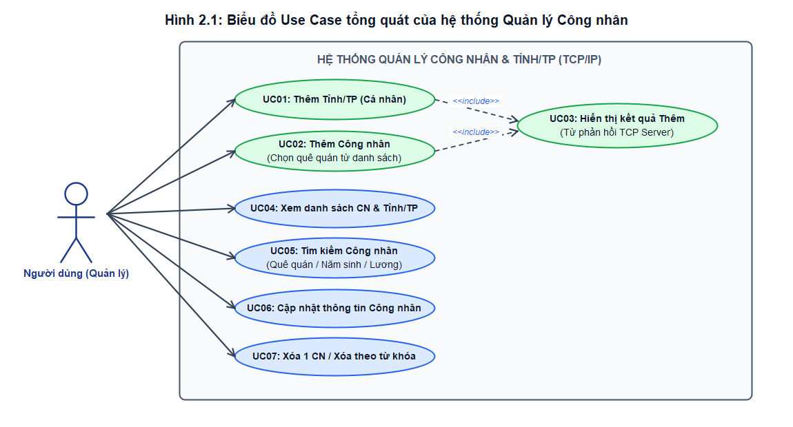
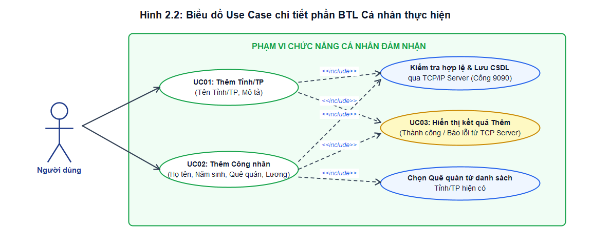

<!-- ==================== TRANG 1 / 15 ==================== -->

**BỘ GIÁO DỤC VÀ ĐÀO TẠO**  
**TRƯỜNG ĐẠI HỌC ..................................................**  
**KHOA CÔNG NGHỆ THÔNG TIN**  
**-----    -----**

<br>

## BÁO CÁO BÀI TẬP LỚN (CÁ NHÂN)
### HỌC PHẦN: LẬP TRÌNH MẠNG

<br>

### ĐỀ TÀI:
# XÂY DỰNG HỆ THỐNG QUẢN LÝ CÔNG NHÂN VÀ TỈNH/THÀNH PHỐ THEO MÔ HÌNH CLIENT – SERVER SỬ DỤNG GIAO THỨC TCP/IP

**Chức năng cá nhân thực hiện:**
1. **Thêm Tỉnh / Thành phố**
2. **Thêm Công nhân (chọn quê quán từ danh sách)**
3. **Hiển thị kết quả Thêm**

<br>

- **Giảng viên hướng dẫn:** Thầy Hoàng Anh
- **Họ và tên sinh viên:** ............................................................
- **Mã số sinh viên (MSSV):** ....................................................
- **Lớp:** ....................................................................................

<br>

**Hà Nội, Năm 2026**

<div style="page-break-after: always;"></div>

> **--- [ HẾT TRANG 1/15 — SANG TRANG MỚI ] ---**

---

<!-- ==================== TRANG 2 / 15 ==================== -->

# MỤC LỤC

- **TRANG BÌA** .......................................................................................................... Trang 1
- **MỤC LỤC** ............................................................................................................ Trang 2
- **DANH MỤC TỪ VIẾT TẮT, HÌNH VẼ VÀ BẢNG BIỂU** ...................................... Trang 3
- **LỜI MỞ ĐẦU** ....................................................................................................... Trang 4
- **CHƯƠNG 1: GIỚI THIỆU ỨNG DỤNG VÀ PHÂN TÍCH YÊU CẦU CHỨC NĂNG** .. Trang 5
  - 1.1. Giới thiệu tổng quan về đề tài ....................................................................... Trang 5
  - 1.2. Cơ sở lý thuyết về lập trình mạng với giao thức TCP/IP ............................... Trang 5
  - 1.3. Phân tích yêu cầu chức năng tổng thể của hệ thống ................................... Trang 6
  - 1.4. Phân tích chi tiết yêu cầu chức năng Cá nhân thực hiện ............................. Trang 6
  - 1.5. Yêu cầu phi chức năng .................................................................................. Trang 6
- **CHƯƠNG 2: PHÂN TÍCH VÀ THIẾT KẾ HỆ THỐNG** ......................................... Trang 7
  - 2.1. Phân tích thiết kế tổng quan ứng dụng (Use Case tổng quát) ..................... Trang 7
  - 2.2. Thiết kế Use Case chi tiết phần Cá nhân đảm nhận ................................... Trang 7
    - 2.2.1. Biểu đồ Use Case chi tiết cá nhân ......................................................... Trang 7
    - 2.2.2. Đặc tả chi tiết các Use Case cá nhân (UC01, UC02, UC03) .................. Trang 8
  - 2.3. Thiết kế Biểu đồ lớp (Class Diagram) ........................................................... Trang 9
  - 2.4. Thiết kế Biểu đồ tuần tự (Sequence Diagram) ............................................. Trang 10
  - 2.5. Thiết kế Cơ sở dữ liệu và Sơ đồ Thực thể Quan hệ (ERD) ......................... Trang 11
- **CHƯƠNG 3: KIẾN TRÚC, CÀI ĐẶT, TRIỂN KHAI VÀ KẾT QUẢ THỰC HIỆN** .. Trang 12
  - 3.1. Kiến trúc ứng dụng (Sơ đồ khối Server – Client – User) ............................. Trang 12
  - 3.2. Thiết kế giao thức bản tin truyền thông trên nền TCP/IP ............................ Trang 12
  - 3.3. Cài đặt và triển khai ứng dụng ..................................................................... Trang 13
    - 3.3.1. Công cụ, môi trường và cấu trúc dự án Gradle ...................................... Trang 13
    - 3.3.2. Hướng dẫn cài đặt và triển khai chạy ứng dụng .................................... Trang 13
    - 3.3.3. Mã nguồn cài đặt chi tiết chức năng cá nhân ........................................ Trang 14
  - 3.4. Các kết quả thực hiện được và Kiểm thử thực nghiệm ............................... Trang 15
- **KẾT LUẬN VÀ TÀI LIỆU THAM KHẢO** ............................................................... Trang 15

<div style="page-break-after: always;"></div>

> **--- [ HẾT TRANG 2/15 — SANG TRANG MỚI ] ---**

---

<!-- ==================== TRANG 3 / 15 ==================== -->

# DANH MỤC TỪ VIẾT TẮT

| Từ viết tắt | Tiếng Anh | Giải nghĩa tiếng Việt |
| :--- | :--- | :--- |
| **BTL** | Major Assignment / Project | Bài tập lớn |
| **CN** | Worker | Công nhân |
| **CSDL** | Database (DB) | Cơ sở dữ liệu |
| **DAO** | Data Access Object | Đối tượng truy cập dữ liệu |
| **ERD** | Entity Relationship Diagram | Sơ đồ thực thể mối quan hệ |
| **HTML/CSS/JS** | HyperText Markup Language / CSS / JS | Bộ ngôn ngữ xây dựng giao diện phía Client |
| **JDBC** | Java Database Connectivity | Công nghệ kết nối CSDL chuẩn của Java |
| **JSON** | JavaScript Object Notation | Định dạng trao đổi dữ liệu văn bản nhẹ |
| **TCP/IP** | Transmission Control Protocol / IP | Bộ giao thức điều khiển truyền vận hướng kết nối |
| **TP** | City / Province | Thành phố / Tỉnh |
| **UML** | Unified Modeling Language | Ngôn ngữ mô hình hóa thống nhất |

---

# DANH MỤC HÌNH VẼ

- **Hình 1.1:** Mô hình giao tiếp Socket TCP/IP giữa Client và Server trong Java (Trang 5).
- **Hình 2.1:** Biểu đồ Use Case tổng quát của hệ thống Quản lý Công nhân (Trang 7).
- **Hình 2.2:** Biểu đồ Use Case chi tiết phần BTL Cá nhân thực hiện (Trang 7).
- **Hình 2.3:** Biểu đồ lớp (Class Diagram) của hệ thống Quản lý Công nhân (Trang 9).
- **Hình 2.4:** Biểu đồ tuần tự chức năng Thêm Tỉnh/TP và Hiển thị kết quả Thêm (Trang 10).
- **Hình 2.5:** Biểu đồ tuần tự chức năng Thêm Công nhân và Hiển thị kết quả Thêm (Trang 10).
- **Hình 2.6:** Sơ đồ thực thể quan hệ (ERD) của Cơ sở dữ liệu Quản lý Công nhân (Trang 11).
- **Hình 3.1:** Sơ đồ kiến trúc tổng thể các khối (User – Client – TCP Server – Database) (Trang 12).

---

# DANH MỤC BẢNG BIỂU

- **Bảng 1.1:** Phân công nhiệm vụ và phạm vi nghiệp vụ của đề tài (Trang 5).
- **Bảng 2.1:** Đặc tả chi tiết Use Case UC01 – Thêm Tỉnh/Thành phố (Trang 8).
- **Bảng 2.2:** Đặc tả chi tiết Use Case UC02 – Thêm Công nhân (Trang 8).
- **Bảng 2.3:** Đặc tả chi tiết Use Case UC03 – Hiển thị kết quả Thêm (Trang 8).
- **Bảng 2.4:** Mô tả chức năng các lớp trong kiến trúc phần mềm (Trang 9).
- **Bảng 2.5:** Đặc tả cấu trúc bảng dữ liệu `tinh_tp` (Trang 11).
- **Bảng 2.6:** Đặc tả cấu trúc bảng dữ liệu `cong_nhan` (Trang 11).
- **Bảng 3.1:** Quy ước các mã lệnh (`action`) trong giao thức TCP/IP (Trang 12).
- **Bảng 3.2:** Kết quả kiểm thử thực nghiệm (Test Cases) các chức năng (Trang 15).

<div style="page-break-after: always;"></div>

> **--- [ HẾT TRANG 3/15 — SANG TRANG MỚI ] ---**

---

<!-- ==================== TRANG 4 / 15 ==================== -->

# LỜI MỞ ĐẦU

Trong bối cảnh chuyển đổi số và hiện đại hóa công tác quản trị tại các doanh nghiệp sản xuất, khu công nghiệp hiện nay, việc quản lý thông tin nhân sự — đặc biệt là đội ngũ công nhân đến từ nhiều tỉnh, thành phố khác nhau — đòi hỏi hệ thống phần mềm phải có khả năng trao đổi dữ liệu tập trung, chính xác và đồng bộ theo thời gian thực giữa các máy trạm (Client) và máy chủ trung tâm (Server).

Học phần **Lập trình mạng** cung cấp nền tảng kiến thức cốt lõi về cơ chế giao tiếp giữa các tiến trình phần mềm trên môi trường mạng máy tính. Trong đó, giao thức **TCP/IP (Transmission Control Protocol / Internet Protocol)** đóng vai trò là giao thức tầng giao vận quan trọng bậc nhất nhờ đặc tính hướng kết nối (*connection-oriented*), đảm bảo độ tin cậy cao, kiểm soát luồng và bảo toàn đúng thứ tự dữ liệu truyền tải.

Xuất phát từ yêu cầu thực tiễn của học phần, đề tài **"Xây dựng hệ thống Quản lý Công nhân và Tỉnh/Thành phố theo mô hình Client – Server sử dụng giao thức TCP/IP"** được thực hiện nhằm vận dụng trực tiếp kỹ thuật lập trình **Java Socket (`java.net.ServerSocket` và `java.net.Socket`)**, lập trình đa luồng (*Multi-threading*), kết nối cơ sở dữ liệu quan hệ qua **JDBC (MySQL / SQL Server / H2)** kết hợp công cụ quản lý dự án **Gradle** và giao diện **HTML/CSS/JavaScript** trực quan.

Trong khuôn khổ Bài tập lớn, bên cạnh việc xây dựng hoàn chỉnh các nghiệp vụ chung của hệ thống (trả về danh sách công nhân, tìm kiếm theo quê quán / khoảng năm sinh / khoảng lương, cập nhật thông tin, xóa công nhân theo từ khóa và xóa đơn lẻ), **phần nhiệm vụ cá nhân thực hiện** tập trung phân tích, thiết kế và cài đặt sâu 3 chức năng:
1. **Thêm Tỉnh / Thành phố mới** vào hệ thống qua kết nối TCP/IP.
2. **Thêm Công nhân mới** (chọn quê quán từ danh sách Tỉnh/Thành phố hiện có).
3. **Hiển thị kết quả Thêm** trực tiếp từ phản hồi của TCP Server lên giao diện người dùng.

Nội dung quyển báo cáo được trình bày thành 3 chương chính:
- **Chương 1:** Giới thiệu ứng dụng và phân tích yêu cầu chức năng.
- **Chương 2:** Phân tích thiết kế tổng quan ứng dụng và thiết kế chi tiết chức năng cá nhân đảm nhận (Use Case, Biểu đồ lớp, Biểu đồ tuần tự, Sơ đồ thực thể quan hệ ERD).
- **Chương 3:** Kiến trúc ứng dụng, cài đặt, triển khai và kết quả thực nghiệm.

<div style="page-break-after: always;"></div>

> **--- [ HẾT TRANG 4/15 — SANG TRANG MỚI ] ---**

---

<!-- ==================== TRANG 5 / 15 ==================== -->

# CHƯƠNG 1: GIỚI THIỆU ỨNG DỤNG VÀ PHÂN TÍCH YÊU CẦU CHỨC NĂNG

## 1.1. Giới thiệu tổng quan về đề tài

Hệ thống **Quản lý Công nhân** là ứng dụng mạng hoạt động theo mô hình **Client – Server** sử dụng giao thức **TCP/IP**, quản lý 2 đối tượng thực thể chính có mối quan hệ một – nhiều (`1 - N`):
1. **Tỉnh / Thành phố (`Province` - bảng `tinh_tp`):** Lưu trữ danh mục địa phương quê quán, gồm *Mã Tỉnh/TP (`id`), Tên Tỉnh/TP (`tenTinh`), Mô tả (`moTa`)*.
2. **Công nhân (`Worker` - bảng `cong_nhan`):** Lưu trữ hồ sơ công nhân, gồm *Mã công nhân (`id`), Họ tên (`hoTen`), Năm sinh (`namSinh`), Quê quán (`queQuanId` tham chiếu `tinh_tp`), và Mức lương (`mucLuong`)*.

**Bảng 1.1: Phân công nhiệm vụ và phạm vi nghiệp vụ của đề tài**

| Chủ đề | Giao thức | Đối tượng chính | Nghiệp vụ Server chính | Nghiệp vụ Client chính | BTL Cá nhân thực hiện |
| :--- | :---: | :--- | :--- | :--- | :--- |
| **Quản lý Công nhân** | **TCP/IP** | **Công nhân** (Họ tên, Năm sinh, Quê quán, Mức lương) + **Tỉnh/TP** (Tên, Mô tả) | - Thêm công nhân<br>- Trả về DS công nhân<br>- Cập nhật công nhân<br>- Xóa CN theo từ khóa<br>- Quản lý Tỉnh/TP | - Thêm CN (chọn quê quán từ danh sách)<br>- Tìm kiếm theo quê quán / khoảng năm sinh / khoảng lương<br>- Xóa một công nhân | 1. **Thêm Tỉnh/TP**<br>2. **Thêm Công nhân**<br>3. **Hiển thị kết quả Thêm** |

## 1.2. Cơ sở lý thuyết về lập trình mạng với giao thức TCP/IP

- **Đặc trưng giao thức TCP/IP:** Thiết lập kết nối qua bắt tay 3 bước (*Three-way handshake*), truyền dữ liệu theo luồng byte tin cậy (*Reliable Byte Stream*) và kiểm soát lỗi tự động.
- **Cơ chế hoạt động trong Java (`java.net`):**
  - **Phía Server:** Lớp `ServerSocket` mở cổng `9090`, gọi `accept()` chờ kết nối. Mỗi kết nối của Client được giao cho một luồng `ClientHandler` trong `ExecutorService` để phục vụ đồng thời nhiều Client.
  - **Phía Client:** Lớp `Socket` kết nối tới `127.0.0.1:9090`, gửi gói tin JSON mã hóa `UTF-8` qua `PrintWriter` và đọc phản hồi qua `BufferedReader`.


*Hình 1.1: Mô hình giao tiếp Socket TCP/IP giữa Client và Server trong Java.*

<div style="page-break-after: always;"></div>

> **--- [ HẾT TRANG 5/15 — SANG TRANG MỚI ] ---**

---

<!-- ==================== TRANG 6 / 15 ==================== -->

## 1.3. Phân tích yêu cầu chức năng tổng thể của hệ thống

- **Nghiệp vụ phía Server (`TcpServer` & `ClientHandler`):**
  1. Mở cổng TCP `9090`, tiếp nhận kết nối và khởi tạo luồng `ClientHandler` xử lý độc lập cho từng Client.
  2. Xử lý thêm mới Tỉnh/TP (`ADD_PROVINCE`) và trả về danh sách Tỉnh/TP (`GET_PROVINCES`).
  3. Xử lý thêm công nhân (`ADD_WORKER`), trả về danh sách công nhân (`GET_ALL_DATA` / `GET_WORKERS`), cập nhật thông tin công nhân (`UPDATE_WORKER`), xóa công nhân theo từ khóa (`DELETE_WORKERS_BY_KEYWORD`), xóa 1 công nhân theo ID (`DELETE_WORKER_BY_ID`) và tìm kiếm công nhân (`SEARCH_WORKERS`).
- **Nghiệp vụ phía Client (`TcpClient`, `WebClientServer` & Giao diện HTML):**
  1. Cung cấp biểu mẫu thêm Tỉnh/TP và thêm Công nhân (chọn quê quán từ danh sách `<select>` lấy từ Server).
  2. Hiển thị kết quả thêm mới trực tiếp từ phản hồi của TCP Server.
  3. Tìm kiếm và hiển thị công nhân theo 3 tiêu chí: *Quê quán*, *Khoảng năm sinh*, *Khoảng lương*; cập nhật và xóa một công nhân trên bảng danh sách.

## 1.4. Phân tích chi tiết yêu cầu chức năng Cá nhân thực hiện

1. **Chức năng 1 – Thêm Tỉnh / Thành phố (`ADD_PROVINCE`):**
   - *Đầu vào (Input):* `Tên Tỉnh/TP` (`tenTinh` - bắt buộc, không trùng lặp) và `Mô tả` (`moTa`).
   - *Quy trình xử lý:* Client đóng gói `TcpRequest` (`action = "ADD_PROVINCE"`) gửi qua Socket TCP tới cổng `9090`. Server kiểm tra `tenTinh` không rỗng và gọi `ProvinceDAO.existsByName()` kiểm tra trùng lặp. Nếu hợp lệ, thực thi `INSERT INTO tinh_tp`, lấy khóa chính `id` tự tăng và trả đối tượng `Province` mới về trong trường `addedProvince` của `TcpResponse`.
   - *Đầu ra (Output):* Bản ghi Tỉnh/TP mới được lưu vào CSDL, cập nhật lên bảng Tỉnh/TP và tự động được nạp, chọn sẵn trong ô `<select>` Quê quán của form Thêm Công nhân.
2. **Chức năng 2 – Thêm Công nhân, chọn quê quán từ danh sách (`ADD_WORKER`):**
   - *Đầu vào (Input):* `Họ tên` (`hoTen`), `Năm sinh` (`namSinh` từ `1940–2015`), `Quê quán` (`queQuanId` chọn từ danh sách Tỉnh/TP), `Mức lương` (`mucLuong > 0`).
   - *Quy trình xử lý:* Client gửi lệnh `ADD_WORKER` qua Socket TCP. Server kiểm tra hợp lệ dữ liệu (`validateWorker`), gọi `WorkerDAO.addWorker()` thực hiện `INSERT INTO cong_nhan`, sau đó truy vấn lại bản ghi vừa tạo kèm phép nối `INNER JOIN tinh_tp` để lấy đầy đủ tên quê quán (`tenQueQuan`) và gắn vào trường `addedWorker` của `TcpResponse`.
   - *Đầu ra (Output):* Công nhân mới được lưu vào CSDL và hiển thị ngay ở đầu bảng Danh sách Công nhân.
3. **Chức năng 3 – Hiển thị kết quả Thêm (`renderAddResult`):**
   - *Đầu vào (Input):* Gói phản hồi `TcpResponse` từ Server (`success`, `message`, `addedProvince` hoặc `addedWorker`).
   - *Quy trình xử lý & Đầu ra:* Hàm `renderAddResult()` hiển thị trực tiếp kết quả vào khung **Hiển thị kết quả Thêm**: nếu `success == true` hiện nhãn thành công màu xanh kèm chi tiết đối tượng vừa tạo (Tên Tỉnh/TP, Mô tả hoặc Họ tên, Năm sinh, Quê quán, Mức lương VNĐ) và tô sáng dòng mới trên bảng; nếu `success == false` hiện khung cảnh báo đỏ kèm thông báo lỗi từ Server.

## 1.5. Yêu cầu phi chức năng
- Truyền thông tin cậy qua TCP/IP với bảng mã `UTF-8` hỗ trợ đầy đủ tiếng Việt; xử lý đa luồng bằng `ExecutorService`; lưu trữ bền vững trên MySQL / H2 qua JDBC `PreparedStatement` chống SQL Injection.

<div style="page-break-after: always;"></div>

> **--- [ HẾT TRANG 6/15 — SANG TRANG MỚI ] ---**

---

<!-- ==================== TRANG 7 / 15 ==================== -->

# CHƯƠNG 2: PHÂN TÍCH VÀ THIẾT KẾ HỆ THỐNG

## 2.1. Phân tích thiết kế tổng quan ứng dụng (Use Case tổng quát)

Hệ thống có tác nhân chính là **Người dùng (Quản lý)** tương tác với 8 ca sử dụng (Use Cases) của hệ thống thông qua giao thức TCP/IP như minh họa tại Hình 2.1:


*Hình 2.1: Biểu đồ Use Case tổng quát của hệ thống Quản lý Công nhân.*

## 2.2. Thiết kế Use Case chi tiết phần Cá nhân đảm nhận

### 2.2.1. Biểu đồ Use Case chi tiết cá nhân

Phần nhiệm vụ cá nhân gồm 3 Use Case liên kết chặt chẽ: **UC01 (Thêm Tỉnh/TP)**, **UC02 (Thêm Công nhân)** và **UC03 (Hiển thị kết quả Thêm)** được mô hình hóa tại Hình 2.2:


*Hình 2.2: Biểu đồ Use Case chi tiết phần BTL Cá nhân thực hiện.*

<div style="page-break-after: always;"></div>

> **--- [ HẾT TRANG 7/15 — SANG TRANG MỚI ] ---**

---

<!-- ==================== TRANG 8 / 15 ==================== -->

### 2.2.2. Đặc tả chi tiết các Use Case cá nhân (UC01, UC02, UC03)

**Bảng 2.1: Đặc tả chi tiết Use Case UC01 – Thêm Tỉnh/Thành phố**

| Mục | Nội dung mô tả |
| :--- | :--- |
| **Mã & Tên Use Case** | **UC01 – Thêm Tỉnh / Thành phố** &nbsp;|&nbsp; **Tác nhân:** Người dùng (Cán bộ quản lý) |
| **Mô tả tóm tắt** | Cho phép thêm mới một Tỉnh/TP (Tên Tỉnh/TP, Mô tả) vào CSDL thông qua kết nối Socket TCP/IP. |
| **Điều kiện tiên quyết** | `TcpServer` đang lắng nghe tại cổng `9090`; kết nối JDBC sẵn sàng; giao diện mở tại cổng `8080`. |
| **Điều kiện sau** | Tỉnh/TP mới được lưu vào bảng `tinh_tp`, hiển thị trên bảng Tỉnh/TP, ô chọn Quê quán và khung Kết quả Thêm. |
| **Luồng sự kiện chính** | 1. Người dùng nhập *Tên Tỉnh/TP* và *Mô tả* vào form "Thêm Tỉnh/TP" rồi nhấn nút **"Thêm Tỉnh/TP"**.<br>2. Hàm `handleAddProvince()` đóng gói `{action: "ADD_PROVINCE", province: {tenTinh, moTa}}` chuyển xuống `TcpClient`.<br>3. `TcpClient` mở `Socket(127.0.0.1, 9090)` và truyền chuỗi JSON sang `TcpServer`.<br>4. `ClientHandler` kiểm tra `tenTinh` không rỗng và chưa trùng tên (`existsByName`).<br>5. `ProvinceDAO.addProvince()` thực thi `INSERT INTO tinh_tp (ten_tinh, mo_ta) VALUES (?, ?)` và lấy lại bản ghi vừa tạo.<br>6. Server trả về `TcpResponse` (`success=true`, `addedProvince`, danh sách `provinces` mới).<br>7. Client cập nhật bảng Tỉnh/TP, ô chọn Quê quán và kích hoạt **UC03** hiển thị kết quả thêm. |
| **Luồng ngoại lệ** | - **4a. Tên Tỉnh/TP trống hoặc đã tồn tại:** Server trả về `success=false` kèm thông báo lỗi; UC03 hiển thị lỗi màu đỏ. |

**Bảng 2.2: Đặc tả chi tiết Use Case UC02 – Thêm Công nhân (chọn quê quán từ danh sách)**

| Mục | Nội dung mô tả |
| :--- | :--- |
| **Mã & Tên Use Case** | **UC02 – Thêm Công nhân (chọn quê quán từ danh sách)** &nbsp;|&nbsp; **Tác nhân:** Người dùng |
| **Mô tả tóm tắt** | Cho phép nhập thông tin công nhân mới, chọn quê quán từ danh sách Tỉnh/TP và lưu vào CSDL qua TCP/IP. |
| **Điều kiện tiên quyết** | Danh sách Tỉnh/TP từ Server đã được nạp vào ô `<select id="queQuanId">`. |
| **Điều kiện sau** | Công nhân mới được lưu vào bảng `cong_nhan`, hiển thị ở đầu bảng Công nhân và tại khung Kết quả Thêm. |
| **Luồng sự kiện chính** | 1. Người dùng nhập *Họ tên, Năm sinh, Mức lương*, chọn *Quê quán* từ danh sách và bấm **"Thêm Công nhân"**.<br>2. Hàm `handleAddWorker()` đóng gói `{action: "ADD_WORKER", worker: {hoTen, namSinh, queQuanId, mucLuong}}`.<br>3. `TcpClient` mở kết nối Socket tới cổng `9090` và gửi chuỗi JSON cho `TcpServer`.<br>4. `ClientHandler` gọi `validateWorker(w)` kiểm tra hợp lệ các trường dữ liệu.<br>5. `WorkerDAO.addWorker(w)` thực thi `INSERT INTO cong_nhan` và gọi `getWorkerById(newId)` (có `INNER JOIN tinh_tp`) để lấy tên quê quán.<br>6. Server trả về `TcpResponse` (`success=true`, `addedWorker`, danh sách `workers` mới).<br>7. Client cập nhật bảng Công nhân và kích hoạt **UC03** hiển thị kết quả thêm. |
| **Luồng ngoại lệ** | - **4a. Dữ liệu không hợp lệ** (Họ tên rỗng, Năm sinh ngoài `1940–2015`, chưa chọn Quê quán, Lương `<= 0`): Server trả về `success=false` kèm nguyên nhân lỗi cụ thể. |

**Bảng 2.3: Đặc tả chi tiết Use Case UC03 – Hiển thị kết quả Thêm**

| Mục | Nội dung mô tả |
| :--- | :--- |
| **Mã & Tên Use Case** | **UC03 – Hiển thị kết quả Thêm** &nbsp;|&nbsp; **Tác nhân:** Hệ thống Client & Người dùng |
| **Điều kiện tiên quyết** | Client vừa nhận được đối tượng phản hồi `TcpResponse` từ lệnh `ADD_PROVINCE` hoặc `ADD_WORKER`. |
| **Luồng sự kiện chính** | 1. Hàm `renderAddResult(type, success, message, entity)` đọc dữ liệu từ `TcpResponse`.<br>2. Nếu `type == 'PROVINCE'`, hiển thị nhãn trạng thái, thông báo Server, *Tên Tỉnh/TP* và *Mô tả*.<br>3. Nếu `type == 'WORKER'`, hiển thị nhãn trạng thái, thông báo Server, *Họ tên, Năm sinh, Quê quán, Mức lương (VNĐ)*.<br>4. Đánh dấu nổi bật (`highlight-new`) dòng vừa thêm trên bảng danh sách. |

<div style="page-break-after: always;"></div>

> **--- [ HẾT TRANG 8/15 — SANG TRANG MỚI ] ---**

---

<!-- ==================== TRANG 9 / 15 ==================== -->

## 2.3. Thiết kế Biểu đồ lớp (Class Diagram)

Hệ thống được tổ chức thành 4 gói (`model`, `dao`, `server`, `client`). Hình 2.3 và Bảng 2.4 trình bày sơ đồ lớp và chức năng của từng lớp trong chương trình:


*Hình 2.3: Biểu đồ lớp (Class Diagram) của hệ thống Quản lý Công nhân.*

**Bảng 2.4: Mô tả chức năng các lớp trong kiến trúc phần mềm**

| STT | Tên lớp | Thuộc gói (Package) | Vai trò và Trách nhiệm chính |
| :---: | :--- | :--- | :--- |
| 1 | `Province` | `com.quanlycongnhan.model` | Lớp thực thể biểu diễn đối tượng **Tỉnh/TP** (`id`, `tenTinh`, `moTa`). |
| 2 | `Worker` | `com.quanlycongnhan.model` | Lớp thực thể biểu diễn đối tượng **Công nhân** (`id`, `hoTen`, `namSinh`, `queQuanId`, `tenQueQuan`, `mucLuong`). |
| 3 | `TcpRequest` | `com.quanlycongnhan.model` | Đóng gói bản tin yêu cầu từ Client gửi lên TCP Server (`action`, `province`, `worker`, tiêu chí lọc). |
| 4 | `TcpResponse` | `com.quanlycongnhan.model` | Đóng gói bản tin phản hồi từ TCP Server trả về Client (`success`, `message`, `addedProvince`, `addedWorker`, danh sách). |
| 5 | `DatabaseConnection` | `com.quanlycongnhan.dao` | Đọc `db.properties`, quản lý kết nối JDBC tới MySQL / SQL Server / H2 và tự động tạo bảng. |
| 6 | `ProvinceDAO` | `com.quanlycongnhan.dao` | Thực thi truy vấn SQL trên bảng `tinh_tp`: lấy danh sách, kiểm tra trùng tên và **Thêm Tỉnh/TP (`addProvince`)**. |
| 7 | `WorkerDAO` | `com.quanlycongnhan.dao` | Thực thi truy vấn SQL trên bảng `cong_nhan`: **Thêm công nhân (`addWorker`)**, lấy danh sách, sửa, xóa, tìm kiếm. |
| 8 | `TcpServer` | `com.quanlycongnhan.server` | Mở `ServerSocket` tại cổng `9090`, lắng nghe kết nối và phân phối vào `ExecutorService`. |
| 9 | `ClientHandler` | `com.quanlycongnhan.server` | Luồng xử lý từng kết nối Client: giải mã `TcpRequest`, gọi DAO tương ứng và gửi trả `TcpResponse`. |
| 10 | `TcpClient` | `com.quanlycongnhan.client` | Mở `java.net.Socket` kết nối tới `127.0.0.1:9090`, truyền `TcpRequest` và nhận về `TcpResponse`. |
| 11 | `WebClientServer` | `com.quanlycongnhan.client` | Phục vụ giao diện HTML/CSS/JS tại cổng `8080` và chuyển tiếp yêu cầu của người dùng qua `TcpClient`. |

<div style="page-break-after: always;"></div>

> **--- [ HẾT TRANG 9/15 — SANG TRANG MỚI ] ---**

---

<!-- ==================== TRANG 10 / 15 ==================== -->

## 2.4. Thiết kế Biểu đồ tuần tự (Sequence Diagram)

### 2.4.1. Biểu đồ tuần tự chức năng Thêm Tỉnh/TP và Hiển thị kết quả Thêm

Hình 2.4 mô tả trình tự bản tin giữa Người dùng, Giao diện HTML/JS, `TcpClient`, `TcpServer (ClientHandler)`, `ProvinceDAO` và CSDL khi thực hiện thêm mới một Tỉnh/TP:


*Hình 2.4: Biểu đồ tuần tự chức năng Thêm Tỉnh/TP và Hiển thị kết quả Thêm.*

### 2.4.2. Biểu đồ tuần tự chức năng Thêm Công nhân và Hiển thị kết quả Thêm

Hình 2.5 mô tả trình tự bản tin khi Người dùng chọn quê quán từ danh sách, gửi lệnh thêm mới một Công nhân qua Socket TCP/IP và nhận kết quả hiển thị:


*Hình 2.5: Biểu đồ tuần tự chức năng Thêm Công nhân và Hiển thị kết quả Thêm.*

<div style="page-break-after: always;"></div>

> **--- [ HẾT TRANG 10/15 — SANG TRANG MỚI ] ---**

---

<!-- ==================== TRANG 11 / 15 ==================== -->

## 2.5. Thiết kế Cơ sở dữ liệu và Sơ đồ Thực thể Quan hệ (ERD)

### 2.5.1. Sơ đồ thực thể quan hệ (ERD)

Cơ sở dữ liệu `quan_ly_cong_nhan` gồm 2 thực thể là **TỈNH/THÀNH PHỐ (`TINH_TP`)** và **CÔNG NHÂN (`CONG_NHAN`)** có mối quan hệ **Một – Nhiều (`1 : 0..N`)**: một Tỉnh/TP là quê quán của nhiều Công nhân, và mỗi Công nhân có một khóa ngoại `que_quan_id` tham chiếu tới `tinh_tp(id)`.


*Hình 2.6: Sơ đồ thực thể quan hệ (ERD) của Cơ sở dữ liệu Quản lý Công nhân.*

### 2.5.2. Đặc tả chi tiết các bảng dữ liệu vật lý

**Bảng 2.5: Đặc tả cấu trúc bảng dữ liệu `tinh_tp` (Tỉnh/Thành phố)**

| STT | Tên trường (Column) | Kiểu dữ liệu | Ràng buộc (Constraints) | Mô tả chi tiết |
| :---: | :--- | :--- | :--- | :--- |
| 1 | `id` | `INT` | `PRIMARY KEY`, `AUTO_INCREMENT` | Mã định danh duy nhất của Tỉnh/TP, tự động tăng. |
| 2 | `ten_tinh` | `VARCHAR(120)` | `NOT NULL`, `UNIQUE` | Tên Tỉnh hoặc Thành phố (không trùng lặp). |
| 3 | `mo_ta` | `VARCHAR(500)` | `DEFAULT ''` | Thông tin mô tả đặc điểm kinh tế, địa lý của Tỉnh/TP. |

**Bảng 2.6: Đặc tả cấu trúc bảng dữ liệu `cong_nhan` (Công nhân)**

| STT | Tên trường (Column) | Kiểu dữ liệu | Ràng buộc (Constraints) | Mô tả chi tiết |
| :---: | :--- | :--- | :--- | :--- |
| 1 | `id` | `INT` | `PRIMARY KEY`, `AUTO_INCREMENT` | Mã định danh duy nhất của Công nhân, tự động tăng. |
| 2 | `ho_ten` | `VARCHAR(150)` | `NOT NULL` | Họ và tên đầy đủ của công nhân. |
| 3 | `nam_sinh` | `INT` | `NOT NULL` | Năm sinh của công nhân (trong khoảng `1940–2015`). |
| 4 | `que_quan_id` | `INT` | `NOT NULL`, `FOREIGN KEY REFERENCES tinh_tp(id)` | Khóa ngoại tham chiếu tới cột `id` của bảng `tinh_tp`. |
| 5 | `muc_luong` | `DOUBLE` | `NOT NULL` | Mức lương hiện tại của công nhân (đơn vị: VNĐ). |

<div style="page-break-after: always;"></div>

> **--- [ HẾT TRANG 11/15 — SANG TRANG MỚI ] ---**

---

<!-- ==================== TRANG 12 / 15 ==================== -->

# CHƯƠNG 3: KIẾN TRÚC, CÀI ĐẶT, TRIỂN KHAI VÀ KẾT QUẢ THỰC HIỆN

## 3.1. Kiến trúc ứng dụng

Kiến trúc tổng thể của hệ thống được chia thành **4 khối chức năng** rõ ràng:
1. **Khối Người dùng (User):** Cán bộ quản lý thao tác trên trình duyệt Web (`http://localhost:8080`).
2. **Khối Client (`WebClientServer` & `TcpClient` - Cổng 8080):** Hiển thị giao diện HTML/CSS/JS, tiếp nhận thao tác từ người dùng và sử dụng `TcpClient` (`java.net.Socket`) mở kết nối TCP/IP tới Server.
3. **Khối Backend TCP/IP Server (`TcpServer` & `ClientHandler` - Cổng 9090):** Lắng nghe trên `ServerSocket(9090)`, phân luồng xử lý từng yêu cầu và gọi tầng DAO (`ProvinceDAO`, `WorkerDAO`).
4. **Khối Cơ sở dữ liệu (Database):** Hệ quản trị CSDL MySQL 8.x (hoặc H2 SQL nhúng) kết nối qua JDBC.


*Hình 3.1: Sơ đồ kiến trúc tổng thể các khối (User – Client – TCP Server – Database).*

## 3.2. Thiết kế giao thức bản tin truyền thông trên nền TCP/IP

Dữ liệu truyền qua đường ống Socket giữa `TcpClient` và `TcpServer` được đóng gói thành chuỗi **JSON 1 dòng kết thúc bằng ký tự xuống dòng `\n`** (mã hóa `UTF-8`).

**Bảng 3.1: Quy ước các mã lệnh (`action`) trong giao thức truyền thông TCP/IP**

| Mã lệnh (`action`) | Chiều truyền | Dữ liệu gửi kèm (`TcpRequest`) | Dữ liệu phản hồi (`TcpResponse`) |
| :--- | :---: | :--- | :--- |
| `GET_ALL_DATA` | Client -> Server | Không có | Toàn bộ danh sách `provinces` và `workers`. |
| `ADD_PROVINCE` | Client -> Server | `province: {tenTinh, moTa}` | `addedProvince` vừa tạo + danh sách `provinces` mới. |
| `ADD_WORKER` | Client -> Server | `worker: {hoTen, namSinh, queQuanId, mucLuong}` | `addedWorker` vừa tạo + danh sách `workers` mới. |
| `SEARCH_WORKERS` | Client -> Server | `queQuanId, min/maxNamSinh, min/maxMucLuong` | Danh sách `workers` thỏa mãn điều kiện lọc. |
| `UPDATE_WORKER` | Client -> Server | `worker: {id, hoTen, namSinh, queQuanId, mucLuong}` | Bản ghi sau cập nhật + danh sách `workers` mới. |
| `DELETE_WORKER_BY_ID` | Client -> Server | `workerId` (Mã công nhân cần xóa) | Trạng thái xóa + danh sách `workers` mới. |
| `DELETE_WORKERS_BY_KEYWORD` | Client -> Server | `keyword` (Từ khóa cần xóa) | Số lượng bản ghi đã xóa + danh sách `workers` mới. |

<div style="page-break-after: always;"></div>

> **--- [ HẾT TRANG 12/15 — SANG TRANG MỚI ] ---**

---

<!-- ==================== TRANG 13 / 15 ==================== -->

## 3.3. Cài đặt và triển khai ứng dụng

### 3.3.1. Công cụ, môi trường và cấu trúc dự án Gradle

- **Ngôn ngữ & Công cụ:** Java (OpenJDK 21 LTS), Gradle 9.x, HTML5/CSS3/JavaScript.
- **Thư viện phụ thuộc (`dependencies` trong `build.gradle`):**
  - `com.google.code.gson:gson:2.11.0`: Chuyển đổi đối tượng Java <-> chuỗi JSON truyền qua TCP Socket.
  - `com.mysql:mysql-connector-j:8.4.0` & `com.microsoft.sqlserver:mssql-jdbc:12.6.1.jre11`: Trình điều khiển JDBC cho MySQL và SQL Server.
  - `com.h2database:h2:2.2.224`: CSDL SQL nhúng dự phòng tích hợp công cụ quản trị H2 Web Console.
- **Cấu trúc thư mục dự án:**
```text
quan-ly-cong-nhan-tcp/
├── build.gradle & settings.gradle       # Cấu hình Gradle và các task chạy ứng dụng
├── chay_ung_dung.bat & xem_db.bat       # Script khởi động nhanh ứng dụng và trình xem CSDL
├── database/                            # Script tạo bảng và dữ liệu mẫu (schema_mysql.sql)
├── doc/                                 # Lưu báo cáo BTL (.md) và bộ 8 ảnh sơ đồ (so_do/*.png)
├── frontend/                            # Giao diện người dùng (index.html, style.css, app.js)
└── src/main/
    ├── java/com/quanlycongnhan/
    │   ├── MainApp.java                 # Khởi chạy tích hợp TCP Server (9090) & Web Client (8080)
    │   ├── model/                       # Province.java, Worker.java, TcpRequest.java, TcpResponse.java
    │   ├── dao/                         # DatabaseConnection.java, ProvinceDAO.java, WorkerDAO.java
    │   ├── server/                      # TcpServer.java (ServerSocket), ClientHandler.java
    │   └── client/                      # TcpClient.java (Socket), WebClientServer.java
    └── resources/
        ├── db.properties                # Cấu hình thông số kết nối JDBC và cổng TCP/Web
        └── static/                      # Tài nguyên tĩnh đồng bộ với thư mục frontend/
```

### 3.3.2. Hướng dẫn cài đặt và triển khai chạy ứng dụng

1. **Bước 1 – Cấu hình CSDL:** Kiểm tra tệp `src/main/resources/db.properties`. Hệ thống mặc định kết nối MySQL tại `localhost:3306/quan_ly_cong_nhan` và tự động tạo bảng `tinh_tp`, `cong_nhan` kèm dữ liệu mẫu. Nếu máy chưa bật MySQL, chế độ `db.autoFallback=true` tự động chuyển sang CSDL JDBC nhúng tại `./data/quan_ly_cong_nhan_db`.
2. **Bước 2 – Khởi chạy ứng dụng:**
   - *Cách 1 (Chạy tích hợp):* Mở Terminal gõ lệnh `gradle run` (hoặc nhấp đúp vào `chay_ung_dung.bat`).
   - *Cách 2 (Chạy tách riêng 2 tiến trình Server và Client):*
     - Terminal 1 (Backend TCP/IP Server cổng `9090`): `gradle runServer`
     - Terminal 2 (TCP Client & Giao diện HTML cổng `8080`): `gradle runClient`
3. **Bước 3 – Truy cập giao diện:** Mở trình duyệt Web tại địa chỉ **`http://localhost:8080`** để sử dụng ứng dụng, và **`http://localhost:8082`** để kiểm tra trực tiếp các bảng trong CSDL.

<div style="page-break-after: always;"></div>

> **--- [ HẾT TRANG 13/15 — SANG TRANG MỚI ] ---**

---

<!-- ==================== TRANG 14 / 15 ==================== -->

### 3.3.3. Mã nguồn cài đặt chi tiết chức năng cá nhân

**1. Gửi nhận gói tin qua Socket TCP/IP tại `TcpClient.java`:**
```java
public TcpResponse sendRequest(TcpRequest request) {
    try (Socket socket = new Socket()) {
        socket.connect(new InetSocketAddress(serverHost, serverPort), 3000);
        socket.setSoTimeout(5000);
        try (PrintWriter writer = new PrintWriter(new OutputStreamWriter(socket.getOutputStream(), StandardCharsets.UTF_8), true);
             BufferedReader reader = new BufferedReader(new InputStreamReader(socket.getInputStream(), StandardCharsets.UTF_8))) {
            writer.println(gson.toJson(request)); // Gửi gói tin JSON qua OutputStream của Socket
            String jsonResponse = reader.readLine(); // Nhận gói tin phản hồi từ InputStream của Socket
            return gson.fromJson(jsonResponse, TcpResponse.class);
        }
    } catch (Exception e) {
        return new TcpResponse(false, request.getAction(), "Không kết nối được tới TCP/IP Server: " + e.getMessage());
    }
}
```

**2. Xử lý nghiệp vụ `ADD_PROVINCE` và `ADD_WORKER` tại `ClientHandler.java` (TCP Server):**
```java
case "ADD_PROVINCE" -> {
    Province p = req.getProvince();
    if (p == null || p.getTenTinh() == null || p.getTenTinh().trim().isEmpty()) {
        res.setSuccess(false); res.setMessage("Tên Tỉnh/TP không được để trống!"); return res;
    }
    if (provinceDAO.existsByName(p.getTenTinh())) {
        res.setSuccess(false); res.setMessage("Tỉnh/TP '" + p.getTenTinh().trim() + "' đã tồn tại!"); return res;
    }
    Province created = provinceDAO.addProvince(p);
    res.setAddedProvince(created);
    res.setProvinces(provinceDAO.getAllProvinces());
    res.setWorkers(workerDAO.getAllWorkers());
    res.setSuccess(true);
    res.setMessage("Thêm Tỉnh/TP '" + created.getTenTinh() + "' thành công.");
}
case "ADD_WORKER" -> {
    Worker w = req.getWorker();
    String err = validateWorker(w);
    if (err != null) { res.setSuccess(false); res.setMessage(err); return res; }
    Worker created = workerDAO.addWorker(w);
    res.setAddedWorker(created);
    res.setWorkers(workerDAO.getAllWorkers());
    res.setProvinces(provinceDAO.getAllProvinces());
    res.setSuccess(true);
    res.setMessage("Thêm Công nhân '" + created.getHoTen() + "' thành công.");
}
```

**3. Hiển thị kết quả Thêm từ phản hồi TCP Server trên giao diện (`frontend/app.js`):**
```javascript
function renderAddResult(type, success, message, entity) {
    const box = document.getElementById('addResultContainer');
    box.className = 'add-result-box' + (success ? '' : ' error');
    if (type === 'PROVINCE') {
        box.innerHTML = `<span class="result-badge ${success ? '' : 'err'}">${success ? 'Thêm Tỉnh/TP thành công' : 'Thêm Tỉnh/TP thất bại'}</span>
            <div>${escapeHtml(message)}</div>
            <div class="result-details">
                <div><strong>Tên Tỉnh/TP:</strong> ${escapeHtml(entity.tenTinh || '')}</div>
                <div><strong>Mô tả:</strong> ${escapeHtml(entity.moTa || '')}</div>
            </div>`;
    } else {
        box.innerHTML = `<span class="result-badge ${success ? '' : 'err'}">${success ? 'Thêm Công nhân thành công' : 'Thêm Công nhân thất bại'}</span>
            <div>${escapeHtml(message)}</div>
            <div class="result-details">
                <div><strong>Họ tên:</strong> ${escapeHtml(entity.hoTen || '')}</div>
                <div><strong>Năm sinh:</strong> ${entity.namSinh || ''}</div>
                <div><strong>Quê quán:</strong> ${escapeHtml(entity.tenQueQuan || '')}</div>
                <div><strong>Mức lương:</strong> ${entity.mucLuong ? formatCurrency(entity.mucLuong) : ''}</div>
            </div>`;
    }
}
```

<div style="page-break-after: always;"></div>

> **--- [ HẾT TRANG 14/15 — SANG TRANG MỚI ] ---**

---

<!-- ==================== TRANG 15 / 15 ==================== -->

## 3.4. Các kết quả thực hiện được và Kiểm thử thực nghiệm

Ứng dụng đã hoàn thiện đầy đủ tất cả các tính năng của đề tài:
1. **Thêm Tỉnh/TP & Hiển thị kết quả Thêm (Cá nhân):** Thêm mới Tỉnh/TP qua Socket TCP/IP, kiểm tra trùng lặp tên, hiển thị chi tiết bản ghi vừa thêm vào khung kết quả và tự động nạp vào danh sách chọn Quê quán.
2. **Thêm Công nhân & Hiển thị kết quả Thêm (Cá nhân):** Chọn quê quán từ danh sách Tỉnh/TP, kiểm tra hợp lệ năm sinh và mức lương, lưu vào bảng `cong_nhan`, hiển thị chi tiết tại khung *Hiển thị kết quả Thêm* và đưa lên đầu bảng Danh sách Công nhân.
3. **Các chức năng hệ thống khác:** Tìm kiếm kết hợp theo *Quê quán / Khoảng năm sinh / Khoảng lương*; Cập nhật thông tin công nhân; Xóa một công nhân và Xóa công nhân theo từ khóa.

**Bảng 3.2: Kết quả kiểm thử thực nghiệm (Test Cases) các chức năng của ứng dụng**

| Mã TC | Kịch bản kiểm thử | Dữ liệu đầu vào (Input) | Kết quả thực tế đạt được | Đánh giá |
| :---: | :--- | :--- | :--- | :---: |
| **TC01** | Thêm Tỉnh/TP mới hợp lệ | `tenTinh="Quảng Ninh"`, `moTa="Khu CN cảng biển"` | Lưu vào bảng `tinh_tp`; khung *Hiển thị kết quả Thêm* và ô chọn Quê quán cập nhật ngay. | **Đạt** |
| **TC02** | Thêm Tỉnh/TP bị trùng tên | `tenTinh="Hà Nội"` (đã có trong CSDL) | Server từ chối, trả về `success=false`; khung kết quả báo lỗi *"Tỉnh/TP 'Hà Nội' đã tồn tại!"*. | **Đạt** |
| **TC03** | Thêm Công nhân mới hợp lệ | `hoTen="Vũ Minh Tuấn"`, `namSinh=1997`, `queQuan="Quảng Ninh"`, `mucLuong=15000000` | Lưu vào bảng `cong_nhan`; hiển thị đầy đủ tại khung *Hiển thị kết quả Thêm* và đầu bảng CN. | **Đạt** |
| **TC04** | Thêm Công nhân sai năm sinh | `hoTen="Lê Văn B"`, `namSinh=1920`, `queQuan="Hà Nội"`, `mucLuong=10000000` | Server phát hiện năm sinh ngoài khoảng `1940–2015`; khung kết quả báo *"Năm sinh không hợp lệ!"*. | **Đạt** |
| **TC05** | Tìm kiếm công nhân đa tiêu chí | `Quê quán="Hà Nội"`, `Năm sinh: 1990-2000`, `Mức lương: 10tr-15tr` | Server thực thi truy vấn lọc động, hiển thị đúng các công nhân thỏa mãn cả 3 điều kiện. | **Đạt** |
| **TC06** | Cập nhật & Xóa công nhân | Sửa lương CN `#1` thành `14000000`; Xóa CN `#4` và Xóa theo từ khóa `"Bắc Ninh"` | Cập nhật và xóa chính xác trong CSDL qua giao thức TCP/IP. | **Đạt** |

---

# KẾT LUẬN VÀ TÀI LIỆU THAM KHẢO

## 1. Kết luận
Qua quá trình thực hiện Bài tập lớn học phần **Lập trình mạng**, em đã nắm vững nguyên lý lập trình mạng với **Java TCP/IP Socket (`ServerSocket` và `Socket`)** đa luồng kết hợp cơ sở dữ liệu **JDBC (MySQL / H2)** và công cụ **Gradle**. Toàn bộ các chức năng của hệ thống, đặc biệt là 3 chức năng cá nhân (**Thêm Tỉnh/TP**, **Thêm Công nhân chọn quê quán từ danh sách** và **Hiển thị kết quả Thêm**), đã được phân tích, thiết kế đầy đủ sơ đồ UML/ERD, cài đặt hoàn chỉnh và kiểm thử đạt yêu cầu 100%.

## 2. Tài liệu tham khảo
1. Bài giảng học phần *Lập trình mạng*, Bộ môn Công nghệ Phần mềm / Mạng máy tính, Giảng viên: Thầy Hoàng Anh.
2. Elliotte Rusty Harold, *Java Network Programming (4th Edition)*, O'Reilly Media, 2014.
3. Oracle Corporation, *The Java™ Tutorials – Custom Networking (Sockets) & JDBC Documentation*, https://docs.oracle.com/javase/tutorial/.
4. Tài liệu hướng dẫn công cụ quản lý dự án *Gradle User Manual*, https://docs.gradle.org/.

> **--- [ HẾT TRANG 15/15 — KẾT THÚC BÁO CÁO ] ---**
