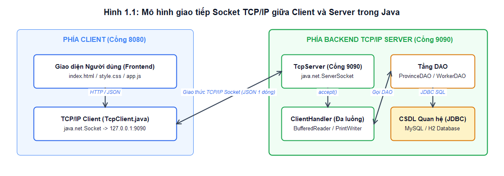
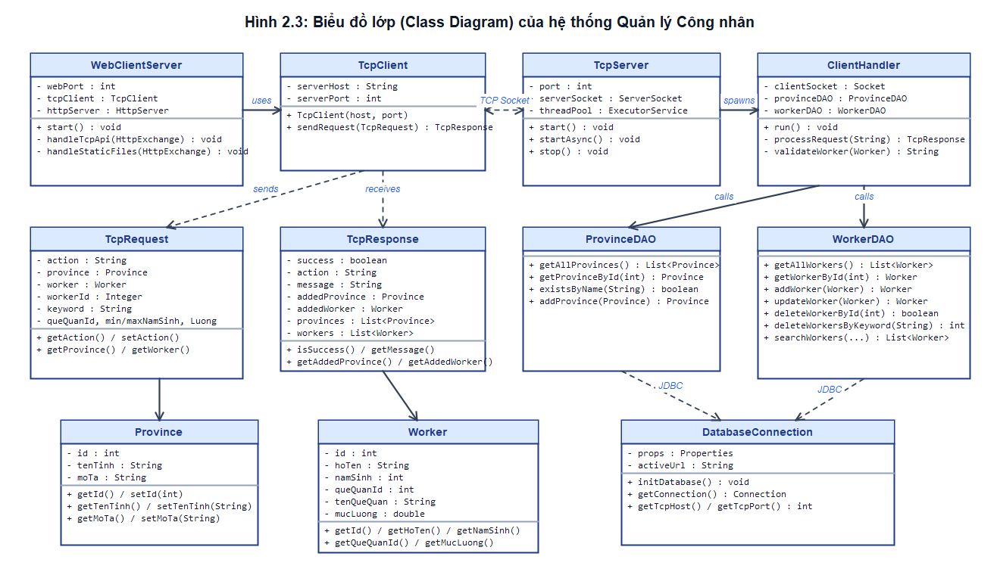
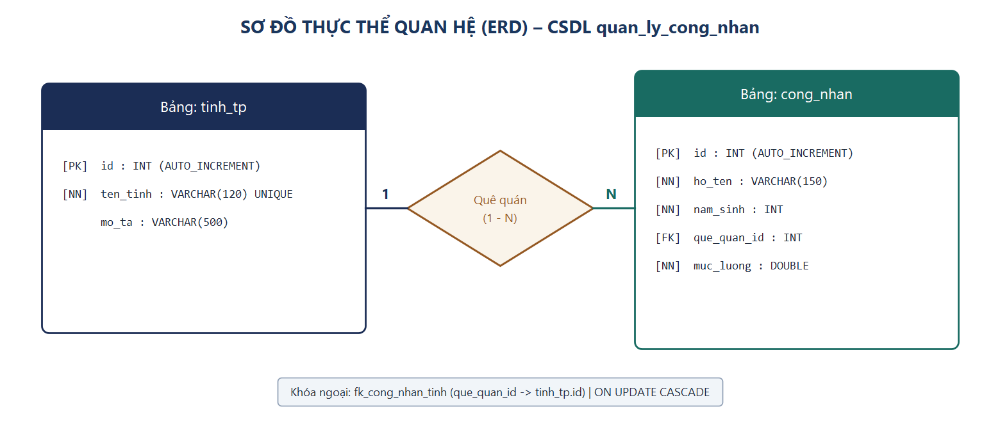
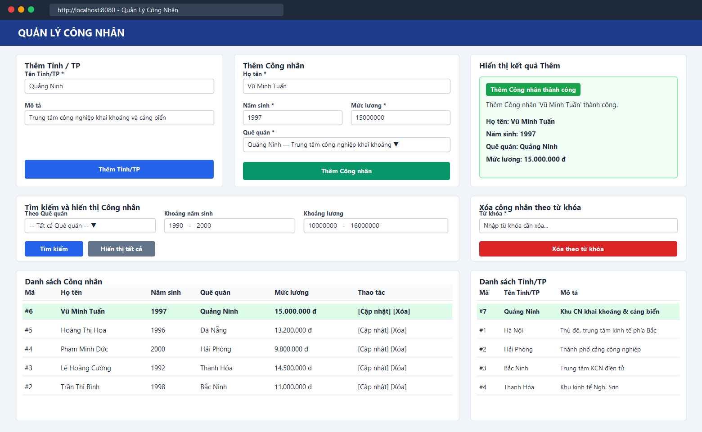

<!-- ==================== TRANG 1 / 15 ==================== -->

**HỌC VIỆN CÔNG NGHỆ BƯU CHÍNH VIỄN THÔNG**

<br>

## BÁO CÁO BÀI TẬP LỚN
### MÔN: LẬP TRÌNH MẠNG (INT1433)

<br>

# ĐỀ TÀI: XÂY DỰNG HỆ THỐNG QUẢN LÝ CÔNG NHÂN VÀ TỈNH/THÀNH PHỐ SỬ DỤNG GIAO THỨC TCP/IP
**(Phần cá nhân: Thêm Tỉnh/TP; Thêm Công nhân chọn quê quán từ danh sách và Hiển thị kết quả Thêm)**

<br>

| Thông tin | Chi tiết |
| :--- | :--- |
| **Giảng viên hướng dẫn** | : **NGUYỄN HOÀNG ANH** |
| **Họ và tên sinh viên** | : **NGUYỄN TRƯỜNG AN** |
| **Mã sinh viên** | : **B24DTCN181** |
| **Lớp** | : **D24TXCN08-B** |

<br>

**Hà Nội – 2026**

<div style="page-break-after: always;"></div>

> **--- [ HẾT TRANG 1/15 — SANG TRANG MỚI ] ---**

---

<!-- ==================== TRANG 2 / 15 ==================== -->

# MỤC LỤC

| Nội dung | Trang |
| :--- | :---: |
| **DANH MỤC TỪ VIẾT TẮT** | 3 |
| **DANH MỤC HÌNH VẼ** | 3 |
| **DANH MỤC BẢNG BIỂU** | 3 |
| **CHƯƠNG 1: MỞ ĐẦU VÀ PHÂN TÍCH YÊU CẦU** | 4 |
| 1.1. Giới thiệu bài toán và ứng dụng Quản lý Công nhân | 4 |
| 1.2. Cơ sở lý thuyết và Công nghệ sử dụng | 4 |
| 1.3. Phân tích yêu cầu chức năng tổng quan hệ thống | 5 |
| 1.4. Phân tích yêu cầu chức năng Cá nhân thực hiện | 6 |
| **CHƯƠNG 2: PHÂN TÍCH VÀ THIẾT KẾ HỆ THỐNG** | 7 |
| 2.1. Phân tích thiết kế tổng quan ứng dụng | 7 |
| 2.2. Phân tích thiết kế chi tiết chức năng Cá nhân đảm nhận | 7 |
| 2.2.1. Biểu đồ Use Case và Đặc tả Use Case chi tiết | 7 |
| 2.2.2. Biểu đồ lớp (Class Diagram) chi tiết | 9 |
| 2.2.3. Biểu đồ tuần tự (Sequence Diagram) | 10 |
| 2.2.4. Sơ đồ thực thể quan hệ (ERD) và Thiết kế cơ sở dữ liệu | 11 |
| **CHƯƠNG 3: CÀI ĐẶT, TRIỂN KHAI VÀ KẾT QUẢ ỨNG DỤNG** | 12 |
| 3.1. Kiến trúc triển khai ứng dụng theo các khối | 12 |
| 3.2. Cài đặt và triển khai ứng dụng | 13 |
| 3.2.1. Môi trường phát triển và cấu hình thư viện | 13 |
| 3.2.2. Hiện thực hóa mã nguồn phần chức năng cá nhân | 13 |
| 3.2.3. Quy trình triển khai và vận hành hệ thống | 14 |
| 3.3. Các kết quả thực hiện được và Kiểm thử ứng dụng | 14 |
| 3.3.1. Giao diện thực tế và các tính năng hoàn thành | 14 |
| 3.3.2. Kịch bản kiểm thử (Test Cases) và kết quả thử nghiệm | 15 |
| 3.3.3. Đánh giá ưu điểm, hạn chế và hướng phát triển | 15 |
| **TÀI LIỆU THAM KHẢO** | 15 |

<div style="page-break-after: always;"></div>

> **--- [ HẾT TRANG 2/15 — SANG TRANG MỚI ] ---**

---

<!-- ==================== TRANG 3 / 15 ==================== -->

# DANH MỤC TỪ VIẾT TẮT

| Từ viết tắt | Thuật ngữ tiếng Anh / Gốc | Ý nghĩa tiếng Việt |
| :--- | :--- | :--- |
| **API** | Application Programming Interface | Giao diện lập trình ứng dụng |
| **CRUD** | Create, Read, Update, Delete | Bốn thao tác cơ bản: Thêm, Đọc, Sửa, Xóa dữ liệu |
| **CSDL** | Cơ sở dữ liệu (Database) | Hệ thống lưu trữ dữ liệu có cấu trúc |
| **DAO** | Data Access Object | Mẫu thiết kế đối tượng truy xuất cơ sở dữ liệu |
| **DOM / JS** | Document Object Model / JavaScript | Mô hình đối tượng tài liệu và ngôn ngữ kịch bản giao diện |
| **ERD** | Entity Relationship Diagram | Sơ đồ thực thể quan hệ |
| **FK / PK** | Foreign Key / Primary Key | Khóa ngoại / Khóa chính trong cơ sở dữ liệu quan hệ |
| **HTML/CSS** | HyperText Markup Language / CSS | Ngôn ngữ đánh dấu và định kiểu giao diện Web Client |
| **JDBC** | Java Database Connectivity | Chuẩn kết nối cơ sở dữ liệu trong ngôn ngữ Java |
| **JSON** | JavaScript Object Notation | Định dạng đóng gói bản tin văn bản truyền qua Socket |
| **JVM** | Java Virtual Machine | Máy ảo Java thực thi mã bytecode |
| **SQL** | Structured Query Language | Ngôn ngữ truy vấn có cấu trúc |
| **TCP/IP** | Transmission Control Protocol / Internet Protocol | Bộ giao thức điều khiển truyền vận hướng kết nối và liên mạng |
| **UML** | Unified Modeling Language | Ngôn ngữ mô hình hóa thống nhất |

# DANH MỤC HÌNH VẼ

| Tên hình vẽ | Trang |
| :--- | :---: |
| **Hình 1.1:** Cơ chế giao tiếp Socket TCP/IP giữa Client và Server trong hệ thống Quản lý Công nhân | 5 |
| **Hình 2.1:** Biểu đồ Use Case tổng quát và phân định phạm vi chức năng Cá nhân thực hiện | 7 |
| **Hình 2.2:** Biểu đồ lớp (Class Diagram) chi tiết của hệ thống Quản lý Công nhân - TCP/IP | 9 |
| **Hình 2.3:** Biểu đồ tuần tự chức năng Thêm Tỉnh/TP và Hiển thị kết quả Thêm | 10 |
| **Hình 2.4:** Biểu đồ tuần tự chức năng Thêm Công nhân và Hiển thị kết quả Thêm | 11 |
| **Hình 2.5:** Sơ đồ thực thể quan hệ (ERD) cơ sở dữ liệu `quan_ly_cong_nhan` | 11 |
| **Hình 3.1:** Sơ đồ kiến trúc triển khai ứng dụng theo các khối (User - Client - Server - Database) | 12 |
| **Hình 3.2:** Giao diện chạy thực tế chức năng Thêm Tỉnh/TP, Thêm Công nhân và Hiển thị kết quả Thêm | 14 |

# DANH MỤC BẢNG BIỂU

| Tên bảng biểu | Trang |
| :--- | :---: |
| **Bảng 1.1:** Quy ước cấu trúc bản tin giao thức ứng dụng trên nền Socket TCP/IP | 5 |
| **Bảng 1.2:** Phân tích yêu cầu chức năng tổng quan giữa TCP Server và Client | 6 |
| **Bảng 2.1:** Danh mục các Use Case trong phạm vi nhiệm vụ cá nhân | 7 |
| **Bảng 2.2:** Đặc tả chi tiết Use Case UC01 – Thêm Tỉnh / Thành phố | 8 |
| **Bảng 2.3:** Đặc tả chi tiết Use Case UC02 – Thêm Công nhân (chọn quê quán từ danh sách) | 8 |
| **Bảng 2.4:** Đặc tả chi tiết Use Case UC03 – Hiển thị kết quả Thêm từ TCP Server | 9 |
| **Bảng 2.5:** Mô tả vai trò và chức năng của các lớp trong Biểu đồ lớp | 9 |
| **Bảng 2.6:** Thiết kế chi tiết bảng vật lý `tinh_tp` (Danh mục Tỉnh / Thành phố) | 11 |
| **Bảng 2.7:** Thiết kế chi tiết bảng vật lý `cong_nhan` (Danh sách Công nhân) | 12 |
| **Bảng 3.1:** Thông số giao tiếp mạng giữa các khối kiến trúc trong hệ thống | 12 |
| **Bảng 3.2:** Tổng hợp đánh giá mức độ hoàn thành các chức năng theo yêu cầu đề bài | 14 |
| **Bảng 3.3:** Bảng kết quả kiểm thử chức năng Thêm mới, Tìm kiếm và giao tiếp TCP/IP | 15 |

<div style="page-break-after: always;"></div>

> **--- [ HẾT TRANG 3/15 — SANG TRANG MỚI ] ---**

---

<!-- ==================== TRANG 4 / 15 ==================== -->

# CHƯƠNG 1: MỞ ĐẦU VÀ PHÂN TÍCH YÊU CẦU

## 1.1. Giới thiệu bài toán và ứng dụng Quản lý Công nhân

Trong hoạt động quản trị nhân sự tại các doanh nghiệp sản xuất và khu công nghiệp hiện nay, nhu cầu lưu trữ, cập nhật và tra cứu hồ sơ đội ngũ công nhân đến từ nhiều tỉnh, thành phố khác nhau một cách tập trung, nhất quán và tức thời là yêu cầu thiết yếu. Nếu dữ liệu công nhân và danh mục quê quán chỉ lưu trữ rời rạc trên từng máy trạm đơn lẻ, việc đồng bộ thông tin giữa bộ phận nhân sự và hệ thống quản lý trung tâm sẽ gặp nhiều khó khăn, dễ phát sinh trùng lặp hoặc sai lệch dữ liệu.

Để giải quyết bài toán này, ứng dụng **Hệ thống Quản lý Công nhân và Tỉnh/Thành phố sử dụng giao thức TCP/IP** được xây dựng theo kiến trúc **Client – Server** hướng kết nối. Toàn bộ dữ liệu danh mục Tỉnh/TP (`tinh_tp`) và hồ sơ Công nhân (`cong_nhan`) được lưu trữ tập trung tại cơ sở dữ liệu MySQL (`quan_ly_cong_nhan`) trên máy chủ. Ứng dụng phía Server mở `ServerSocket` lắng nghe tại cổng mạng **9090** để xử lý đa luồng các yêu cầu nghiệp vụ, trong khi phía Client kết nối qua `Socket` TCP/IP và cung cấp giao diện Web HTML/CSS/JavaScript trực quan tại cổng **8080** giúp người dùng thao tác thuận tiện.

## 1.2. Cơ sở lý thuyết và Công nghệ sử dụng

Hệ thống được phát triển trên nền tảng ngôn ngữ Java (JDK 21) kết hợp công cụ quản lý dự án Gradle và hệ quản trị cơ sở dữ liệu MySQL, vận dụng bốn trụ cột công nghệ cốt lõi của lập trình mạng:

- **Lập trình Socket với giao thức TCP/IP (`java.net.ServerSocket` & `java.net.Socket`):** TCP là giao thức tầng giao vận hướng kết nối (*Connection-oriented*), thiết lập kênh truyền ảo tin cậy qua quá trình bắt tay ba bước (*Three-way handshake*). Phía Server sử dụng `ServerSocket(9090)` gọi phương thức `accept()` để tiếp nhận kết nối và phân phối mỗi `Socket` vào một luồng `ClientHandler` độc lập trong `ExecutorService` (`CachedThreadPool`). Phía Client sử dụng `TcpClient` khởi tạo `Socket` kết nối tới `127.0.0.1:9090`, truyền và nhận dữ liệu qua cặp luồng ký tự `PrintWriter` / `BufferedReader` mã hóa chuẩn **UTF-8**.
- **Đóng gói bản tin JSON trên luồng TCP (Newline-delimited JSON & Gson):** Do TCP truyền dữ liệu dưới dạng luồng byte liên tục (*Byte Stream*), hệ thống xây dựng hai lớp bản tin chuẩn hóa là `model.TcpRequest` và `model.TcpResponse` kết hợp thư viện **Google Gson 2.11.0**. Mỗi yêu cầu hoặc phản hồi được tuần tự hóa thành một chuỗi JSON trên một dòng duy nhất kết thúc bởi ký tự xuống dòng `\n`, giúp `writer.println()` và `reader.readLine()` phân tách ranh giới gói tin chính xác tuyệt đối.
- **MySQL / H2 Database và chuẩn kết nối JDBC:** Hệ quản trị cơ sở dữ liệu quan hệ MySQL lưu trữ bền vững hai bảng `tinh_tp` và `cong_nhan` với bộ mã `utf8mb4` hỗ trợ đầy đủ tiếng Việt. Tầng truy xuất dữ liệu (`com.quanlycongnhan.dao`) sử dụng `mysql-connector-j:8.4.0` (kèm cơ chế tự động dự phòng H2 MySQL Mode), đối tượng `PreparedStatement` và khối `try-with-resources` nhằm ngăn chặn triệt để lỗi **SQL Injection** và tự động giải phóng kết nối.
- **Giao diện Frontend HTML5/CSS3/JS kết hợp Client Bridge (`WebClientServer`):** Phía Client tích hợp `HttpServer` nhẹ tại cổng **8080** phục vụ giao diện người dùng (`index.html`, `style.css`, `app.js`). Mọi thao tác trên giao diện được gửi qua Fetch API tới `WebClientServer` và chuyển tiếp trực tiếp qua `TcpClient` tới `TcpServer` bằng giao thức Socket TCP/IP.

<div style="page-break-after: always;"></div>

> **--- [ HẾT TRANG 4/15 — SANG TRANG MỚI ] ---**

---

<!-- ==================== TRANG 5 / 15 ==================== -->


*Hình 1.1: Cơ chế giao tiếp Socket TCP/IP giữa Client và Server trong hệ thống Quản lý Công nhân*

**Bảng 1.1: Quy ước cấu trúc bản tin giao thức ứng dụng trên nền Socket TCP/IP**

| Mã lệnh (`action`) | Chiều truyền | Nội dung đóng gói trong `TcpRequest` & Phản hồi trong `TcpResponse` |
| :--- | :---: | :--- |
| `ADD_PROVINCE` | Client -> Server | Gửi đối tượng `province {tenTinh, moTa}`. Server kiểm tra trùng tên, lưu vào bảng `tinh_tp` và trả về `addedProvince` vừa tạo kèm danh sách `provinces` mới. |
| `ADD_WORKER` | Client -> Server | Gửi đối tượng `worker {hoTen, namSinh, queQuanId, mucLuong}`. Server kiểm tra hợp lệ, lưu bảng `cong_nhan` và trả về `addedWorker` kèm tên Tỉnh/TP quê quán. |
| `GET_ALL_DATA` | Client -> Server | Yêu cầu tải dữ liệu khởi tạo. Server truy vấn và trả về đồng thời danh sách Tỉnh/TP (`provinces`) và danh sách Công nhân (`workers`). |
| `SEARCH_WORKERS` | Client -> Server | Gửi bộ tiêu chí lọc: `queQuanId`, khoảng năm sinh (`minNamSinh`, `maxNamSinh`), khoảng lương (`minMucLuong`, `maxMucLuong`). Trả về danh sách `workers` thỏa mãn. |
| `UPDATE / DELETE` | Client -> Server | `UPDATE_WORKER` cập nhật thông tin công nhân; `DELETE_WORKER_BY_ID` xóa 1 công nhân theo mã; `DELETE_WORKERS_BY_KEYWORD` xóa công nhân khớp từ khóa. |

## 1.3. Phân tích yêu cầu chức năng tổng quan hệ thống

Căn cứ theo đặc tả đề tài Bài tập lớn môn Lập trình mạng, hệ thống Quản lý Công nhân phân tách rõ ràng trách nhiệm giữa hai khối thành phần TCP Server và Client như tổng hợp trong Bảng 1.2.

<div style="page-break-after: always;"></div>

> **--- [ HẾT TRANG 5/15 — SANG TRANG MỚI ] ---**

---

<!-- ==================== TRANG 6 / 15 ==================== -->

**Bảng 1.2: Phân tích yêu cầu chức năng tổng quan giữa TCP Server và Client**

| Thành phần | Nhóm chức năng chính | Mô tả chi tiết nghiệp vụ |
| :--- | :--- | :--- |
| **TCP/IP Server**<br>(`TcpServer`, `ClientHandler`) | Lắng nghe & Điều phối kết nối đa luồng | Mở `ServerSocket` tại cổng `9090`; chấp nhận kết nối `Socket` từ Client và phân phối vào `ExecutorService` ThreadPool để xử lý song song. |
| **TCP/IP Server**<br>(`ProvinceDAO`, `WorkerDAO`) | Xử lý nghiệp vụ Công nhân & Tỉnh/TP | Thực thi các thao tác Thêm Tỉnh/TP, Thêm Công nhân, Trả về danh sách, Cập nhật thông tin, Xóa theo từ khóa và Tìm kiếm trên CSDL qua JDBC. |
| **TCP/IP Client**<br>(Khu vực Thêm mới & Kết quả) | Thêm Tỉnh/TP, Thêm CN & Hiển thị kết quả (Phần cá nhân) | Nhập và gửi lệnh TCP thêm Tỉnh/TP mới; thêm Công nhân mới (chọn quê quán từ danh sách Tỉnh/TP); hiển thị chi tiết kết quả phản hồi từ TCP Server. |
| **TCP/IP Client**<br>(Khu vực Tìm kiếm & Xóa) | Tìm kiếm đa tiêu chí & Xóa theo từ khóa | Tìm kiếm và hiển thị công nhân theo Quê quán, Khoảng năm sinh, Khoảng mức lương; gửi lệnh xóa công nhân theo từ khóa. |
| **TCP/IP Client**<br>(Khu vực Bảng danh sách) | Hiển thị, Cập nhật & Xóa một công nhân | Hiển thị bảng danh sách Công nhân và Tỉnh/TP; mở hộp thoại Cập nhật thông tin công nhân hoặc Xóa một công nhân cụ thể theo mã ID. |

## 1.4. Phân tích yêu cầu chức năng Cá nhân thực hiện

Trong khuôn khổ Bài tập lớn cá nhân, tác giả chịu trách nhiệm thiết kế và cài đặt xuyên suốt từ tầng giao diện Frontend (`index.html`, `app.js`), tầng kết nối Socket Client (`TcpClient`, `WebClientServer`), tầng xử lý luồng Server (`ClientHandler`) đến tầng truy xuất cơ sở dữ liệu (`ProvinceDAO`, `WorkerDAO`) cho ba chức năng trọng tâm sau:

- **Chức năng 1 – Thêm Tỉnh / Thành phố (`ADD_PROVINCE`):** Cho phép người dùng nhập *Tên Tỉnh/TP* và *Mô tả* để bổ sung vào danh mục quê quán. Khi gửi qua Socket TCP tới cổng `9090`, Server kiểm tra tính hợp lệ (không rỗng) và gọi `ProvinceDAO.existsByName()` kiểm tra không trùng tên Tỉnh/TP đã có (không phân biệt hoa/thường). Nếu hợp lệ, Server thực thi `INSERT INTO tinh_tp`, lấy khóa chính `id` tự sinh và trả đối tượng `Province` vừa tạo về cho Client.
- **Chức năng 2 – Thêm Công nhân, chọn quê quán từ danh sách (`ADD_WORKER`):** Cho phép người dùng nhập *Họ tên*, *Năm sinh*, *Mức lương* và chọn *Quê quán* từ danh sách thả xuống (`<select id="queQuanId">`) được nạp động từ dữ liệu Tỉnh/TP của Server. Phía Server kiểm tra hợp lệ (`validateWorker`: họ tên không trống, năm sinh trong khoảng `1940–2015`, đã chọn mã quê quán hợp lệ, mức lương `> 0`), thực thi `INSERT INTO cong_nhan` và truy vấn `INNER JOIN tinh_tp` để trả về đối tượng `Worker` hoàn chỉnh kèm tên quê quán.
- **Chức năng 3 – Hiển thị kết quả Thêm (`renderAddResult`):** Ngay khi `TcpClient` nhận được bản tin `TcpResponse` từ Server sau lệnh `ADD_PROVINCE` hoặc `ADD_WORKER`, giao diện tự động trích xuất trường `addedProvince` hoặc `addedWorker` để trình bày trực quan tại khung **Hiển thị kết quả Thêm** (hiển thị nhãn trạng thái Thành công/Thất bại, thông điệp từ Server và chi tiết từng thuộc tính của bản ghi vừa thêm), đồng thời cập nhật tức thì bảng danh sách và tô sáng dòng dữ liệu mới.

**Yêu cầu phi chức năng:** Đảm bảo truyền tải tiếng Việt chuẩn `UTF-8` không lỗi font qua Socket; kiểm tra hợp lệ dữ liệu chặt chẽ ở cả Client và Server; đặt thời gian chờ kết nối (`connectTimeout = 3000ms`, `soTimeout = 5000ms`) và bắt ngoại lệ `IOException` để thông báo rõ ràng khi Server chưa bật mà không gây treo ứng dụng.

<div style="page-break-after: always;"></div>

> **--- [ HẾT TRANG 6/15 — SANG TRANG MỚI ] ---**

---

<!-- ==================== TRANG 7 / 15 ==================== -->

# CHƯƠNG 2: PHÂN TÍCH VÀ THIẾT KẾ HỆ THỐNG

## 2.1. Phân tích thiết kế tổng quan ứng dụng

Để đảm bảo tính mô-đun hóa, tách biệt rõ ràng giữa giao diện người dùng, tầng giao tiếp Socket TCP/IP và tầng lưu trữ dữ liệu, ứng dụng được tổ chức theo kiến trúc phân tầng 3 lớp (3-Tier Architecture) kết hợp mẫu thiết kế DAO (Data Access Object):

- **Tầng Trình diễn & Cầu nối Client (Presentation & Client Layer – thư mục `frontend` và gói `client`):** Gồm bộ giao diện `index.html`, `style.css`, `app.js` kết hợp `WebClientServer` và `TcpClient`. Tầng này tiếp nhận thao tác của người dùng, đóng gói đối tượng `TcpRequest`, mở kết nối `java.net.Socket` tới cổng `9090` của Server và cập nhật giao diện từ kết quả `TcpResponse`.
- **Tầng Xử lý Mạng & Nghiệp vụ Server (TCP Server Layer – gói `server`):** Gồm lớp `TcpServer` quản lý `ServerSocket(9090)` cùng `ExecutorService` ThreadPool và lớp `ClientHandler` (`implements Runnable`). Tầng này chịu trách nhiệm đọc dòng bản tin JSON từ Socket, giải tuần tự hóa, kiểm tra hợp lệ nghiệp vụ và điều phối xuống các lớp DAO.
- **Tầng Truy xuất Dữ liệu & Thực thể (Data Access & Model Layer – gói `dao` và `model`):** Gồm các lớp thực thể và bản tin (`Province`, `Worker`, `TcpRequest`, `TcpResponse`), lớp quản lý kết nối JDBC (`DatabaseConnection`) và hai lớp `ProvinceDAO`, `WorkerDAO` thực thi trực tiếp các câu lệnh SQL trên cơ sở dữ liệu.

## 2.2. Phân tích thiết kế chi tiết chức năng Cá nhân đảm nhận

### 2.2.1. Biểu đồ Use Case và Đặc tả Use Case chi tiết

Hình 2.1 mô tả biểu đồ Use Case tổng quát của toàn hệ thống Quản lý Công nhân và khoanh vùng rõ ràng ba Use Case thuộc phạm vi nhiệm vụ cá nhân thực hiện (`UC01`, `UC02`, `UC03`).


*Hình 2.1: Biểu đồ Use Case tổng quát và phân định phạm vi chức năng Cá nhân thực hiện*

**Bảng 2.1: Danh mục các Use Case trong phạm vi nhiệm vụ cá nhân**

| Mã UC | Tên Use Case | Tác nhân chính | Mô tả tóm tắt |
| :---: | :--- | :--- | :--- |
| **UC01** | Thêm Tỉnh / Thành phố | Người dùng (Client User) | Nhập tên Tỉnh/TP và mô tả, gửi lệnh `ADD_PROVINCE` qua Socket TCP tới Server để kiểm tra trùng và lưu vào bảng `tinh_tp`. |
| **UC02** | Thêm Công nhân (chọn quê quán từ danh sách) | Người dùng (Client User) | Nhập họ tên, năm sinh, mức lương và chọn quê quán từ danh sách Tỉnh/TP, gửi lệnh `ADD_WORKER` qua Socket TCP để lưu bảng `cong_nhan`. |
| **UC03** | Hiển thị kết quả Thêm từ TCP Server | Người dùng (Client User) | Trích xuất đối tượng vừa thêm từ gói phản hồi `TcpResponse` để hiển thị chi tiết trạng thái và thông tin bản ghi lên khung Kết quả Thêm. |

<div style="page-break-after: always;"></div>

> **--- [ HẾT TRANG 7/15 — SANG TRANG MỚI ] ---**

---

<!-- ==================== TRANG 8 / 15 ==================== -->

**Bảng 2.2: Đặc tả chi tiết Use Case UC01 – Thêm Tỉnh / Thành phố**

| Thuộc tính | Nội dung đặc tả chi tiết |
| :--- | :--- |
| **Mã & Tên Use Case** | **UC01 – Thêm Tỉnh / Thành phố** |
| **Tác nhân** | Người dùng ứng dụng Client (Client User) |
| **Tiền điều kiện** | TCP Server (`TcpServer`) đang lắng nghe tại cổng `9090`; kết nối JDBC tới CSDL sẵn sàng; giao diện Client đang mở tại cổng `8080`. |
| **Luồng sự kiện chính** | 1. Tại khung `'Thêm Tỉnh / TP'`, người dùng nhập Tên Tỉnh/TP vào ô `tenTinh` và Mô tả vào ô `moTaTinh`.<br>2. Người dùng nhấn nút `'Thêm Tỉnh/TP'`.<br>3. Hàm `handleAddProvince()` trong `app.js` đóng gói bản tin JSON `{action: 'ADD_PROVINCE', province: {tenTinh, moTa}}` gửi xuống `WebClientServer`.<br>4. `TcpClient` mở kết nối `java.net.Socket` tới `127.0.0.1:9090` và truyền chuỗi JSON qua `PrintWriter.println()`.<br>5. `ClientHandler` trên Server đọc bản tin, gọi `ProvinceDAO.existsByName()` kiểm tra tên Tỉnh/TP chưa tồn tại, sau đó gọi `ProvinceDAO.addProvince()` thực thi `INSERT INTO tinh_tp (ten_tinh, mo_ta) VALUES (?, ?)`.<br>6. Server lấy khóa chính `id` tự tăng, đóng gói đối tượng `Province` mới vào trường `addedProvince` của `TcpResponse` và gửi trả về Client; Client cập nhật bảng Tỉnh/TP, nạp vào ô chọn Quê quán và kích hoạt **UC03**. |
| **Luồng rẽ nhánh / Ngoại lệ** | • Nếu Tên Tỉnh/TP để trống: Server trả về `TcpResponse {success: false, message: 'Tên Tỉnh/TP không được để trống!'}`.<br>• Nếu Tên Tỉnh/TP đã tồn tại trong CSDL: `existsByName()` trả về `true` -> Server trả về `{success: false, message: 'Tỉnh/TP đã tồn tại!'}`.<br>• Nếu mất kết nối TCP Server: `TcpClient` bắt `IOException` và trả về thông báo lỗi kết nối mạng. |
| **Hậu điều kiện** | Bản ghi Tỉnh/TP mới được lưu bền vững vào bảng `tinh_tp`, xuất hiện trên bảng danh sách và được chọn sẵn trong dropdown Quê quán. |

**Bảng 2.3: Đặc tả chi tiết Use Case UC02 – Thêm Công nhân (chọn quê quán từ danh sách)**

| Thuộc tính | Nội dung đặc tả chi tiết |
| :--- | :--- |
| **Mã & Tên Use Case** | **UC02 – Thêm Công nhân (chọn quê quán từ danh sách)** |
| **Tác nhân** | Người dùng ứng dụng Client (Client User) |
| **Tiền điều kiện** | TCP Server đang hoạt động; danh sách Tỉnh/TP đã được nạp từ Server vào ô chọn `<select id="queQuanId">`. |
| **Luồng sự kiện chính** | 1. Tại khung `'Thêm Công nhân'`, người dùng nhập Họ tên (`hoTen`), Năm sinh (`namSinh`), Mức lương (`mucLuong`) và chọn một Tỉnh/TP trong danh sách thả xuống Quê quán (`queQuanId`).<br>2. Người dùng nhấn nút `'Thêm Công nhân'`.<br>3. Hàm `handleAddWorker()` thu thập dữ liệu, đóng gói bản tin `{action: 'ADD_WORKER', worker: {hoTen, namSinh, queQuanId, mucLuong}}`.<br>4. `TcpClient` mở kết nối Socket TCP tới cổng `9090` và gửi dòng JSON yêu cầu sang `TcpServer`.<br>5. `ClientHandler` gọi `validateWorker()` kiểm tra hợp lệ, sau đó gọi `WorkerDAO.addWorker()` thực thi `INSERT INTO cong_nhan (ho_ten, nam_sinh, que_quan_id, muc_luong) VALUES (?, ?, ?, ?)`.<br>6. `WorkerDAO` lấy mã `id` vừa sinh và gọi `getWorkerById(newId)` thực hiện `INNER JOIN tinh_tp` để lấy tên quê quán (`tenQueQuan`), đóng gói vào `addedWorker` của `TcpResponse` gửi về Client để cập nhật bảng và kích hoạt **UC03**. |
| **Luồng rẽ nhánh / Ngoại lệ** | • Họ tên để trống hoặc chưa chọn Quê quán (`queQuanId <= 0`): Server trả về thông báo lỗi tương ứng và dừng lưu CSDL.<br>• Năm sinh nằm ngoài khoảng hợp lệ (`1940 – 2015`) hoặc Mức lương `<= 0`: `validateWorker()` trả về lỗi và hiển thị cảnh báo đỏ tại khung Kết quả Thêm. |
| **Hậu điều kiện** | Hồ sơ công nhân mới được lưu vào bảng `cong_nhan` và hiển thị ngay ở dòng đầu tiên của bảng Danh sách Công nhân. |

<div style="page-break-after: always;"></div>

> **--- [ HẾT TRANG 8/15 — SANG TRANG MỚI ] ---**

---

<!-- ==================== TRANG 9 / 15 ==================== -->

**Bảng 2.4: Đặc tả chi tiết Use Case UC03 – Hiển thị kết quả Thêm từ TCP Server**

| Thuộc tính | Nội dung đặc tả chi tiết |
| :--- | :--- |
| **Mã & Tên Use Case** | **UC03 – Hiển thị kết quả Thêm từ TCP Server** |
| **Tác nhân** | Người dùng ứng dụng Client (được kích hoạt tự động sau UC01 và UC02) |
| **Tiền điều kiện** | Client vừa nhận được đối tượng phản hồi `TcpResponse` từ TCP Server sau khi gửi lệnh `ADD_PROVINCE` hoặc `ADD_WORKER`. |
| **Luồng sự kiện chính** | 1. Sau khi nhận phản hồi JSON từ `TcpClient`, hàm `handleAddProvince()` hoặc `handleAddWorker()` gọi hàm `renderAddResult(type, success, message, entity)`.<br>2. Hệ thống cập nhật khung hiển thị `#addResultContainer` theo trạng thái `success` (khung xanh lá nếu thành công, khung đỏ nếu thất bại).<br>3. Nếu `type == 'PROVINCE'`, khung kết quả hiển thị nhãn `'Thêm Tỉnh/TP thành công'`, thông điệp từ Server, Tên Tỉnh/TP và Mô tả của đối tượng `addedProvince`.<br>4. Nếu `type == 'WORKER'`, khung kết quả hiển thị nhãn `'Thêm Công nhân thành công'`, thông điệp từ Server, Họ tên, Năm sinh, Quê quán (`tenQueQuan`) và Mức lương định dạng tiền tệ VNĐ của đối tượng `addedWorker`.<br>5. Đồng thời hệ thống gán lớp CSS `highlight-new` tô sáng dòng vừa thêm trên bảng danh sách và hiển thị thông báo Toast. |
| **Luồng rẽ nhánh / Ngoại lệ** | • Khi thao tác thêm mới bị Server từ chối (`success == false`): Khung `#addResultContainer` chuyển sang giao diện cảnh báo lỗi (`.error`) và hiển thị rõ thông điệp nguyên nhân lỗi từ Server. |
| **Hậu điều kiện** | Người dùng quan sát trực quan toàn bộ thông tin bản ghi thực tế vừa được TCP Server ghi nhận vào cơ sở dữ liệu. |

### 2.2.2. Biểu đồ lớp (Class Diagram) chi tiết

Biểu đồ lớp trong Hình 2.2 thể hiện đầy đủ 12 lớp cấu thành nên hệ thống Quản lý Công nhân theo giao thức TCP/IP, bao gồm các thuộc tính, phương thức chính và mối quan hệ giữa các tầng.


*Hình 2.2: Biểu đồ lớp (Class Diagram) chi tiết của hệ thống Quản lý Công nhân - TCP/IP*

**Bảng 2.5: Mô tả vai trò và chức năng của các lớp trong Biểu đồ lớp**

| Tên Lớp | Gói (Package) | Vai trò kiến trúc & Chức năng chính |
| :--- | :--- | :--- |
| `Province` | `com.quanlycongnhan.model` | Lớp thực thể Tỉnh/TP (`id`, `tenTinh`, `moTa`), cài đặt `Serializable`. |
| `Worker` | `com.quanlycongnhan.model` | Lớp thực thể Công nhân (`id`, `hoTen`, `namSinh`, `queQuanId`, `tenQueQuan`, `mucLuong`), cài đặt `Serializable`. |
| `TcpRequest` / `TcpResponse` | `com.quanlycongnhan.model` | Đóng gói bản tin yêu cầu từ Client và bản tin phản hồi từ TCP Server qua Socket. |
| `DatabaseConnection` | `com.quanlycongnhan.dao` | Quản lý cấu hình `db.properties`, kết nối JDBC tới MySQL / H2 và tự động khởi tạo bảng. |
| `ProvinceDAO` | `com.quanlycongnhan.dao` | Thực thi truy vấn JDBC trên bảng `tinh_tp`: `getAllProvinces()`, `existsByName()`, `addProvince()`. |
| `WorkerDAO` | `com.quanlycongnhan.dao` | Thực thi truy vấn JDBC trên bảng `cong_nhan`: `addWorker()`, `getAllWorkers()`, `updateWorker()`, `delete...`, `searchWorkers()`. |
| `TcpServer` & `ClientHandler` | `com.quanlycongnhan.server` | Mở `ServerSocket(9090)`, phân phối kết nối vào `ExecutorService` và xử lý đa luồng các lệnh `action`. |
| `TcpClient` & `WebClientServer` | `com.quanlycongnhan.client` | Mở `Socket` kết nối tới `127.0.0.1:9090` và phục vụ giao diện HTML/CSS/JS tại cổng `8080`. |

<div style="page-break-after: always;"></div>

> **--- [ HẾT TRANG 9/15 — SANG TRANG MỚI ] ---**

---

<!-- ==================== TRANG 10 / 15 ==================== -->

### 2.2.3. Biểu đồ tuần tự (Sequence Diagram)

Để làm rõ trình tự trao đổi bản tin theo thời gian giữa giao diện người dùng, tầng Socket Client, tầng Socket Server và cơ sở dữ liệu, Hình 2.3 và Hình 2.4 lần lượt mô tả biểu đồ tuần tự cho hai nghiệp vụ thêm mới và hiển thị kết quả của phần cá nhân.


*Hình 2.3: Biểu đồ tuần tự chức năng Thêm Tỉnh/TP và Hiển thị kết quả Thêm*

**Phân tích luồng tuần tự Hình 2.3:** Khi người dùng nhập tên Tỉnh/TP, mô tả và nhấn nút **Thêm Tỉnh/TP**, hàm `handleAddProvince()` gửi yêu cầu tới `TcpClient.sendRequest()`. `TcpClient` mở kết nối `Socket` tới cổng **9090**, chuyển đối tượng `TcpRequest` thành chuỗi JSON một dòng và bắn qua `OutputStream`. Phía Server, `ClientHandler` đọc dòng JSON, gọi `ProvinceDAO.existsByName()` kiểm tra trùng tên, sau đó gọi `ProvinceDAO.addProvince()` thực thi `INSERT INTO tinh_tp` và lấy khóa tự tăng `RETURN_GENERATED_KEYS`. Bản ghi `Province` vừa tạo được gắn vào `addedProvince` của `TcpResponse`, truyền ngược qua Socket về Client để cập nhật bảng và gọi `renderAddResult('PROVINCE', ...)` hiển thị kết quả.


*Hình 2.4: Biểu đồ tuần tự chức năng Thêm Công nhân và Hiển thị kết quả Thêm*

**Phân tích luồng tuần tự Hình 2.4:** Người dùng nhập họ tên, năm sinh, mức lương và chọn một Tỉnh/TP từ danh sách thả xuống Quê quán rồi nhấn nút **Thêm Công nhân**. `TcpClient` mở kết nối Socket TCP tới cổng **9090** và truyền gói tin `ADD_WORKER`. Tại Server, `ClientHandler.validateWorker()` kiểm tra tính hợp lệ của dữ liệu trước khi gọi `WorkerDAO.addWorker()`. Sau khi chèn bản ghi vào bảng `cong_nhan`, `WorkerDAO` gọi `getWorkerById(newId)` thực hiện phép nối `INNER JOIN tinh_tp` để lấy tên quê quán tương ứng, trả đối tượng `Worker` đầy đủ về Client trong trường `addedWorker` để cập nhật bảng danh sách và hiển thị lên khung **Hiển thị kết quả Thêm**.

<div style="page-break-after: always;"></div>

> **--- [ HẾT TRANG 10/15 — SANG TRANG MỚI ] ---**

---

<!-- ==================== TRANG 11 / 15 ==================== -->

### 2.2.4. Sơ đồ thực thể quan hệ (ERD) và Thiết kế cơ sở dữ liệu

Cơ sở dữ liệu của hệ thống có tên là `quan_ly_cong_nhan`, sử dụng bảng mã `utf8mb4_unicode_ci` nhằm lưu trữ chính xác dữ liệu tiếng Việt. Hệ thống gồm hai thực thể chính có mối quan hệ **một – nhiều (1 – N)**: một Tỉnh/Thành phố (`tinh_tp`) là quê quán của nhiều Công nhân (`cong_nhan`), trong khi mỗi công nhân thuộc về một Tỉnh/Thành phố quê quán xác định.


*Hình 2.5: Sơ đồ thực thể quan hệ (ERD) cơ sở dữ liệu quan_ly_cong_nhan*

**Bảng 2.6: Thiết kế chi tiết bảng vật lý `tinh_tp` (Danh mục Tỉnh / Thành phố)**

| Tên cột | Kiểu dữ liệu | Ràng buộc | Mô tả ý nghĩa |
| :--- | :--- | :--- | :--- |
| `id` | `INT` | `PRIMARY KEY, AUTO_INCREMENT` | Mã định danh duy nhất của Tỉnh/Thành phố, tự động tăng khi thêm mới. |
| `ten_tinh` | `VARCHAR(120)` | `NOT NULL, UNIQUE` | Tên Tỉnh hoặc Thành phố (ví dụ: Hà Nội, Hải Phòng, Bắc Ninh, Quảng Ninh). |
| `mo_ta` | `VARCHAR(500)` | `DEFAULT ''` | Mô tả đặc điểm kinh tế, khu công nghiệp hoặc vị trí địa lý của Tỉnh/TP. |

**Bảng 2.7: Thiết kế chi tiết bảng vật lý `cong_nhan` (Danh sách Công nhân)**

| Tên cột | Kiểu dữ liệu | Ràng buộc | Mô tả ý nghĩa |
| :--- | :--- | :--- | :--- |
| `id` | `INT` | `PRIMARY KEY, AUTO_INCREMENT` | Mã định danh duy nhất của công nhân, tự động tăng khi thêm mới. |
| `ho_ten` | `VARCHAR(150)` | `NOT NULL` | Họ và tên đầy đủ của công nhân. |
| `nam_sinh` | `INT` | `NOT NULL` | Năm sinh của công nhân (kiểm tra hợp lệ trong khoảng `1940 – 2015`). |
| `que_quan_id` | `INT` | `NOT NULL, FOREIGN KEY (tinh_tp.id)` | Khóa ngoại tham chiếu tới cột `id` của bảng `tinh_tp` (`ON UPDATE CASCADE`). |
| `muc_luong` | `DOUBLE` | `NOT NULL` | Mức lương hiện tại của công nhân (đơn vị: VNĐ, lớn hơn `0`). |

**Trích đoạn mã nguồn: `database/schema_mysql.sql` – Kịch bản khởi tạo cấu trúc bảng và khóa ngoại**
```sql
CREATE DATABASE IF NOT EXISTS quan_ly_cong_nhan CHARACTER SET utf8mb4 COLLATE utf8mb4_unicode_ci;
USE quan_ly_cong_nhan;
CREATE TABLE IF NOT EXISTS tinh_tp (
    id INT AUTO_INCREMENT PRIMARY KEY,
    ten_tinh VARCHAR(120) NOT NULL UNIQUE,
    mo_ta VARCHAR(500) DEFAULT ''
) ENGINE=InnoDB DEFAULT CHARSET=utf8mb4;
CREATE TABLE IF NOT EXISTS cong_nhan (
    id INT AUTO_INCREMENT PRIMARY KEY,
    ho_ten VARCHAR(150) NOT NULL,
    nam_sinh INT NOT NULL,
    que_quan_id INT NOT NULL,
    muc_luong DOUBLE NOT NULL,
    CONSTRAINT fk_cong_nhan_tinh FOREIGN KEY (que_quan_id) REFERENCES tinh_tp(id)
) ENGINE=InnoDB DEFAULT CHARSET=utf8mb4;
```

<div style="page-break-after: always;"></div>

> **--- [ HẾT TRANG 11/15 — SANG TRANG MỚI ] ---**

---

<!-- ==================== TRANG 12 / 15 ==================== -->

# CHƯƠNG 3: CÀI ĐẶT, TRIỂN KHAI VÀ KẾT QUẢ ỨNG DỤNG

## 3.1. Kiến trúc triển khai ứng dụng theo các khối

Về mặt triển khai vật lý và luồng vận hành hệ thống, ứng dụng được tổ chức thành bốn khối chức năng tương tác chặt chẽ với nhau như minh họa tại Hình 3.1:

- **Khối Tác nhân Người dùng (User):** Bao gồm cán bộ quản lý nhân sự tương tác trực tiếp với hệ thống thông qua giao diện Web (`http://localhost:8080`) trên trình duyệt máy trạm để thực hiện thêm Tỉnh/TP, thêm Công nhân, tìm kiếm, cập nhật và xóa.
- **Khối Client (Máy trạm – Cổng 8080):** Gồm `WebClientServer` phục vụ giao diện HTML5/CSS3/JS (`index.html`, `style.css`, `app.js`) và lớp `TcpClient` sử dụng `java.net.Socket` mở kết nối TCP/IP tới địa chỉ `127.0.0.1:9090` để gửi bản tin `TcpRequest` và nhận bản tin `TcpResponse`.
- **Khối Server (TCP/IP Application Server – Cổng 9090):** Gồm `TcpServer` mở `java.net.ServerSocket` tại cổng **9090**, phân phối các kết nối vào `ExecutorService` ThreadPool để chạy các luồng `ClientHandler`, kết hợp tầng `ProvinceDAO`, `WorkerDAO` và `DatabaseConnection` xử lý nghiệp vụ.
- **Khối Database Server (MySQL / H2 SQL Server):** Vận hành dịch vụ cơ sở dữ liệu MySQL tại cổng **3306** (kèm trình quản trị H2 Web Console tại cổng **8082**), quản lý schema `quan_ly_cong_nhan` và giao tiếp với khối TCP Server qua giao thức JDBC.


*Hình 3.1: Sơ đồ kiến trúc triển khai ứng dụng theo các khối (User - Client - Server - Database)*

**Bảng 3.1: Thông số giao tiếp mạng giữa các khối kiến trúc trong hệ thống**

| Tuyến kết nối | Giao thức | Cổng mạng | Định danh / Chuỗi kết nối |
| :--- | :---: | :---: | :--- |
| Trình duyệt <-> `WebClientServer` | HTTP / JSON | `8080` | `http://localhost:8080` (Giao diện HTML & Endpoint `/api/tcp`) |
| `TcpClient` <-> `TcpServer` | TCP/IP Socket | `9090` | `Socket(127.0.0.1, 9090)` – Luồng JSON 1 dòng mã hóa `UTF-8` |
| `TcpServer` <-> MySQL / H2 DB | JDBC / TCP | `3306` / `8082` | `jdbc:mysql://localhost:3306/quan_ly_cong_nhan?characterEncoding=UTF-8` |

<div style="page-break-after: always;"></div>

> **--- [ HẾT TRANG 12/15 — SANG TRANG MỚI ] ---**

---

<!-- ==================== TRANG 13 / 15 ==================== -->

## 3.2. Cài đặt và triển khai ứng dụng

### 3.2.1. Môi trường phát triển và cấu hình thư viện

Dự án được xây dựng và quản lý cấu trúc tự động bằng công cụ **Gradle 9.x** (`build.gradle`), sử dụng bộ phát triển **Java Development Kit 21 (OpenJDK 21 LTS)**, hệ quản trị cơ sở dữ liệu **MySQL Server 8.x** cùng các thư viện `gson:2.11.0`, `mysql-connector-j:8.4.0` và `h2:2.2.224`. Thông số kết nối CSDL và cổng mạng (`tcp.port=9090`, `web.port=8080`) được cấu hình tập trung tại tệp `src/main/resources/db.properties` và nạp tự động qua lớp `DatabaseConnection`.

### 3.2.2. Hiện thực hóa mã nguồn phần chức năng cá nhân

Dưới đây là mã nguồn cài đặt thực tế các phương thức trọng tâm của phần nhiệm vụ cá nhân tại tầng giao tiếp Socket Client (`TcpClient`), tầng xử lý luồng TCP Server (`ClientHandler`), tầng DAO (`ProvinceDAO`, `WorkerDAO`) và tầng giao diện Frontend (`app.js`):

**Trích đoạn mã nguồn: `client/TcpClient.java` – Gửi yêu cầu và nhận phản hồi qua Socket TCP/IP**
```java
public TcpResponse sendRequest(TcpRequest request) {
    try (Socket socket = new Socket()) {
        socket.connect(new InetSocketAddress(serverHost, serverPort), 3000);
        socket.setSoTimeout(5000);
        try (PrintWriter writer = new PrintWriter(
                     new OutputStreamWriter(socket.getOutputStream(), StandardCharsets.UTF_8), true);
             BufferedReader reader = new BufferedReader(
                     new InputStreamReader(socket.getInputStream(), StandardCharsets.UTF_8))) {
            writer.println(gson.toJson(request)); // Truyền bản tin JSON qua Socket TCP
            String jsonResponse = reader.readLine(); // Nhận bản tin phản hồi từ TCP Server
            return gson.fromJson(jsonResponse, TcpResponse.class);
        }
    } catch (Exception e) {
        return new TcpResponse(false, request.getAction(), "Lỗi kết nối TCP: " + e.getMessage());
    }
}
```

**Trích đoạn mã nguồn: `server/ClientHandler.java` – Xử lý lệnh `ADD_PROVINCE` và `ADD_WORKER` tại Server**
```java
case "ADD_PROVINCE" -> {
    Province p = req.getProvince();
    if (p == null || p.getTenTinh() == null || p.getTenTinh().trim().isEmpty()) {
        res.setSuccess(false); res.setMessage("Tên Tỉnh/TP không được để trống!"); return res;
    }
    if (provinceDAO.existsByName(p.getTenTinh())) {
        res.setSuccess(false); res.setMessage("Tỉnh/TP '" + p.getTenTinh().trim() + "' đã tồn tại!"); return res;
    }
    Province created = provinceDAO.addProvince(p);
    res.setAddedProvince(created);
    res.setProvinces(provinceDAO.getAllProvinces());
    res.setWorkers(workerDAO.getAllWorkers());
    res.setSuccess(true);
    res.setMessage("Thêm Tỉnh/TP '" + created.getTenTinh() + "' thành công.");
}
case "ADD_WORKER" -> {
    Worker w = req.getWorker();
    String validationError = validateWorker(w);
    if (validationError != null) {
        res.setSuccess(false); res.setMessage(validationError); return res;
    }
    Worker created = workerDAO.addWorker(w);
    res.setAddedWorker(created);
    res.setWorkers(workerDAO.getAllWorkers());
    res.setProvinces(provinceDAO.getAllProvinces());
    res.setSuccess(true);
    res.setMessage("Thêm Công nhân '" + created.getHoTen() + "' thành công.");
}
```

<div style="page-break-after: always;"></div>

> **--- [ HẾT TRANG 13/15 — SANG TRANG MỚI ] ---**

---

<!-- ==================== TRANG 14 / 15 ==================== -->

**Trích đoạn mã nguồn: `dao/ProvinceDAO.java` & `WorkerDAO.java` – Lưu Tỉnh/TP và Công nhân vào CSDL**
```java
public Province addProvince(Province province) throws SQLException {
    String sql = "INSERT INTO tinh_tp (ten_tinh, mo_ta) VALUES (?, ?)";
    try (Connection conn = DatabaseConnection.getConnection();
         PreparedStatement ps = conn.prepareStatement(sql, Statement.RETURN_GENERATED_KEYS)) {
        ps.setString(1, province.getTenTinh().trim());
        ps.setString(2, province.getMoTa() != null ? province.getMoTa().trim() : "");
        if (ps.executeUpdate() > 0) {
            try (ResultSet keys = ps.getGeneratedKeys()) {
                if (keys.next()) return getProvinceById(keys.getInt(1));
            }
        }
    }
    return null;
}

public Worker addWorker(Worker worker) throws SQLException {
    String sql = "INSERT INTO cong_nhan (ho_ten, nam_sinh, que_quan_id, muc_luong) VALUES (?, ?, ?, ?)";
    try (Connection conn = DatabaseConnection.getConnection();
         PreparedStatement ps = conn.prepareStatement(sql, Statement.RETURN_GENERATED_KEYS)) {
        ps.setString(1, worker.getHoTen().trim());
        ps.setInt(2, worker.getNamSinh());
        ps.setInt(3, worker.getQueQuanId());
        ps.setDouble(4, worker.getMucLuong());
        if (ps.executeUpdate() > 0) {
            try (ResultSet keys = ps.getGeneratedKeys()) {
                if (keys.next()) return getWorkerById(keys.getInt(1));
            }
        }
    }
    return null;
}
```

### 3.2.3. Quy trình triển khai và vận hành hệ thống

- **Bước 1 – Khởi tạo Cơ sở dữ liệu:** Khởi động dịch vụ MySQL Server tại cổng `3306` (hoặc sử dụng chế độ tự động khởi tạo trong `DatabaseConnection`). Hệ thống tự động tạo database `quan_ly_cong_nhan`, hai bảng `tinh_tp` và `cong_nhan`.
- **Bước 2 – Khởi chạy Backend TCP/IP Server (`TcpServer`):** Chạy lệnh `gradle runServer` (hoặc chạy tích hợp qua `gradle run` / `chay_ung_dung.bat`). Tiến trình mở `ServerSocket` lắng nghe tại cổng **9090**.
- **Bước 3 – Khởi chạy TCP Client & Giao diện Web (`WebClientServer`):** Chạy lệnh `gradle runClient` và mở trình duyệt tại `http://localhost:8080`.

## 3.3. Các kết quả thực hiện được và Kiểm thử ứng dụng

### 3.3.1. Giao diện thực tế và các tính năng hoàn thành


*Hình 3.2: Giao diện chạy thực tế chức năng Thêm Tỉnh/TP, Thêm Công nhân và Hiển thị kết quả Thêm*

**Bảng 3.2: Tổng hợp đánh giá mức độ hoàn thành các chức năng theo yêu cầu đề bài**

| STT | Hạng mục chức năng | Lớp / Tệp cài đặt chính | Trạng thái |
| :---: | :--- | :--- | :---: |
| 1 | Khởi tạo TCP/IP `ServerSocket (9090)` & Xử lý đa luồng | `TcpServer.java`, `ClientHandler.java` | Hoàn thành 100% |
| 2 | Quản lý Công nhân (Danh sách, Cập nhật, Xóa 1 CN, Xóa theo từ khóa) | `WorkerDAO.java`, `ClientHandler.java`, `app.js` | Hoàn thành 100% |
| 3 | Tìm kiếm Công nhân theo Quê quán / Khoảng năm sinh / Khoảng lương | `WorkerDAO.searchWorkers()`, `app.js` | Hoàn thành 100% |
| 4 | **[Cá nhân]** Thêm Tỉnh / Thành phố mới qua TCP/IP | `ProvinceDAO.addProvince()`, `ClientHandler`, `app.js` | Hoàn thành 100% |
| 5 | **[Cá nhân]** Thêm Công nhân mới (chọn quê quán từ danh sách) | `WorkerDAO.addWorker()`, `ClientHandler`, `app.js` | Hoàn thành 100% |
| 6 | **[Cá nhân]** Hiển thị chi tiết kết quả Thêm từ phản hồi TCP Server | `TcpResponse.java`, `app.js (renderAddResult)` | Hoàn thành 100% |

<div style="page-break-after: always;"></div>

> **--- [ HẾT TRANG 14/15 — SANG TRANG MỚI ] ---**

---

<!-- ==================== TRANG 15 / 15 ==================== -->

### 3.3.2. Kịch bản kiểm thử (Test Cases) và kết quả thử nghiệm

Hệ thống được kiểm thử thực tế với bộ dữ liệu trong cơ sở dữ liệu `quan_ly_cong_nhan` qua 8 kịch bản kiểm thử đại diện cho các tình huống sử dụng bình thường và ngoại lệ (Bảng 3.3).

**Bảng 3.3: Bảng kết quả kiểm thử chức năng Thêm mới, Tìm kiếm và giao tiếp TCP/IP**

| Mã TC | Kịch bản kiểm thử | Dữ liệu đầu vào | Kết quả thực tế | Đánh giá |
| :---: | :--- | :--- | :--- | :---: |
| **TC01** | Thêm Tỉnh/TP mới hợp lệ (Cá nhân) | Tên: `'Quảng Ninh'`, Mô tả: `'Khu công nghiệp cảng biển'` | Lưu bảng `tinh_tp`; khung Kết quả Thêm hiện Tỉnh Quảng Ninh; nạp ngay vào ô chọn Quê quán | **Đạt** |
| **TC02** | Thêm Tỉnh/TP bị trùng tên (Cá nhân) | Tên: `'Hà Nội'` (đã tồn tại trong CSDL) | Server từ chối thêm; khung Kết quả Thêm báo lỗi đỏ: `"Tỉnh/TP 'Hà Nội' đã tồn tại!"` | **Đạt** |
| **TC03** | Thêm Công nhân mới chọn quê quán từ danh sách (Cá nhân) | Họ tên: `'Vũ Minh Tuấn'`, Năm sinh: `1997`, Quê quán: `'Quảng Ninh'`, Lương: `15000000` | Lưu bảng `cong_nhan`; khung Kết quả Thêm hiện chi tiết công nhân; thêm dòng mới đầu bảng | **Đạt** |
| **TC04** | Thêm Công nhân với năm sinh không hợp lệ (Cá nhân) | Họ tên: `'Lê Văn B'`, Năm sinh: `1920`, Quê quán: `'Hà Nội'`, Lương: `10000000` | Server kiểm tra `validateWorker()` và trả về lỗi: `'Năm sinh không hợp lệ!'` | **Đạt** |
| **TC05** | Tìm kiếm Công nhân theo Quê quán + Khoảng năm sinh + Lương | Quê quán: `'Hà Nội'`, Năm sinh: `1990–2000`, Lương: `10tr–15tr` | Server thực thi SQL lọc động, trả về đúng công nhân Nguyễn Văn An (`1995`, Hà Nội, `12.500.000 đ`) | **Đạt** |
| **TC06** | Cập nhật thông tin Công nhân qua TCP/IP | Sửa mức lương công nhân `#1` từ `12500000` thành `14000000` | Thực thi `UPDATE cong_nhan`; bảng danh sách cập nhật ngay mức lương `14.000.000 đ` | **Đạt** |
| **TC07** | Xóa một công nhân & Xóa công nhân theo từ khóa | Bấm nút Xóa tại dòng `#4`; Nhập từ khóa `'Bắc Ninh'` vào ô Xóa theo từ khóa | Xóa chính xác công nhân `#4` và xóa toàn bộ công nhân khớp từ khóa `'Bắc Ninh'` | **Đạt** |
| **TC08** | Kiểm thử ngắt kết nối TCP Server đột ngột | Dừng `TcpServer` (cổng `9090`) và bấm nút Thêm Công nhân trên Client | `TcpClient` bắt `IOException`, hiển thị thông báo `'Không kết nối được tới TCP/IP Server'` | **Đạt** |

### 3.3.3. Đánh giá ưu điểm, hạn chế và hướng phát triển

- **Ưu điểm:** Hệ thống tuân thủ chuẩn kiến trúc Client – Server sử dụng giao thức Socket TCP/IP đa luồng (`ServerSocket` / `Socket` + `ExecutorService`); giao thức bản tin JSON một dòng mã hóa `UTF-8` truyền tải tiếng Việt chính xác; sử dụng `PreparedStatement` an toàn trước tấn công SQL Injection; giao diện trực quan, phản hồi tức thì kết quả thêm mới từ Server.
- **Hạn chế và Hướng phát triển:** Hiện tại đường truyền Socket TCP đang truyền văn bản JSON thuần chưa mã hóa bảo mật tầng giao vận và chưa phân quyền tài khoản đăng nhập. Trong hướng phát triển tiếp theo, hệ thống có thể nâng cấp lên `SSLServerSocket` / `SSLSocket` (TLS), bổ sung chức năng đăng nhập phân quyền (Admin / Nhân sự) và xuất báo cáo danh sách lương công nhân ra tệp Excel / PDF.

---

# TÀI LIỆU THAM KHẢO

[1] Nguyễn Hoàng Anh, *Bài giảng môn Lập trình mạng (INT1433)*, Khoa Công nghệ Thông tin 1, Học viện Công nghệ Bưu chính Viễn thông (PTIT), Hà Nội, 2026.  
[2] Oracle Corporation, *The Java™ Tutorials – Custom Networking (All About Sockets & ServerSockets)*, https://docs.oracle.com/javase/tutorial/networking/sockets/.  
[3] Oracle Corporation, *MySQL Connector/J 8.4 Developer Guide (JDBC API)*, https://dev.mysql.com/doc/connector-j/en/.  
[4] Elliotte Rusty Harold, *Java Network Programming (4th Edition)*, O'Reilly Media, 2014.  
[5] Esmond Pitt, *Fundamental Networking in Java*, Springer-Verlag London, 2006.

> **--- [ HẾT TRANG 15/15 — KẾT THÚC BÁO CÁO ] ---**
