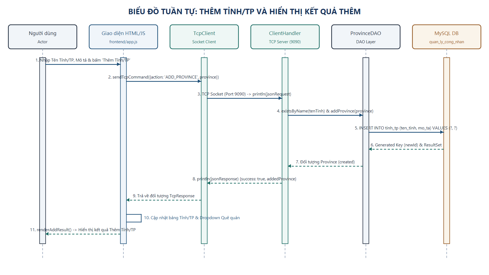
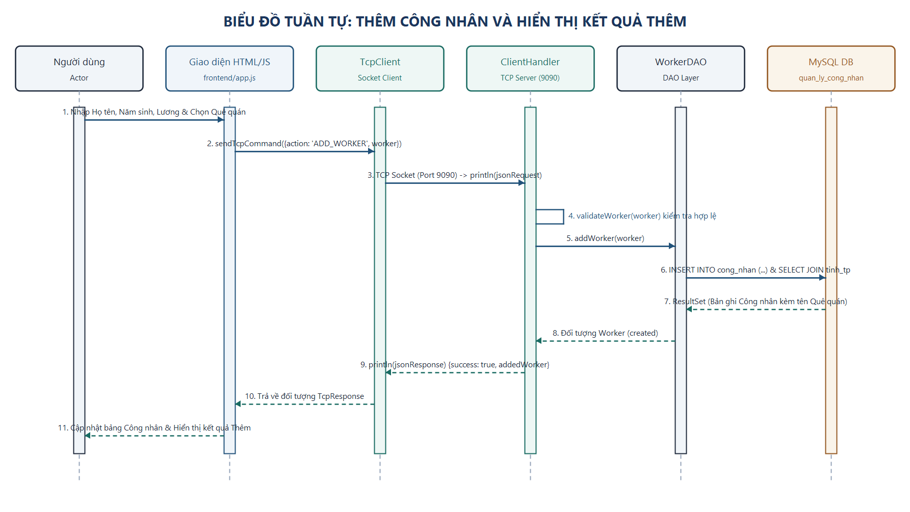
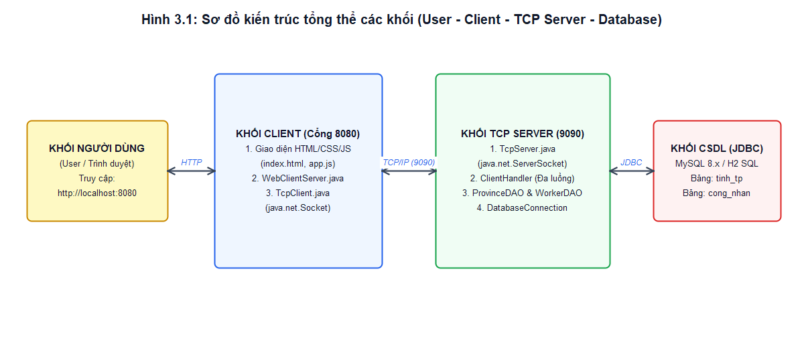

# TRANG BÌA

**BỘ GIÁO DỤC VÀ ĐÀO TẠO**  
**TRƯỜNG ĐẠI HỌC ..................................................**  
**KHOA CÔNG NGHỆ THÔNG TIN**  
**-----    -----**

<br>

## BÁO CÁO BÀI TẬP LỚN (CÁ NHÂN)
### HỌC PHẦN: LẬP TRÌNH MẠNG

<br>

### ĐỀ TÀI:
# XÂY DỰNG HỆ THỐNG QUẢN LÝ CÔNG NHÂN VÀ TỈNH/THÀNH PHỐ THEO MÔ HÌNH CLIENT – SERVER SỬ DỤNG GIAO THỨC TCP/IP

**Chức năng cá nhân thực hiện:**
1. **Thêm Tỉnh / Thành phố**
2. **Thêm Công nhân (chọn quê quán từ danh sách)**
3. **Hiển thị kết quả Thêm**

<br>

- **Giảng viên hướng dẫn:** Thầy Hoàng Anh
- **Họ và tên sinh viên:** ............................................................
- **Mã số sinh viên (MSSV):** ....................................................
- **Lớp:** ....................................................................................

<br>

**Hà Nội, Năm 2026**

---

# MỤC LỤC

- **DANH MỤC TỪ VIẾT TẮT**
- **DANH MỤC HÌNH VẼ & BẢNG BIỂU**
- **LỜI MỞ ĐẦU**
- **CHƯƠNG 1: GIỚI THIỆU ỨNG DỤNG VÀ PHÂN TÍCH YÊU CẦU CHỨC NĂNG**
  - 1.1. Giới thiệu tổng quan về đề tài
  - 1.2. Cơ sở lý thuyết về lập trình mạng với giao thức TCP/IP
  - 1.3. Phân tích yêu cầu chức năng tổng thể của hệ thống
  - 1.4. Phân tích chi tiết yêu cầu chức năng Cá nhân thực hiện
- **CHƯƠNG 2: PHÂN TÍCH VÀ THIẾT KẾ HỆ THỐNG**
  - 2.1. Phân tích thiết kế tổng quan ứng dụng (Use Case tổng quát)
  - 2.2. Thiết kế Use Case chi tiết phần Cá nhân đảm nhận
  - 2.3. Thiết kế Biểu đồ lớp (Class Diagram)
  - 2.4. Thiết kế Biểu đồ tuần tự (Sequence Diagram)
  - 2.5. Thiết kế Cơ sở dữ liệu và Sơ đồ Thực thể Quan hệ (ERD)
- **CHƯƠNG 3: KIẾN TRÚC, CÀI ĐẶT, TRIỂN KHAI VÀ KẾT QUẢ THỰC HIỆN**
  - 3.1. Kiến trúc ứng dụng
  - 3.2. Thiết kế giao thức bản tin truyền thông trên nền TCP/IP
  - 3.3. Cài đặt và triển khai ứng dụng
  - 3.4. Các kết quả thực hiện được và Kiểm thử thực nghiệm
- **KẾT LUẬN VÀ TÀI LIỆU THAM KHẢO**

---

# DANH MỤC TỪ VIẾT TẮT

| Từ viết tắt | Tiếng Anh | Giải nghĩa tiếng Việt |
| :--- | :--- | :--- |
| **BTL** | Major Assignment / Project | Bài tập lớn |
| **CN** | Worker | Công nhân |
| **CSDL** | Database (DB) | Cơ sở dữ liệu |
| **DAO** | Data Access Object | Đối tượng truy cập dữ liệu |
| **ERD** | Entity Relationship Diagram | Sơ đồ thực thể mối quan hệ |
| **HTML/CSS/JS** | HyperText Markup Language / CSS / JS | Bộ ngôn ngữ xây dựng giao diện phía Client |
| **JDBC** | Java Database Connectivity | Công nghệ kết nối CSDL chuẩn của Java |
| **JSON** | JavaScript Object Notation | Định dạng trao đổi dữ liệu văn bản nhẹ |
| **TCP/IP** | Transmission Control Protocol / IP | Bộ giao thức điều khiển truyền vận hướng kết nối |
| **TP** | City / Province | Thành phố / Tỉnh |

---

# DANH MỤC HÌNH VẼ & BẢNG BIỂU

**Danh sách hình vẽ:**
- **Hình 1.1:** Mô hình giao tiếp Socket TCP/IP giữa Client và Server trong Java.
- **Hình 2.1:** Biểu đồ Use Case tổng quát của hệ thống Quản lý Công nhân.
- **Hình 2.2:** Biểu đồ Use Case chi tiết phần BTL Cá nhân thực hiện.
- **Hình 2.3:** Biểu đồ lớp (Class Diagram) của hệ thống Quản lý Công nhân.
- **Hình 2.4:** Biểu đồ tuần tự chức năng Thêm Tỉnh/TP và Hiển thị kết quả Thêm.
- **Hình 2.5:** Biểu đồ tuần tự chức năng Thêm Công nhân và Hiển thị kết quả Thêm.
- **Hình 2.6:** Sơ đồ thực thể quan hệ (ERD) của Cơ sở dữ liệu Quản lý Công nhân.
- **Hình 3.1:** Sơ đồ kiến trúc tổng thể các khối (User – Client – TCP Server – Database).

**Danh sách bảng biểu:**
- **Bảng 1.1:** Phân công nhiệm vụ và phạm vi nghiệp vụ của đề tài.
- **Bảng 2.1:** Đặc tả chi tiết Use Case UC01 – Thêm Tỉnh/Thành phố.
- **Bảng 2.2:** Đặc tả chi tiết Use Case UC02 – Thêm Công nhân (chọn quê quán từ danh sách).
- **Bảng 2.3:** Đặc tả chi tiết Use Case UC03 – Hiển thị kết quả Thêm.
- **Bảng 2.4:** Mô tả chức năng các lớp trong kiến trúc phần mềm.
- **Bảng 2.5 & 2.6:** Đặc tả cấu trúc bảng `tinh_tp` và bảng `cong_nhan`.
- **Bảng 3.1:** Quy ước các mã lệnh (`action`) trong giao thức TCP/IP.
- **Bảng 3.2:** Kết quả kiểm thử thực nghiệm (Test Cases).

---

# LỜI MỞ ĐẦU

Trong bối cảnh chuyển đổi số tại các doanh nghiệp sản xuất và khu công nghiệp hiện nay, nhu cầu quản lý hồ sơ công nhân đến từ nhiều tỉnh, thành phố khác nhau đòi hỏi hệ thống phần mềm phải có khả năng trao đổi dữ liệu tập trung, chính xác và đồng bộ theo thời gian thực giữa các máy trạm (Client) và máy chủ (Server).

Học phần **Lập trình mạng** cung cấp nền tảng kiến thức cốt lõi về giao tiếp giữa các tiến trình qua mạng máy tính. Trong đó, giao thức **TCP/IP (Transmission Control Protocol / Internet Protocol)** đóng vai trò quan trọng nhờ đặc tính hướng kết nối (*connection-oriented*), đảm bảo độ tin cậy và thứ tự gói tin.

Đề tài **"Xây dựng hệ thống Quản lý Công nhân và Tỉnh/Thành phố theo mô hình Client – Server sử dụng giao thức TCP/IP"** áp dụng trực tiếp kỹ thuật lập trình **Java Socket (`ServerSocket` và `Socket`)**, xử lý đa luồng (*Multi-threading*), kết nối CSDL qua **JDBC (MySQL / H2)** kết hợp công cụ **Gradle** và giao diện **HTML/CSS/JavaScript**. Trong đó, phần nhiệm vụ cá nhân tập trung phân tích, thiết kế và cài đặt 3 chức năng trọng tâm: **Thêm Tỉnh/TP**, **Thêm Công nhân (chọn quê quán từ danh sách)** và **Hiển thị kết quả Thêm**.

---

# CHƯƠNG 1: GIỚI THIỆU ỨNG DỤNG VÀ PHÂN TÍCH YÊU CẦU CHỨC NĂNG

## 1.1. Giới thiệu tổng quan về đề tài

Hệ thống **Quản lý Công nhân** hoạt động theo mô hình **Client – Server** qua giao thức **TCP/IP**, quản lý 2 đối tượng thực thể chính có quan hệ `1 - N`:
1. **Tỉnh / Thành phố (`Province` - bảng `tinh_tp`):** Gồm *Mã Tỉnh/TP (`id`), Tên Tỉnh/TP (`tenTinh`), Mô tả (`moTa`)*.
2. **Công nhân (`Worker` - bảng `cong_nhan`):** Gồm *Mã công nhân (`id`), Họ tên (`hoTen`), Năm sinh (`namSinh`), Quê quán (`queQuanId` tham chiếu `tinh_tp`), và Mức lương (`mucLuong`)*.

**Bảng 1.1: Phân công nhiệm vụ và phạm vi nghiệp vụ của đề tài**

| Chủ đề | Giao thức | Đối tượng chính | Nghiệp vụ Server chính | Nghiệp vụ Client chính | BTL Cá nhân thực hiện |
| :--- | :---: | :--- | :--- | :--- | :--- |
| **Quản lý Công nhân** | **TCP/IP** | **Công nhân** (Họ tên, Năm sinh, Quê quán, Mức lương) + **Tỉnh/TP** (Tên, Mô tả) | - Thêm công nhân<br>- Trả về DS công nhân<br>- Cập nhật công nhân<br>- Xóa CN theo từ khóa<br>- Quản lý Tỉnh/TP | - Thêm CN (chọn quê quán từ danh sách)<br>- Tìm kiếm theo quê quán / khoảng năm sinh / khoảng lương<br>- Xóa một công nhân | 1. **Thêm Tỉnh/TP**<br>2. **Thêm Công nhân**<br>3. **Hiển thị kết quả Thêm** |

## 1.2. Cơ sở lý thuyết về lập trình mạng với giao thức TCP/IP

- **Đặc trưng TCP/IP:** Thiết lập kết nối qua bắt tay 3 bước (*Three-way handshake*), truyền dữ liệu theo luồng byte tin cậy (*Reliable Byte Stream*) và kiểm soát lỗi tự động.
- **Cơ chế hoạt động trong Java (`java.net`):**
  - **Phía Server:** Lớp `ServerSocket` mở cổng `9090`, gọi `accept()` chờ kết nối. Mỗi kết nối của Client được đẩy vào một luồng `ClientHandler` trong `ExecutorService` để xử lý đồng thời nhiều Client.
  - **Phía Client:** Lớp `Socket` kết nối tới `127.0.0.1:9090`, truyền chuỗi JSON mã hóa `UTF-8` qua `PrintWriter` và nhận phản hồi qua `BufferedReader`.


*Hình 1.1: Mô hình giao tiếp Socket TCP/IP giữa Client và Server trong Java.*

## 1.3. Phân tích yêu cầu chức năng tổng thể của hệ thống

- **Nghiệp vụ phía Server:** Lắng nghe kết nối TCP cổng `9090`; xử lý các lệnh thêm Tỉnh/TP (`ADD_PROVINCE`), lấy danh sách Tỉnh/TP (`GET_PROVINCES`), thêm công nhân (`ADD_WORKER`), trả về danh sách công nhân (`GET_ALL_DATA`), cập nhật thông tin công nhân (`UPDATE_WORKER`), xóa công nhân theo từ khóa (`DELETE_WORKERS_BY_KEYWORD`), xóa 1 công nhân (`DELETE_WORKER_BY_ID`) và tìm kiếm công nhân (`SEARCH_WORKERS`).
- **Nghiệp vụ phía Client:** Cung cấp giao diện nhập liệu, chọn quê quán từ danh sách Tỉnh/TP, hiển thị kết quả thêm mới, tìm kiếm lọc theo *Quê quán / Khoảng năm sinh / Khoảng lương*, cập nhật và xóa công nhân.

## 1.4. Phân tích chi tiết yêu cầu chức năng Cá nhân thực hiện

1. **Chức năng 1 – Thêm Tỉnh/TP (`ADD_PROVINCE`):**
   - *Đầu vào:* `tenTinh` (bắt buộc, duy nhất) và `moTa`.
   - *Xử lý:* Client đóng gói `TcpRequest` gửi qua Socket tới cổng `9090`. Server kiểm tra rỗng và kiểm tra trùng tên (`existsByName`). Nếu hợp lệ, thực thi `INSERT INTO tinh_tp`, lấy `id` tự tăng và trả đối tượng `Province` mới về trong trường `addedProvince` của `TcpResponse`.
   - *Đầu ra:* Lưu vào CSDL, cập nhật bảng Tỉnh/TP và tự động nạp vào ô chọn `<select>` Quê quán.
2. **Chức năng 2 – Thêm Công nhân (`ADD_WORKER`):**
   - *Đầu vào:* `hoTen`, `namSinh` (`1940–2015`), `queQuanId` (chọn từ danh sách Tỉnh/TP), `mucLuong` (`> 0`).
   - *Xử lý:* Client gửi lệnh `ADD_WORKER` qua Socket TCP. Server kiểm tra hợp lệ (`validateWorker`), gọi `WorkerDAO.addWorker()` lưu vào bảng `cong_nhan`, truy vấn lại bản ghi kèm `INNER JOIN tinh_tp` để lấy tên quê quán và trả về trong `addedWorker`.
   - *Đầu ra:* Lưu vào CSDL, cập nhật dòng mới lên đầu bảng Danh sách Công nhân.
3. **Chức năng 3 – Hiển thị kết quả Thêm (`renderAddResult`):**
   - *Xử lý & Đầu ra:* Nhận phản hồi `TcpResponse` từ TCP Server và hiển thị trực tiếp vào khung **Hiển thị kết quả Thêm**: nếu `success == true` hiện khung xanh lá kèm thông tin chi tiết bản ghi vừa tạo; nếu `success == false` hiện khung cảnh báo đỏ kèm nguyên nhân lỗi từ Server.

---

# CHƯƠNG 2: PHÂN TÍCH VÀ THIẾT KẾ HỆ THỐNG

## 2.1. Phân tích thiết kế tổng quan ứng dụng (Use Case tổng quát)


*Hình 2.1: Biểu đồ Use Case tổng quát của hệ thống Quản lý Công nhân.*

## 2.2. Thiết kế Use Case chi tiết phần Cá nhân đảm nhận


*Hình 2.2: Biểu đồ Use Case chi tiết phần BTL Cá nhân thực hiện.*

**Bảng 2.1: Đặc tả chi tiết Use Case UC01 – Thêm Tỉnh/Thành phố**

| Mục | Nội dung mô tả |
| :--- | :--- |
| **Tên Use Case / Actor** | **UC01 – Thêm Tỉnh / Thành phố** &nbsp;|&nbsp; **Tác nhân:** Người dùng (Quản lý) |
| **Điều kiện tiên quyết** | `TcpServer` đang chạy ở cổng `9090`, CSDL sẵn sàng, giao diện Client mở tại cổng `8080`. |
| **Luồng sự kiện chính** | 1. Người dùng nhập *Tên Tỉnh/TP*, *Mô tả* và bấm **"Thêm Tỉnh/TP"**.<br>2. Hàm `handleAddProvince()` gửi gói `{action: "ADD_PROVINCE", province: {tenTinh, moTa}}` xuống `TcpClient`.<br>3. `TcpClient` mở `Socket(127.0.0.1, 9090)` truyền chuỗi JSON sang `TcpServer`.<br>4. `ClientHandler` kiểm tra tên Tỉnh/TP chưa tồn tại, gọi `ProvinceDAO.addProvince()` thực thi `INSERT INTO tinh_tp`.<br>5. Server trả về `TcpResponse` (`success=true`, `addedProvince`, `provinces`).<br>6. Client cập nhật bảng Tỉnh/TP, ô chọn Quê quán và gọi **UC03** hiển thị kết quả thêm. |
| **Luồng ngoại lệ** | Tên Tỉnh/TP trống hoặc đã tồn tại trong CSDL -> Server trả về `success=false` kèm thông báo lỗi; UC03 hiển thị lỗi màu đỏ. |

**Bảng 2.2: Đặc tả chi tiết Use Case UC02 – Thêm Công nhân (chọn quê quán từ danh sách)**

| Mục | Nội dung mô tả |
| :--- | :--- |
| **Tên Use Case / Actor** | **UC02 – Thêm Công nhân** &nbsp;|&nbsp; **Tác nhân:** Người dùng (Quản lý) |
| **Điều kiện tiên quyết** | Danh sách Tỉnh/TP đã được nạp vào ô `<select id="queQuanId">`. |
| **Luồng sự kiện chính** | 1. Người dùng nhập *Họ tên, Năm sinh, Mức lương*, chọn *Quê quán* từ danh sách và bấm **"Thêm Công nhân"**.<br>2. Hàm `handleAddWorker()` đóng gói `{action: "ADD_WORKER", worker: {hoTen, namSinh, queQuanId, mucLuong}}`.<br>3. `TcpClient` gửi gói tin qua Socket TCP tới cổng `9090`.<br>4. `ClientHandler` kiểm tra `validateWorker()`, gọi `WorkerDAO.addWorker()` chèn vào bảng `cong_nhan` và lấy lại bản ghi kèm tên Tỉnh/TP.<br>5. Server trả về `TcpResponse` (`success=true`, `addedWorker`, `workers`).<br>6. Client cập nhật bảng Công nhân và gọi **UC03** hiển thị kết quả thêm. |
| **Luồng ngoại lệ** | Họ tên rỗng, năm sinh ngoài `1940–2015`, chưa chọn quê quán hoặc lương `<= 0` -> Server trả về `success=false` kèm thông báo lỗi. |

**Bảng 2.3: Đặc tả chi tiết Use Case UC03 – Hiển thị kết quả Thêm**

| Mục | Nội dung mô tả |
| :--- | :--- |
| **Tên Use Case / Actor** | **UC03 – Hiển thị kết quả Thêm** &nbsp;|&nbsp; **Tác nhân:** Hệ thống Client & Người dùng |
| **Điều kiện tiên quyết** | Client vừa nhận được đối tượng phản hồi `TcpResponse` từ lệnh `ADD_PROVINCE` hoặc `ADD_WORKER`. |
| **Luồng sự kiện chính** | 1. Hàm `renderAddResult(type, success, message, entity)` trích xuất dữ liệu từ `TcpResponse`.<br>2. Nếu `type == 'PROVINCE'`, hiển thị trạng thái, thông báo Server, *Tên Tỉnh/TP* và *Mô tả*.<br>3. Nếu `type == 'WORKER'`, hiển thị trạng thái, thông báo Server, *Họ tên, Năm sinh, Quê quán, Mức lương (VNĐ)*.<br>4. Tô sáng (`highlight-new`) dòng vừa thêm trên bảng danh sách. |

---

## 2.3. Thiết kế Biểu đồ lớp (Class Diagram)


*Hình 2.3: Biểu đồ lớp (Class Diagram) của hệ thống Quản lý Công nhân.*

**Bảng 2.4: Mô tả chức năng các lớp trong kiến trúc phần mềm**

| STT | Tên lớp | Thuộc gói | Trách nhiệm chính |
| :---: | :--- | :--- | :--- |
| 1 | `Province` | `model` | Thực thể **Tỉnh/TP** (`id`, `tenTinh`, `moTa`). |
| 2 | `Worker` | `model` | Thực thể **Công nhân** (`id`, `hoTen`, `namSinh`, `queQuanId`, `tenQueQuan`, `mucLuong`). |
| 3 | `TcpRequest` / `TcpResponse` | `model` | Đóng gói bản tin yêu cầu và bản tin phản hồi truyền qua Socket TCP/IP. |
| 4 | `DatabaseConnection` | `dao` | Quản lý kết nối JDBC (MySQL / SQL Server / H2) và khởi tạo bảng tự động. |
| 5 | `ProvinceDAO` | `dao` | Truy vấn bảng `tinh_tp`: lấy danh sách, kiểm tra trùng tên và thêm Tỉnh/TP (`addProvince`). |
| 6 | `WorkerDAO` | `dao` | Truy vấn bảng `cong_nhan`: thêm mới (`addWorker`), lấy danh sách, sửa, xóa, tìm kiếm. |
| 7 | `TcpServer` & `ClientHandler` | `server` | Mở `ServerSocket(9090)`, phân luồng xử lý từng kết nối Client và điều phối DAO. |
| 8 | `TcpClient` & `WebClientServer` | `client` | Mở `Socket` kết nối cổng `9090` và phục vụ giao diện HTML/CSS/JS tại cổng `8080`. |

---

## 2.4. Thiết kế Biểu đồ tuần tự (Sequence Diagram)

### 2.4.1. Biểu đồ tuần tự chức năng Thêm Tỉnh/TP và Hiển thị kết quả Thêm


*Hình 2.4: Biểu đồ tuần tự chức năng Thêm Tỉnh/TP và Hiển thị kết quả Thêm.*

### 2.4.2. Biểu đồ tuần tự chức năng Thêm Công nhân và Hiển thị kết quả Thêm


*Hình 2.5: Biểu đồ tuần tự chức năng Thêm Công nhân và Hiển thị kết quả Thêm.*

---

## 2.5. Thiết kế Cơ sở dữ liệu và Sơ đồ Thực thể Quan hệ (ERD)


*Hình 2.6: Sơ đồ thực thể quan hệ (ERD) của Cơ sở dữ liệu Quản lý Công nhân.*

**Bảng 2.5: Cấu trúc bảng `tinh_tp` (Tỉnh/TP)**

| Tên trường | Kiểu dữ liệu | Ràng buộc | Mô tả |
| :--- | :--- | :--- | :--- |
| `id` | `INT` | `PRIMARY KEY, AUTO_INCREMENT` | Mã định danh Tỉnh/TP tự tăng. |
| `ten_tinh` | `VARCHAR(120)` | `NOT NULL, UNIQUE` | Tên Tỉnh/Thành phố (duy nhất). |
| `mo_ta` | `VARCHAR(500)` | `DEFAULT ''` | Mô tả đặc điểm Tỉnh/TP. |

**Bảng 2.6: Cấu trúc bảng `cong_nhan` (Công nhân)**

| Tên trường | Kiểu dữ liệu | Ràng buộc | Mô tả |
| :--- | :--- | :--- | :--- |
| `id` | `INT` | `PRIMARY KEY, AUTO_INCREMENT` | Mã định danh Công nhân tự tăng. |
| `ho_ten` | `VARCHAR(150)` | `NOT NULL` | Họ và tên công nhân. |
| `nam_sinh` | `INT` | `NOT NULL` | Năm sinh công nhân. |
| `que_quan_id` | `INT` | `NOT NULL, FK -> tinh_tp(id)` | Mã Tỉnh/TP quê quán. |
| `muc_luong` | `DOUBLE` | `NOT NULL` | Mức lương (VNĐ). |

---

# CHƯƠNG 3: KIẾN TRÚC, CÀI ĐẶT, TRIỂN KHAI VÀ KẾT QUẢ THỰC HIỆN

## 3.1. Kiến trúc ứng dụng

Ứng dụng được thiết kế gồm 4 khối chức năng tách biệt: **Khối Người dùng (Browser)** <-> **Khối Client (`WebClientServer` & `TcpClient` cổng 8080)** <-> **Khối Backend TCP/IP Server (`TcpServer` & `ClientHandler` cổng 9090)** <-> **Khối CSDL JDBC (`MySQL / H2`)**.


*Hình 3.1: Sơ đồ kiến trúc tổng thể các khối (User – Client – TCP Server – Database).*

## 3.2. Thiết kế giao thức bản tin truyền thông trên nền TCP/IP

Dữ liệu trao đổi qua Socket giữa `TcpClient` và `TcpServer` được định dạng thành chuỗi **JSON 1 dòng kết thúc bởi `\n`** (gửi bằng `PrintWriter.println()`, đọc bằng `BufferedReader.readLine()` với bảng mã `UTF-8`).

**Bảng 3.1: Quy ước các mã lệnh (`action`) trong giao thức TCP/IP**

| Mã lệnh (`action`) | Dữ liệu gửi (`TcpRequest`) | Dữ liệu phản hồi (`TcpResponse`) |
| :--- | :--- | :--- |
| `GET_ALL_DATA` | Không có | Toàn bộ danh sách `provinces` và `workers`. |
| `ADD_PROVINCE` | `province: {tenTinh, moTa}` | `addedProvince` vừa tạo + danh sách `provinces` mới. |
| `ADD_WORKER` | `worker: {hoTen, namSinh, queQuanId, mucLuong}` | `addedWorker` vừa tạo + danh sách `workers` mới. |
| `SEARCH_WORKERS` | `queQuanId, min/maxNamSinh, min/maxMucLuong` | Danh sách `workers` thỏa mãn điều kiện lọc. |
| `UPDATE_WORKER` | `worker: {id, hoTen, namSinh, queQuanId, mucLuong}` | Bản ghi sau cập nhật + danh sách `workers` mới. |
| `DELETE_WORKER_BY_ID` | `workerId` | Trạng thái xóa + danh sách `workers` mới. |
| `DELETE_WORKERS_BY_KEYWORD` | `keyword` | Số lượng bản ghi đã xóa + danh sách `workers` mới. |

## 3.3. Cài đặt và triển khai ứng dụng

### 3.3.1. Môi trường cài đặt và triển khai
- **Môi trường:** Java OpenJDK 21 LTS, Gradle 9.x, thư viện `gson:2.11.0`, `mysql-connector-j:8.4.0`, `h2:2.2.224`.
- **Cách khởi chạy:** Chạy lệnh `gradle run` (hoặc chạy `chay_ung_dung.bat`), mở trình duyệt tại `http://localhost:8080`. Khi cần chạy độc lập 2 tiến trình: dùng `gradle runServer` (cổng `9090`) và `gradle runClient` (cổng `8080`).

### 3.3.2. Mã nguồn trọng tâm của chức năng cá nhân

**1. Gửi nhận gói tin qua Socket tại `TcpClient.java`:**
```java
public TcpResponse sendRequest(TcpRequest request) {
    try (Socket socket = new Socket()) {
        socket.connect(new InetSocketAddress(serverHost, serverPort), 3000);
        try (PrintWriter writer = new PrintWriter(new OutputStreamWriter(socket.getOutputStream(), StandardCharsets.UTF_8), true);
             BufferedReader reader = new BufferedReader(new InputStreamReader(socket.getInputStream(), StandardCharsets.UTF_8))) {
            writer.println(gson.toJson(request));
            String jsonResponse = reader.readLine();
            return gson.fromJson(jsonResponse, TcpResponse.class);
        }
    } catch (Exception e) {
        return new TcpResponse(false, request.getAction(), "Lỗi kết nối TCP: " + e.getMessage());
    }
}
```

**2. Xử lý `ADD_PROVINCE` và `ADD_WORKER` tại `ClientHandler.java` (TCP Server):**
```java
case "ADD_PROVINCE" -> {
    Province p = req.getProvince();
    if (provinceDAO.existsByName(p.getTenTinh())) {
        res.setSuccess(false);
        res.setMessage("Tỉnh/TP '" + p.getTenTinh().trim() + "' đã tồn tại!");
        return res;
    }
    Province created = provinceDAO.addProvince(p);
    res.setAddedProvince(created);
    res.setProvinces(provinceDAO.getAllProvinces());
    res.setWorkers(workerDAO.getAllWorkers());
    res.setSuccess(true);
    res.setMessage("Thêm Tỉnh/TP '" + created.getTenTinh() + "' thành công.");
}
case "ADD_WORKER" -> {
    Worker created = workerDAO.addWorker(req.getWorker());
    res.setAddedWorker(created);
    res.setWorkers(workerDAO.getAllWorkers());
    res.setProvinces(provinceDAO.getAllProvinces());
    res.setSuccess(true);
    res.setMessage("Thêm Công nhân '" + created.getHoTen() + "' thành công.");
}
```

## 3.4. Các kết quả thực hiện được và Kiểm thử thực nghiệm

Ứng dụng đã thực hiện trọn vẹn các chức năng: **Thêm Tỉnh/TP**, **Thêm Công nhân (chọn quê quán từ danh sách)**, **Hiển thị kết quả Thêm** trực tiếp từ phản hồi TCP Server, cùng các chức năng **Tìm kiếm theo quê quán / khoảng năm sinh / khoảng lương**, **Cập nhật** và **Xóa công nhân**.

**Bảng 3.2: Kết quả kiểm thử thực nghiệm (Test Cases)**

| Mã TC | Kịch bản kiểm thử | Dữ liệu đầu vào | Kết quả thực tế đạt được | Đánh giá |
| :---: | :--- | :--- | :--- | :---: |
| **TC01** | Thêm Tỉnh/TP mới hợp lệ | `tenTinh="Quảng Ninh"`, `moTa="Khu CN cảng biển"` | Lưu CSDL thành công; khung *Hiển thị kết quả Thêm* và ô chọn Quê quán cập nhật ngay. | **Đạt** |
| **TC02** | Thêm Tỉnh/TP trùng tên | `tenTinh="Hà Nội"` (đã tồn tại) | Server trả về `success=false`; khung kết quả báo lỗi *"Tỉnh/TP 'Hà Nội' đã tồn tại!"*. | **Đạt** |
| **TC03** | Thêm Công nhân mới | `hoTen="Vũ Minh Tuấn"`, `namSinh=1997`, `queQuan="Quảng Ninh"`, `mucLuong=15000000` | Lưu vào bảng `cong_nhan`; hiển thị chi tiết tại khung *Hiển thị kết quả Thêm* và đầu bảng CN. | **Đạt** |
| **TC04** | Tìm kiếm đa tiêu chí | `Quê quán="Hà Nội"`, `Năm sinh: 1990-2000`, `Lương: 10tr-15tr` | Hiển thị chính xác danh sách các công nhân thỏa mãn đồng thời cả 3 điều kiện. | **Đạt** |
| **TC05** | Cập nhật & Xóa công nhân | Sửa lương CN `#1` thành `14000000`; Xóa CN `#4` và Xóa theo từ khóa `"Bắc Ninh"` | Cập nhật và xóa chính xác trong CSDL thông qua kết nối TCP/IP. | **Đạt** |

---

# KẾT LUẬN VÀ TÀI LIỆU THAM KHẢO

## 1. Kết luận
Đề tài đã hoàn thành đầy đủ mục tiêu của học phần **Lập trình mạng**: xây dựng thành công ứng dụng Quản lý Công nhân & Tỉnh/TP theo mô hình Client – Server sử dụng giao thức **TCP/IP (`ServerSocket` / `Socket`)** đa luồng kết hợp CSDL **JDBC (MySQL / H2)** và giao diện Web trực quan. Ba chức năng cá nhân (**Thêm Tỉnh/TP, Thêm Công nhân, Hiển thị kết quả Thêm**) vận hành ổn định, chính xác và đáp ứng đầy đủ các kịch bản kiểm thử.

## 2. Tài liệu tham khảo
1. Bài giảng học phần *Lập trình mạng*, Giảng viên: Thầy Hoàng Anh.
2. Elliotte Rusty Harold, *Java Network Programming (4th Edition)*, O'Reilly Media, 2014.
3. Oracle Corporation, *The Java™ Tutorials – Custom Networking & JDBC Documentation*, https://docs.oracle.com/javase/tutorial/.
