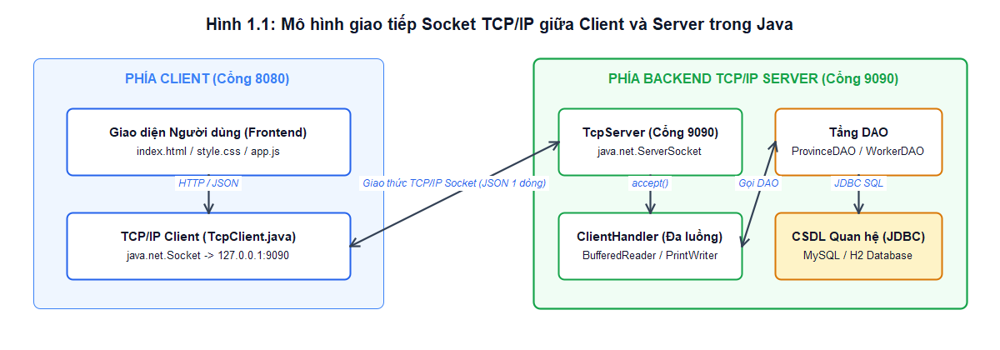
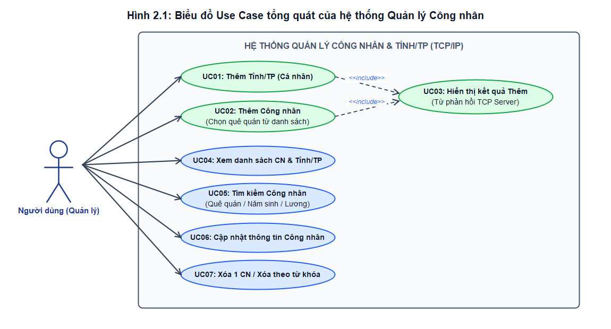
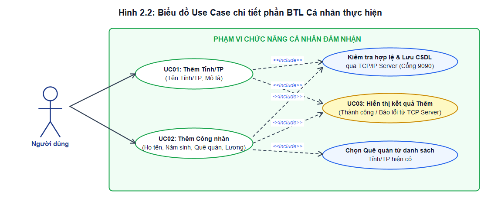
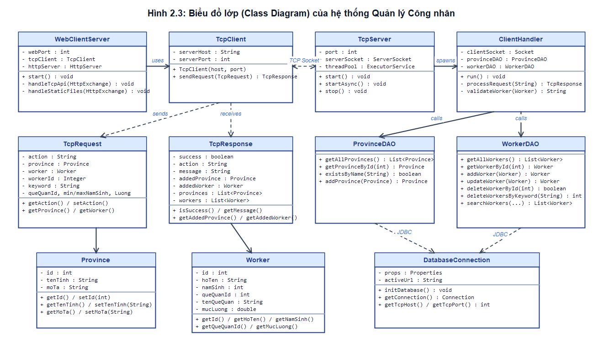
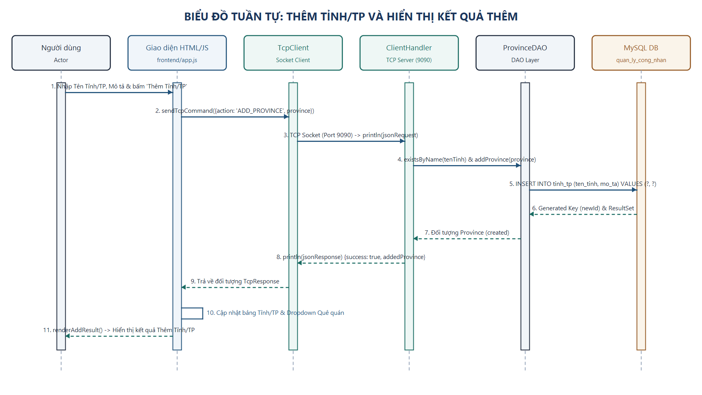
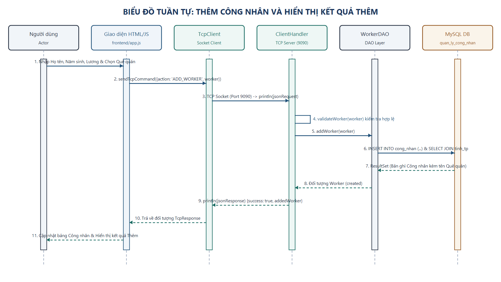
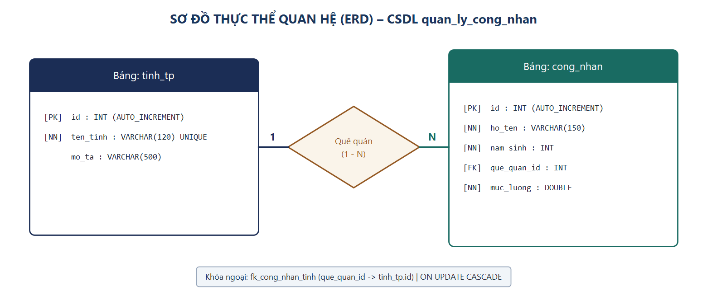

# TỔNG HỢP CÁC SƠ ĐỒ THIẾT KẾ HỆ THỐNG QUẢN LÝ CÔNG NHÂN (TCP/IP)

Tài liệu này tổng hợp đầy đủ 8 sơ đồ trong Báo cáo BTL cá nhân môn Lập trình mạng (lưu tại thư mục `doc/so_do/`).

---

## 1. Hình 1.1: Mô hình giao tiếp Socket TCP/IP giữa Client và Server trong Java

---

## 2. Hình 2.1: Biểu đồ Use Case tổng quát của hệ thống

---

## 3. Hình 2.2: Biểu đồ Use Case chi tiết phần BTL Cá nhân thực hiện

---

## 4. Hình 2.3: Biểu đồ lớp (Class Diagram) của toàn bộ hệ thống

---

## 5. Hình 2.4: Biểu đồ tuần tự chức năng Thêm Tỉnh/TP và Hiển thị kết quả Thêm

---

## 6. Hình 2.5: Biểu đồ tuần tự chức năng Thêm Công nhân và Hiển thị kết quả Thêm

---

## 7. Hình 2.6: Sơ đồ thực thể quan hệ (ERD) của Cơ sở dữ liệu

---

## 8. Hình 3.1: Sơ đồ kiến trúc tổng thể các khối của ứng dụng

