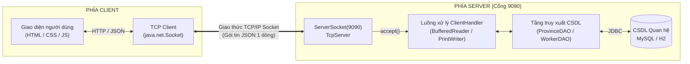
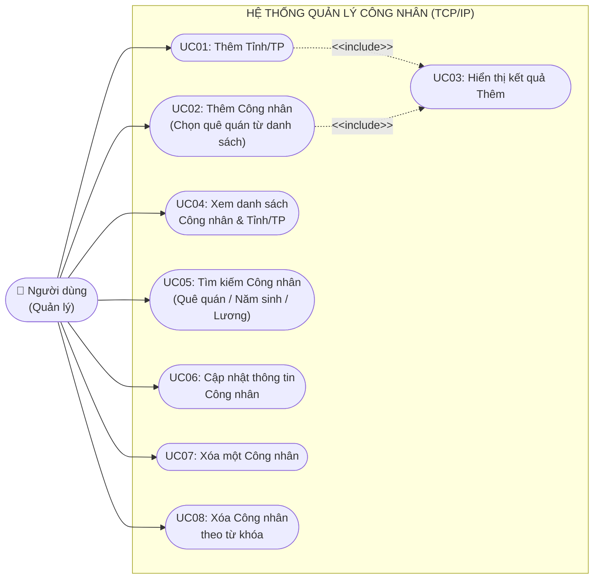
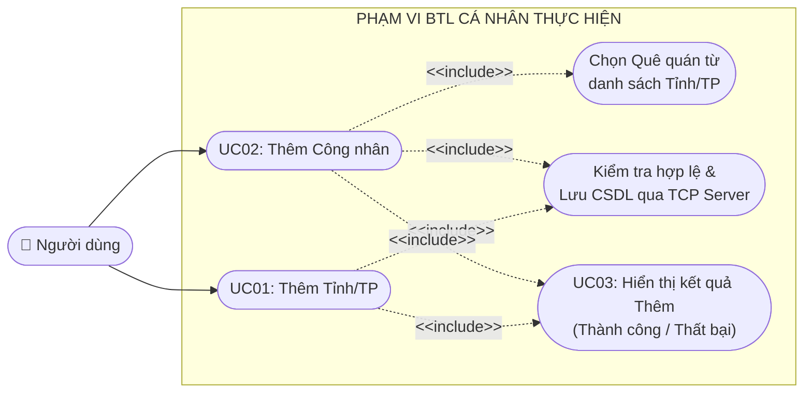
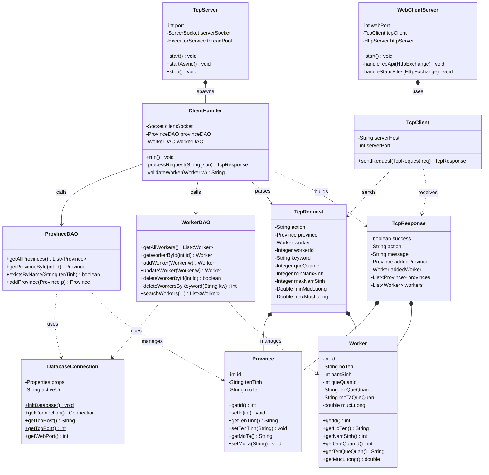
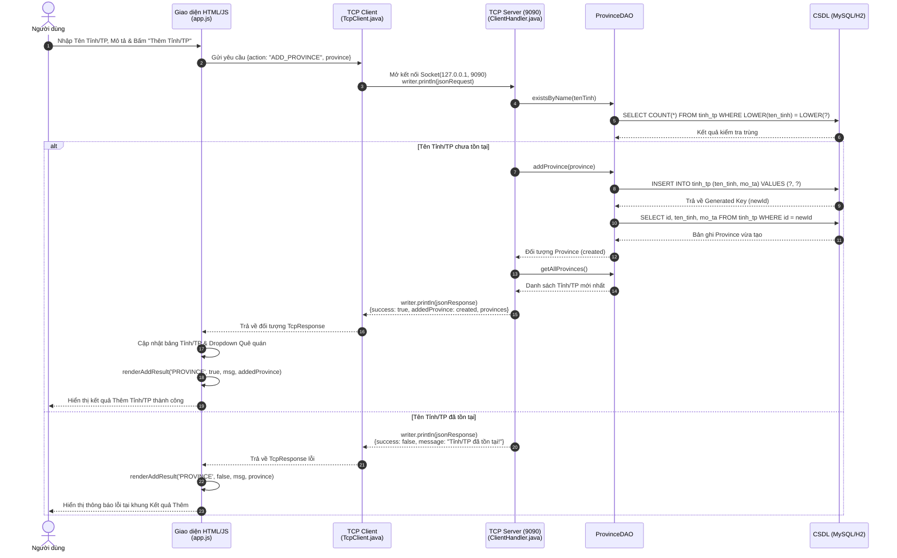
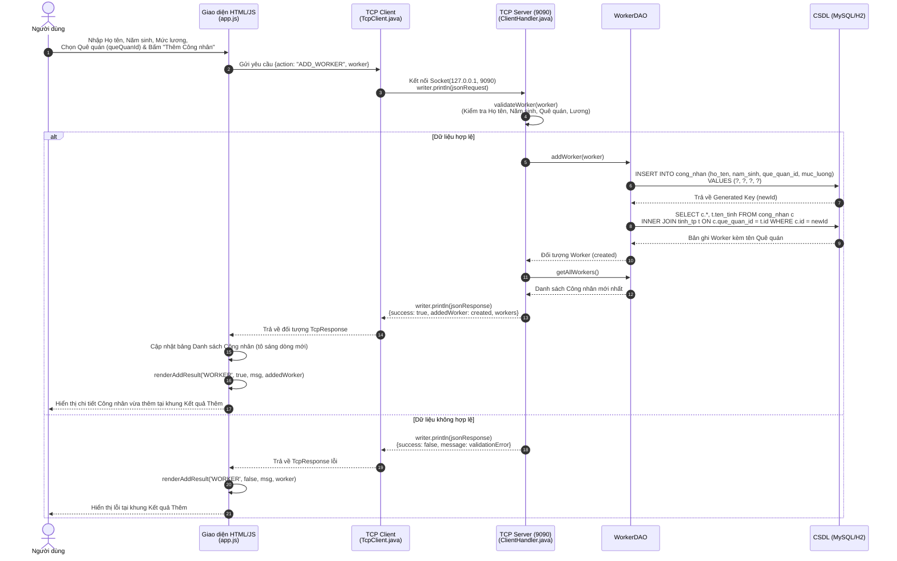
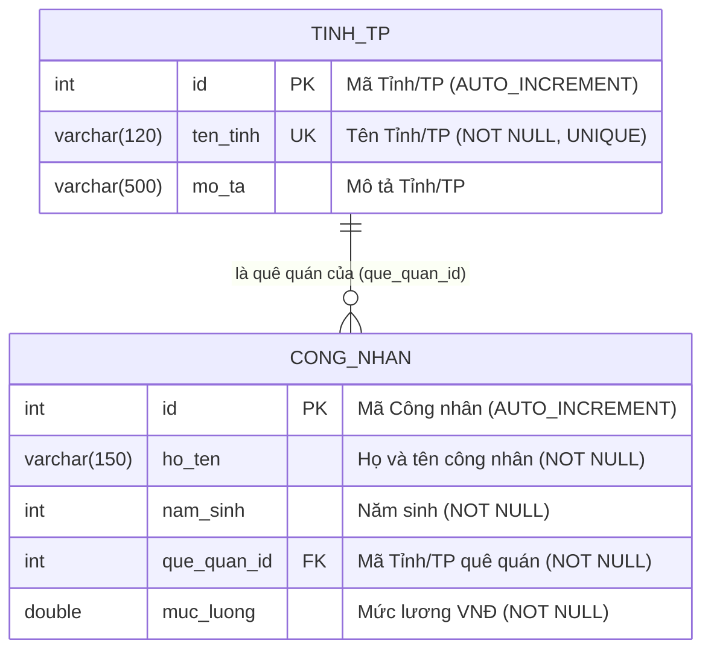
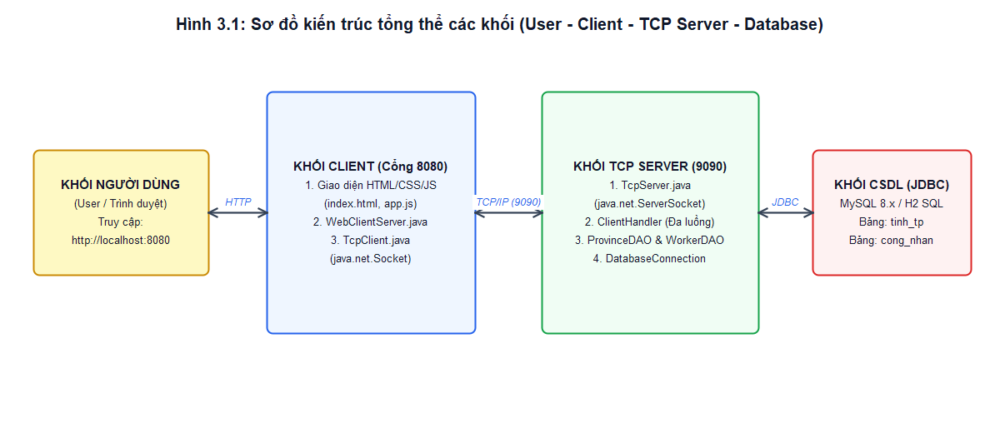
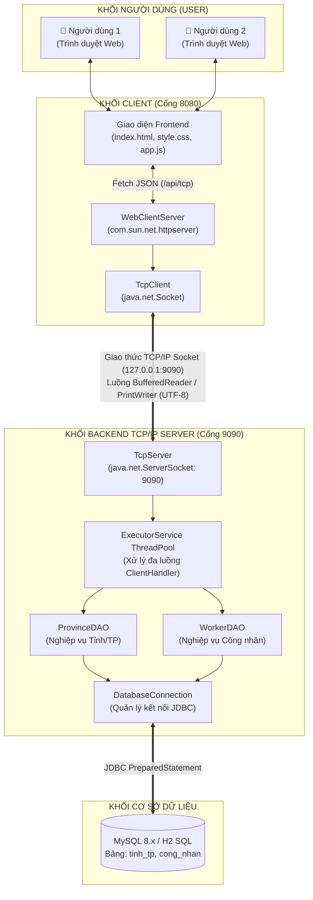

# TỔNG HỢP CÁC SƠ ĐỒ THIẾT KẾ HỆ THỐNG QUẢN LÝ CÔNG NHÂN (TCP/IP)

Tài liệu này tổng hợp đầy đủ 8 sơ đồ trong Báo cáo BTL cá nhân môn Lập trình mạng (bao gồm cả hình ảnh `.png` trong thư mục `doc/so_do/` và mã nguồn sơ đồ Mermaid).

---

## 1. Hình 1.1: Mô hình giao tiếp Socket TCP/IP giữa Client và Server trong Java
- **File ảnh PNG:** [so_do/Hinh_1_1_Mo_Hinh_Giao_Tiep_TCP_IP.png](so_do/Hinh_1_1_Mo_Hinh_Giao_Tiep_TCP_IP.png)

---

## 2. Hình 2.1: Biểu đồ Use Case tổng quát của hệ thống
- **File ảnh PNG:** [so_do/Hinh_2_1_UseCase_Tong_Quat.png](so_do/Hinh_2_1_UseCase_Tong_Quat.png)

---

## 3. Hình 2.2: Biểu đồ Use Case chi tiết phần cá nhân thực hiện
- **File ảnh PNG:** [so_do/Hinh_2_2_UseCase_Chi_Tiet_Ca_Nhan.png](so_do/Hinh_2_2_UseCase_Chi_Tiet_Ca_Nhan.png)

---

## 4. Hình 2.3: Biểu đồ lớp (Class Diagram) của toàn bộ hệ thống
- **File ảnh PNG:** [so_do/Hinh_2_3_Bieu_Do_Lop_Class_Diagram.png](so_do/Hinh_2_3_Bieu_Do_Lop_Class_Diagram.png)

---

## 5. Hình 2.4: Biểu đồ tuần tự chức năng Thêm Tỉnh/TP và Hiển thị kết quả Thêm
- **File ảnh PNG:** [so_do/Hinh_2_4_Sequence_Them_Tinh_TP.png](so_do/Hinh_2_4_Sequence_Them_Tinh_TP.png)

---

## 6. Hình 2.5: Biểu đồ tuần tự chức năng Thêm Công nhân và Hiển thị kết quả Thêm
- **File ảnh PNG:** [so_do/Hinh_2_5_Sequence_Them_Cong_Nhan.png](so_do/Hinh_2_5_Sequence_Them_Cong_Nhan.png)

---

## 7. Hình 2.6: Sơ đồ thực thể quan hệ (ERD) của Cơ sở dữ liệu
- **File ảnh PNG:** [so_do/Hinh_2_6_So_Do_ERD_CSDL.png](so_do/Hinh_2_6_So_Do_ERD_CSDL.png)

---

## 8. Hình 3.1: Sơ đồ kiến trúc tổng thể các khối của ứng dụng
- **File ảnh PNG:** [so_do/Hinh_3_1_Kien_Truc_Ung_Dung.png](so_do/Hinh_3_1_Kien_Truc_Ung_Dung.png)

